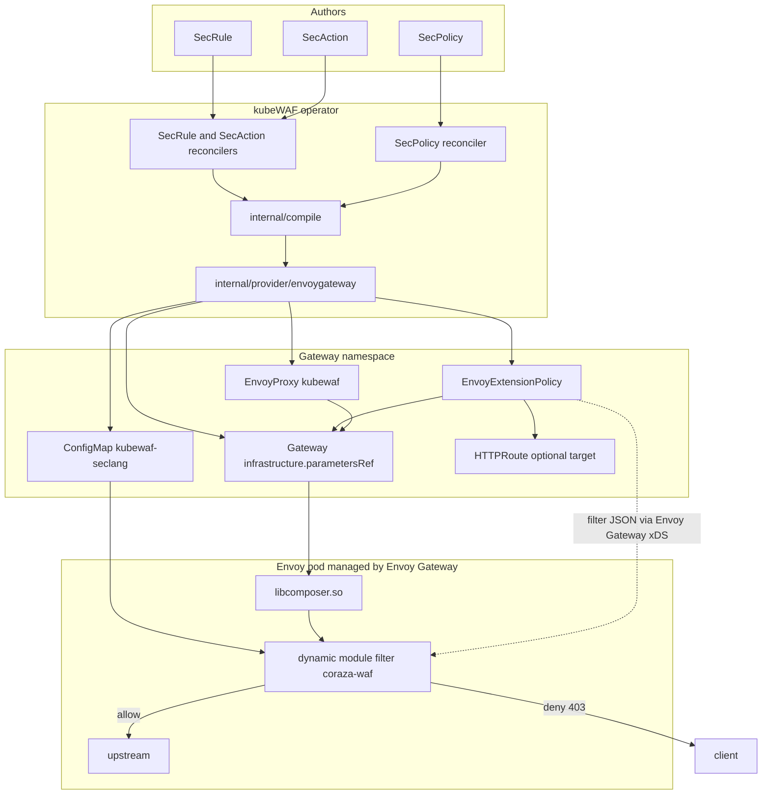

# kubeWAF rewrite plan

Status: planning only. This document is the design. It does not change operator code.

Source tree: `github.com/kubewaf-io/kubewaf` at `v0.1.0-beta.5` (`git describe` → `v0.1.0-beta.5-1-g6d4cabc` on `main`). Latest release named by the owner: `v0.1.0-beta.5`.

The rewrite is a breaking replacement of the API and the data-plane integration. SecRule and SecAction stay, and they map 1:1 onto SecLang. Everything that exists to push Wasm over xDS goes away. Envoy Gateway loads a Coraza dynamic module the same way the Envoy Gateway task does: an `EnvoyProxy` registers the `.so`, an `EnvoyExtensionPolicy` passes the filter config. Istio and Cilium are a Go interface with no implementation in this stage. A higher-level Protection API is phase 2 and compiles down to the same SecLang bundle.

## 1. Goals and non-goals

### Goals

1. One SecLang API, `seclang.kubewaf.io/v1alpha1`, with `SecRule` and `SecAction` that emit SecLang and nothing else. One rule per object. Chains, targets, operators, transformations, and the five SecLang action classes are fields, not free-form blobs and not a second legacy bag.
2. One attachment object, `SecPolicy`, that selects those rules and binds them to an Envoy Gateway `Gateway` or `HTTPRoute`.
3. The operator writes three Kubernetes objects and then stops: a ConfigMap of SecLang files, an `EnvoyProxy` that loads the dynamic module, and an `EnvoyExtensionPolicy` whose `dynamicModule.config` is the Coraza filter JSON. Envoy Gateway's own xDS server programs Envoy.
4. The request path contains Envoy and the in-process Coraza module. The operator is not in that path.
5. A provider interface so a later Istio or Cilium backend consumes the same compiled bundle and leaves `api/` and `internal/compile` untouched.
6. A phase-2 `Protection` CRD with CRS presets and exclusions that compiles to SecLang plus the same provider call.
7. Tests that lock the language mapping (SecLang round trip) and a Kind test that proves a clean `GET` returns 200 and `User-Agent: sqlmap/1.0` returns 403.

### Non-goals (this stage)

- Serving `seclang.kubewaf.io/v1beta1` or `waf.kubewaf.io/v1beta1`. No conversion webhook and no dual-stack controller.
- Envoy control-plane integration of any kind: ECDS, the Envoy Gateway Extension Server, a Wasm HTTP server, xDS mutation, `EnvoyFilter`, `CiliumEnvoyConfig`, bootstrap cluster injection.
- Implementing Istio or Cilium. The seam is the interface and an empty registration list.
- Proxy-Wasm engines (`modsecurity-proxy-wasm`, `pow-proxy-wasm`) and the Proof-of-Work challenge filter.
- Shipping a metrics stack. VictoriaMetrics, VictoriaTraces, the OTel collector, the subresource API, and the probe API leave the repo. The Coraza module already exports `waf_tx_total`, `waf_tx_blocked`, and `waf_tx_duration` through Envoy stats.
- A Headlamp plugin, a cluster ID allocator, PhraseList and IPList CRDs, and the RuleSet CRD.
- Persistent collections (`IP`, `SESSION`, `GLOBAL`, `USER`, `RESOURCE`) as a supported feature. The actions stay in the language API so SecLang still round-trips. The dynamic module has no durable `SecDataDir`. Rate limits in phase 2 use Envoy Gateway `BackendTrafficPolicy`, which already has a working store.
- `SecRuleScript` / Lua.
- Editing rules that already live inside the bundled CRS files. Exclusions are `SecRuleRemoveById`, `SecRuleRemoveByTag`, and `SecRuleUpdateTargetById` emitted after the CRS include.

### Decisions recorded here

These are the defaults an implementer should follow. Section 13 lists the ones that still need a spike or an owner override.

| Topic | Decision |
| --- | --- |
| API version | `seclang.kubewaf.io/v1alpha1` only. Promote to `v1` by a storage-version copy after the Kind test has passed on two Envoy Gateway minors and the spikes in section 13 are closed. |
| Rule shape | One logical rule per `SecRule`. Delete `spec.secLangRules[]` and the `Condition` vs `Match` split. |
| Targets | One `Target` type. Delete the separate Variable and Collection structs. |
| Chain action | The emitter writes `chain`. The user does not set it. CEL rejects a hand-written `chain`. |
| IDs | `metadata.id` is required. Delete `SecRuleIDPool`. |
| Phrase and IP lists | Delete the CRDs. Bodies live on `SecPolicy.spec.dataFiles` and are mounted next to the conf. |
| CRS default | Bundled virtual includes inside the Coraza module. Generated CRDs are an opt-in converter output, not a default Helm install. |
| Attachment namespace | `SecPolicy`, its Gateway or HTTPRoute, and the rendered Envoy objects are the same namespace. Rule selectors are the same namespace. |
| Foreign EnvoyProxy | The operator creates `EnvoyProxy/kubewaf-<gateway>`. It sets `Gateway.spec.infrastructure.parametersRef` only when that field is empty or already points at ours. It does not merge into a user's EnvoyProxy. |
| Module delivery | Init container copy is the default (works on the whole Envoy Gateway v1.10 Kubernetes range, which starts at 1.34). Image volumes are a chart switch for Kubernetes 1.35 and later, matching the Envoy Gateway task note. |
| Engine | Upstream Coraza filter inside Tetrate Built-on-Envoy `libcomposer.so`, filter name `coraza-waf`. This repo does not fork the engine. |

## 2. Complexity removed

The current operator is a control plane. A WAF object resolves RuleSets recursively, renders SecLang, pushes it over gRPC ECDS (`:18001`), serves Wasm over HTTP (`:18002`), and runs an Envoy Gateway Extension Server (`:5005`) that patches listeners and clusters. Istio gets an `EnvoyFilter`. Cilium gets a `CiliumEnvoyConfig` plus a hand-merged bootstrap cluster. A second controller on every replica re-publishes the same snapshot so followers can serve gRPC. PhraseList and IPList exist because the Wasm plugin has to receive `data_files` in its JSON. SecRuleIDPool exists because ids are optional. Two SecRule shapes exist (single-rule `match[]` and legacy `secLangRules[]`). goverter plus `github.com/coreruleset/crslang` sit between the CRD and a string. Managed telemetry then adds a collector, VictoriaMetrics, and VictoriaTraces.

The rewrite deletes that stack. The operator's runtime job is: render SecLang, write a ConfigMap, write an EnvoyProxy, write an EnvoyExtensionPolicy. Leader election still guards those writes. Followers do not serve traffic config. There is one rule shape, one target type, one emitter, and no xDS library in `go.mod`.

Concrete deletions that follow from that:

- Ports `:18001`, `:5005`, and `:18002`, and the Services, NetworkPolicies, and Cilium bootstrap fragments that exist for them.
- `github.com/envoyproxy/go-control-plane` and the Envoy Gateway extension protobuf.
- The `references2` resolver, RuleSet recursion, finalizers, and `status.ruleSetRefs` back-pointers. A policy watches rules; rules do not point back.
- Path A (`Include @owasp_crs` inside Wasm) versus Path B (CRS as thousands of CRDs plus injected phrase files). One CRS path: the module's embedded files. Custom rules are always SecLang the operator wrote.
- The per-replica "dataplane sync" pipeline. One reconciler writes status and the three objects.
- Engine catalog, Wasm registry client, challenge HMAC Secrets, probe assembler, subresource API server.

What stays conceptually, rewritten against the new types: the SecLang vocabulary already enumerated in `api/seclang/v1beta1`, the CRS converter CLI, a validating admission path that asks Coraza to parse one rule, a small Helm chart, and Kind-based end-to-end tests.

## 3. Inventory

Legend: **Delete** means the rewrite does not carry it forward. **Rewrite** means the idea survives and the code is replaced. **Keep** means it can move with mechanical edits.

### API

| Path | Verdict | Reason |
| --- | --- | --- |
| `api/seclang/v1beta1/secrule_types.go`, `secaction_types.go`, `secrule_metadata.go`, `secrule_actions.go`, `secrule_operator.go`, `secrule_transformations.go`, `secrule_variables.go`, `secrule_collections.go`, `secrule_conditions.go` | Rewrite | Vocabulary is the SecLang catalog and is reused as enums. Shape changes: one target type, required id, no legacy bag, metadata fields match metadata actions including `accuracy`. |
| `api/seclang/v1beta1/convert/` (goverter, `zz_generated_*.go`, crslang mapping) | Delete | A direct emitter replaces the converter. Golden strings are the contract. |
| `api/seclang/v1beta1/phraselist_types.go`, `iplist_types.go` | Delete | Folded into `SecPolicy.spec.dataFiles`. |
| `api/seclang/v1beta1/secrule_id_pool_types.go`, `labels.go` | Delete | Ids are author-supplied. Tag label mirroring existed for RuleSet selectors; selectors match `metadata.tags` via an index the controller maintains, or plain user labels. The controller does not rewrite rule labels. |
| `api/seclang/v1beta1/seclang.go` (`SecLang` interface, `RuleSetRef`) | Delete | No back-references. |
| `api/waf/v1beta1/waf_types.go` | Delete | Provider, ECDS, challenge, CRS Path A/B, telemetry, block headers, and phrase policy are control-plane surface. Attachment becomes `SecPolicy`. Block status and message, if still wanted, are SecLang (`status`, `msg`) plus the module's own 403. |
| `api/waf/v1beta1/ruleset_types.go` | Delete | `SecPolicy.spec.rules` is a name or a label selector. No intermediate object, no recursion. |
| `api/waf/v1beta1/workload_types.go` | Delete | Unused workload-template scaffolding. Not referenced by a CRD. |
| `api/waf/v1beta1/waf_interfaces.go` | Delete | Goes away with RuleSet. |
| `api/subresources/v1alpha1/` | Delete | Probe types for the aggregated API. |

### Controllers, webhooks, compiler inputs

| Path | Verdict | Reason |
| --- | --- | --- |
| `internal/controller/seclang/` (`secrule_controller.go`, `secaction_controller.go`) | Rewrite | Render `status.secLang` and set Ready. Drop ID allocation and label sync. |
| `internal/controller/seclang/id_pool.go`, `iplist_controller.go`, `phraselist_controller.go`, `labels_sync.go` | Delete | The CRDs they own are gone. |
| `internal/controller/waf/` | Delete | Replaced by one `SecPolicy` reconciler. |
| `internal/seclang/render.go` | Rewrite | Becomes `internal/compile`. |
| `internal/coraza/` | Keep, slim | Coraza as a library for admission and unit tests. Delete `internal/coraza/crsdata/` (phrase files embedded for the Wasm path). The dynamic module carries CRS data. |
| `internal/webhook/` | Rewrite | One validator: render the rule, ask Coraza to parse it. Delete PhraseList, IPList, RuleSet, and WAF webhooks. Structural rules move to CEL. |
| `internal/references2/` | Delete | Selectors are a list/watch plus an index. |
| `internal/metrics/` | Rewrite | Operator build info and reconcile counters only. Delete Wasm series catalogs. |

### Data plane

| Path | Verdict | Reason |
| --- | --- | --- |
| `internal/dataplane/ecds/` | Delete | ECDS server, `:18001`. |
| `internal/dataplane/extensionserver/` | Delete | Envoy Gateway Extension Server, `:5005`. |
| `internal/dataplane/wasmserve/` | Delete | Wasm HTTP server, `:18002`. |
| `internal/dataplane/xdsutil/` | Delete | Cluster and OTel xDS helpers. |
| `internal/dataplane/slot/`, `slot/istio/`, `slot/cilium/` | Delete | EnvoyFilter and CiliumEnvoyConfig builders. The future seam is `internal/provider`, which does not import these. |
| `internal/dataplane/engine/` | Delete | Wasm module catalog. |
| `internal/dataplane/config/` | Delete | Portable Wasm JSON, phrase-file injection, compression, provider discovery. |
| `internal/dataplane/pipeline/`, `sync/`, `index/`, `challenge/`, `observability/` | Delete | Leader/follower publish split, challenge HMAC, managed telemetry. |
| `internal/wasmregistry/` | Delete | Registry client for Wasm images. |
| `internal/probeassemble/`, `internal/probetest/`, `internal/subresourceapi/` | Delete | Probe and aggregated API. |
| `cmd/main.go` | Rewrite | Manager, three reconcilers, webhook. No gRPC listeners for xDS. |
| `cmd/crs-converter/` | Rewrite | Emit `v1alpha1` SecRule and SecAction from upstream CRS conf. |
| `cmd/probe-test-server/`, `cmd/subresource-api/`, `cmd/_coraza-wasm-registry/` | Delete | Servers for the removed features. |

### Packaging, samples, engines

| Path | Verdict | Reason |
| --- | --- | --- |
| `engines/modsecurity-proxy-wasm`, `engines/pow-proxy-wasm` | Delete | Submodules. The engine is the upstream Composer image. |
| `wasm.Dockerfile`, `dist/wasm/`, `schemas/waf-plugin-config.json` | Delete | Wasm build outputs and the plugin JSON schema. |
| `charts/kubewaf/` | Rewrite | Operator Deployment, CRDs, RBAC, webhook cert. Delete dataplane Service, ECDS, Cilium fragment, OTel, VictoriaMetrics, VictoriaTraces, probe server, subresource API. |
| `charts/kubewaf-crs/` | Delete as a default install | Thousands of generated CRDs. The converter can still emit them into a git repo the user applies. They are not a supported chart in v1alpha1. |
| `config/samples/crs/`, `config/samples/phraselist/`, `config/samples/iplist/`, `config/samples/cilium/`, `config/samples/observability/` | Delete | Replaced by a handful of v1alpha1 examples under `config/samples/`. |
| `config/crd/bases/seclang.kubewaf.io_{phraselists,iplists,secruleidpools}.yaml`, `waf.kubewaf.io_{rulesets,wafs}.yaml` | Delete | CRDs removed. |
| `config/rbac/*secrule*`, `*secaction*` | Rewrite | New group version. |
| `hack/scripts/cilium_envoy_ecds_merge.py`, `merge-cilium-envoy-ecds-bootstrap.sh`, `extract-wasm-from-image.sh`, `generate-crs-phraselists.py` | Delete | Bootstrap merge and Wasm/phrase tooling. |
| `hack/boilerplate.go.txt`, `hack/githooks/` | Keep | Unrelated to the data plane. |
| `test/e2e/` provider, FTW, phrase, probe, headlamp suites | Rewrite | One Kind suite: Envoy Gateway v1.10, clean GET, sqlmap User-Agent. FTW against full CRS is a follow-up, not a gate for the rewrite. |
| `Makefile` wasm, ecds, local-demo engine targets | Rewrite | Drop Wasm build targets. Keep `generate`, `test`, `lint`, a Kind e2e target. |
| `go.mod` require of `github.com/envoyproxy/gateway` | Rewrite | Bump from v1.8.3 (no dynamic modules; that release ships Envoy 1.38) to v1.10.x for the typed `EnvoyProxy` and `EnvoyExtensionPolicy` clients. |
| `go.mod` require of `go-control-plane`, `crslang`, `coraza` | Rewrite | Drop `go-control-plane` and `crslang`. Keep `coraza` for parse tests. |
| `README.md`, `CHANGELOG.md`, `TODO.md`, `PROJECT` | Rewrite when implementation starts | This plan does not edit them. The implementation PR updates them to describe the new architecture. |
| `LICENSE`, `CONTRIBUTING.md`, `SECURITY.md`, `CODE_OF_CONDUCT.md` | Keep | |

## 4. Target architecture



Request path: client to Envoy, in-process `coraza-waf`, then upstream or a local 403. Envoy Gateway programs the filter from `EnvoyExtensionPolicy`. kubeWAF does not open an xDS stream.

Reconcile path for a `SecPolicy`:

1. Resolve `spec.rules` in the policy namespace. A missing name or a selector match that is not Ready fails the policy with `RulesResolved=False` and leaves the last good ConfigMap in place.
2. Sort ready rules by `spec.order` ascending, then by name.
3. Compile each object with `internal/compile`. Split on `spec.placement`.
4. Ask Coraza to parse `before + after` with a minimal preamble (`SecRuleEngine On` and the body-access lines). A parse error sets `Programmed=False` and does not write.
5. Build the bundle hash from the file bytes.
6. Call `provider.Apply`. The Envoy Gateway provider writes the ConfigMap keys, the `EnvoyProxy`, the `EnvoyExtensionPolicy`, and, when allowed, the Gateway `parametersRef`.
7. Read `EnvoyExtensionPolicy` status. Reflect Accepted into `Programmed`.

The hash is a `SecMarker` directive inside the filter config (`SecMarker KUBEWAF<16 hex chars>`). Coraza re-reads `Include` files when the filter config is re-initialized. A ConfigMap-only edit would not change the xDS resource, so the marker is part of `directives` and changes when the files change. The marker sits before user rules. `skipAfter` targets the user's own markers, which are emitted later.

### Filter config the provider builds

`Bundle` is provider-neutral. The compiler fills it. Only the Envoy Gateway provider knows `@coraza.conf`, `@owasp_crs`, and the JSON keys.

```go
// internal/provider/provider.go
type Placement string

const (
    PlacementBeforeCRS Placement = "BeforeCRS"
    PlacementAfterCRS  Placement = "AfterCRS" // default
)

type Bundle struct {
    Namespace string
    Name      string
    Hash      string // lowercase hex sha256 of the file map

    Engine              string // On, DetectionOnly, Off
    RequestBodyAccess   bool
    ResponseBodyAccess  bool
    CRSBundle           bool
    Inspection          string // REQUEST_ONLY or FULL

    // Before and After are complete SecLang documents, including data-file
    // operator paths already rewritten to /etc/kubewaf/seclang/<file>.
    Before string
    After  string

    // Files includes "<policy>-before.conf", "<policy>-after.conf", and data files.
    Files map[string]string
}

type Target struct {
    Namespace string
    Gateway   string
    // HTTPRoute is empty when the policy targets the Gateway.
    HTTPRoute string
}

type Provider interface {
    Name() string
    Apply(ctx context.Context, c client.Client, tgt Target, b Bundle) error
    // Delete removes this policy's EnvoyExtensionPolicy and its ConfigMap keys.
    // The EnvoyProxy and the ConfigMap themselves are removed when no SecPolicy
    // still targets the Gateway.
    Delete(ctx context.Context, c client.Client, tgt Target, policyName string) error
}
```

Envoy Gateway `directives` for a policy that opts into the CRS bundle:

```text
Include @coraza.conf
SecRuleEngine On
SecRequestBodyAccess On
SecResponseBodyAccess Off
SecMarker KUBEWAF<hash>
Include @crs-setup.conf
Include /etc/kubewaf/seclang/<policy>-before.conf
Include @owasp_crs/*.conf
Include /etc/kubewaf/seclang/<policy>-after.conf
```

`@crs-setup.conf` and `@owasp_crs/*.conf` are omitted when `CRSBundle` is false. `@coraza.conf` stays: it is the module's recommended Coraza configuration, not the OWASP rules. Body-access lines override what `@coraza.conf` set, because they come after that include. This matches the [Coraza WAF extension](https://builtonenvoy.io/extensions/coraza-waf/) and the [Envoy Gateway dynamic modules task](https://gateway.envoyproxy.io/docs/tasks/extensibility/dynamic-modules/).

`mode` on the filter JSON is `REQUEST_ONLY` or `FULL`. The extension documents that `mode` chooses which phases are presented to Coraza and does not itself turn body access on. `RESPONSE_ONLY` is deprecated by the extension and is not a value we emit. `request_uri_path_only` is always `true`, which is the value the extension asks new users to set so `REQUEST_URI` is the path and query. `metrics.authority_label` is always `route_name` so `waf_tx_blocked` does not grow with client-supplied `:authority`.

## 5. SecRule and SecAction

Group: `seclang.kubewaf.io`. Version: `v1alpha1`. Scope: namespaced. Short names: `sr`, `sa`, `sp`.

Storage conventions: camelCase JSON, one object per logical directive, `status.secLang` is the exact text the policy compiler concatenates. Comments in the Go structs below are the kubebuilder comments the implementation should keep. Methods that only exist to satisfy a back-reference interface are not part of the API.

### 5.1 Go types

```go
package v1alpha1

import metav1 "k8s.io/apimachinery/pkg/apis/meta/v1"

// SecRule is one SecRule directive, or one chain of them, plus an optional SecMarker.
// +kubebuilder:object:root=true
// +kubebuilder:subresource:status
// +kubebuilder:resource:path=secrules,scope=Namespaced,shortName=sr,categories=waf;security
// +kubebuilder:printcolumn:name="Ready",type=string,JSONPath=`.status.conditions[?(@.type=="Ready")].status`
// +kubebuilder:printcolumn:name="ID",type=integer,JSONPath=`.spec.metadata.id`
// +kubebuilder:printcolumn:name="Phase",type=integer,JSONPath=`.spec.metadata.phase`
// +kubebuilder:printcolumn:name="Age",type=date,JSONPath=`.metadata.creationTimestamp`
type SecRule struct {
    metav1.TypeMeta   `json:",inline"`
    metav1.ObjectMeta `json:"metadata,omitempty"`
    Spec              SecRuleSpec   `json:"spec"`
    Status            SecLangStatus `json:"status,omitempty"`
}

type SecRuleSpec struct {
    // Order is the sort key inside a SecPolicy. Lower runs first.
    // Ties break by object name. Zero is a real value.
    // +optional
    // +kubebuilder:default=1000
    Order int32 `json:"order,omitempty"`

    // Placement selects which file the policy writes this rule into when the
    // policy enables the bundled CRS. BeforeCRS is for setup overrides.
    // AfterCRS is the default and is where custom detections belong.
    // +optional
    // +kubebuilder:default=AfterCRS
    // +kubebuilder:validation:Enum=BeforeCRS;AfterCRS
    Placement Placement `json:"placement,omitempty"`

    // MarkerAfter emits a SecMarker line after this rule. skipAfter targets it.
    // +optional
    // +kubebuilder:validation:Pattern=`^[A-Za-z_][A-Za-z0-9_-]*$`
    // +kubebuilder:validation:MaxLength=64
    MarkerAfter string `json:"markerAfter,omitempty"`

    // Metadata is the SecLang metadata actions. id and phase are required.
    Metadata Metadata `json:"metadata"`

    // Chain is one or more links. Link 0 is the SecRule. Later links are
    // emitted with the chain action on the previous link.
    // +kubebuilder:validation:MinItems=1
    // +kubebuilder:validation:MaxItems=16
    Chain []ChainLink `json:"chain"`
}

type Placement string

const (
    PlacementBeforeCRS Placement = "BeforeCRS"
    PlacementAfterCRS  Placement = "AfterCRS"
)

// Metadata maps onto SecLang metadata actions.
// id and phase are emitted first. The rest follow in the canonical order in section 5.4.
type Metadata struct {
    // +kubebuilder:validation:Minimum=1
    // +kubebuilder:validation:Maximum=2147483647
    ID int `json:"id"`

    // Phase is 1 request headers, 2 request body, 3 response headers,
    // 4 response body, 5 logging.
    // +kubebuilder:validation:Minimum=1
    // +kubebuilder:validation:Maximum=5
    Phase int `json:"phase"`

    // +optional
    Message string `json:"message,omitempty"`
    // +optional
    Severity string `json:"severity,omitempty"`
    // +optional
    Tags []string `json:"tags,omitempty"`
    // +optional
    Revision string `json:"revision,omitempty"`
    // +optional
    Version string `json:"version,omitempty"`
    // +optional
    Maturity string `json:"maturity,omitempty"`
    // +optional
    Accuracy string `json:"accuracy,omitempty"`
}

// ChainLink is one SecRule line in a chain.
type ChainLink struct {
    // +kubebuilder:validation:MinItems=1
    Targets []Target `json:"targets"`

    Operator Operator `json:"operator"`

    // +optional
    Transformations []Transformation `json:"transformations,omitempty"`

    // Actions on link 0 may include one disruptive action.
    // Later links must leave Disruptive empty. The chain action is not set here.
    // +optional
    Actions *Actions `json:"actions,omitempty"`
}

// Target is one SecLang variable or collection expression.
// Emission: [!][&]NAME[:selector]
// A selector wrapped in slashes is a regex selector: ARGS:/pattern/
type Target struct {
    Name VariableName `json:"name"`
    // +optional
    Selector string `json:"selector,omitempty"`
    // +optional
    Exclude bool `json:"exclude,omitempty"`
    // +optional
    Count bool `json:"count,omitempty"`
}

type Operator struct {
    // Negate emits !@name.
    // +optional
    Negate bool `json:"negate,omitempty"`
    Name   OperatorName `json:"name"`
    // +optional
    Value string `json:"value,omitempty"`
}

// Actions is the SecLang action list minus metadata (those are Metadata)
// and minus chain (the chain structure emits that).
type Actions struct {
    // +optional
    Disruptive *DisruptiveAction `json:"disruptive,omitempty"`
    // +optional
    Flow []FlowAction `json:"flow,omitempty"`
    // +optional
    Data []DataAction `json:"data,omitempty"`
    // +optional
    NonDisruptive []NonDisruptiveAction `json:"nonDisruptive,omitempty"`
}

type DisruptiveAction struct {
    Type DisruptiveActionType `json:"type"`
    // Value is the argument: allow:phase, allow:request, pause:<ms>,
    // proxy:<url>, redirect:<url>. Empty for deny, drop, block, pass.
    // +optional
    Value string `json:"value,omitempty"`
}

type FlowAction struct {
    // chain is rejected. skip and skipAfter are the accepted types.
    Type  FlowActionType `json:"type"`
    Value string         `json:"value"`
}

type DataAction struct {
    Type DataActionType `json:"type"`
    // +optional
    Value string `json:"value,omitempty"`
}

type NonDisruptiveAction struct {
    Type NonDisruptiveActionType `json:"type"`
    // +optional
    Value string `json:"value,omitempty"`
}

// SecAction is an unconditional SecAction directive.
// +kubebuilder:object:root=true
// +kubebuilder:subresource:status
// +kubebuilder:resource:path=secactions,scope=Namespaced,shortName=sa,categories=waf;security
type SecAction struct {
    metav1.TypeMeta   `json:",inline"`
    metav1.ObjectMeta `json:"metadata,omitempty"`
    Spec              SecActionSpec `json:"spec"`
    Status            SecLangStatus `json:"status,omitempty"`
}

type SecActionSpec struct {
    // +optional
    // +kubebuilder:default=100
    Order int32 `json:"order,omitempty"`
    // +optional
    // +kubebuilder:default=AfterCRS
    // +kubebuilder:validation:Enum=BeforeCRS;AfterCRS
    Placement Placement `json:"placement,omitempty"`
    // +optional
    MarkerAfter string `json:"markerAfter,omitempty"`
    Metadata    Metadata `json:"metadata"`
    // +optional
    Transformations []Transformation `json:"transformations,omitempty"`
    // +optional
    Actions *Actions `json:"actions,omitempty"`
}

type SecLangStatus struct {
    // +listType=map
    // +listMapKey=type
    // +optional
    Conditions []metav1.Condition `json:"conditions,omitempty"`
    // SecLang is the rendered directive text, including a trailing SecMarker line.
    // +optional
    SecLang string `json:"secLang,omitempty"`
}
```

CEL on `SecRule`, expressed as kubebuilder `XValidation` rules:

- `chain` has at least one link (also `MinItems`).
- At most one disruptive action on link 0. Links after 0 have no `actions.disruptive`.
- No flow entry has type `chain`.
- `exclude` and `count` are not both true on one target (`!` and `&` together is not SecLang).
- `operator.name` of `unconditionalMatch`, `detectSQLi`, `detectXSS`, `validateUrlEncoding`, `validateUtf8Encoding`, `geoLookup` has an empty value. Operators that take a value (`rx`, `pm`, `eq`, …) have a non-empty value. The webhook is the backstop for operators whose arity the CEL list misses; CEL covers the common set.
- `metadata.id` and `metadata.phase` are bounded by the int markers above.

`SecAction` uses the same metadata bounds. A disruptive action is allowed (CRS setup uses `pass`). `chain` is rejected.

### 5.2 Canonical emission

The emitter is deterministic so golden files do not churn.

Action order on each SecRule line:

1. `id:<metadata.id>` on link 0 only
2. `phase:<metadata.phase>` on link 0 only
3. `t:<transformation>` in list order
4. `chain` on every link except the last, when the chain has more than one link
5. disruptive action
6. data actions, in list order
7. `skip` and `skipAfter`, in list order
8. metadata other than id and phase, on link 0 only: `msg`, `severity`, `tag` (one action per tag, list order), `rev`, `ver`, `maturity`, `accuracy`
9. non-disruptive actions, in list order

Quoting follows SecLang: the operator value is a quoted string when it is present; action values that contain spaces, quotes, or commas are double-quoted with `\"` and `\\` escapes. The round-trip suite is the spec for the quoter. A single rule is parsed back by Coraza and compared to the golden string.

`SecAction` uses the same action order and no targets or operator:

```text
SecAction "id:900990,phase:1,nolog,pass,setvar:tx.blocking_paranoia_level=2"
```

`markerAfter: END_SCANNERS` appends a line `SecMarker END_SCANNERS`.

Operator emission is `@<name>` or `!<@name>`, with the SecLang token from the tables below (`pmFromFile`, not a display name).

Target emission:

| Fields | SecLang |
| --- | --- |
| name REQUEST_URI | `REQUEST_URI` |
| name REQUEST_HEADERS, selector User-Agent | `REQUEST_HEADERS:User-Agent` |
| name ARGS, count true | `&ARGS` |
| name ARGS, selector password, exclude true | `!ARGS:password` |
| name ARGS, selector `/^id_/`, exclude true | `!ARGS:/^id_/` |

Several targets on one link are joined with `|`.

### 5.3 Example YAML

Scanner block used by the Kind test:

```yaml
apiVersion: seclang.kubewaf.io/v1alpha1
kind: SecRule
metadata:
  name: block-sqlmap
  namespace: default
spec:
  order: 10
  metadata:
    id: 100001
    phase: 1
    message: scanner user-agent
    severity: CRITICAL
    tags:
      - scanner
      - sqlmap
  chain:
    - targets:
        - name: REQUEST_HEADERS
          selector: User-Agent
      operator:
        name: rx
        value: (?i)sqlmap
      actions:
        disruptive:
          type: deny
        data:
          - type: status
            value: "403"
        nonDisruptive:
          - type: log
          - type: auditlog
```

Rendered `status.secLang`:

```text
SecRule REQUEST_HEADERS:User-Agent "@rx (?i)sqlmap" "id:100001,phase:1,deny,status:403,msg:'scanner user-agent',severity:CRITICAL,tag:scanner,tag:sqlmap,log,auditlog"
```

An empty transformation list emits no `t:` action. `t:none` is emitted only when the user lists the `none` transformation. The round-trip suite's golden file is the authority for quoting and action order.

Chain with a marker:

```yaml
apiVersion: seclang.kubewaf.io/v1alpha1
kind: SecRule
metadata:
  name: post-without-type
  namespace: default
spec:
  metadata:
    id: 100010
    phase: 1
    message: POST missing content type
  markerAfter: END_METHOD
  chain:
    - targets:
        - name: REQUEST_METHOD
      operator:
        name: rx
        value: ^POST$
      actions:
        disruptive:
          type: deny
        data:
          - type: status
            value: "403"
    - targets:
        - name: REQUEST_HEADERS
          selector: Content-Type
          count: true
      operator:
        name: eq
        value: "0"
```

Rendered:

```text
SecRule REQUEST_METHOD "@rx ^POST$" "id:100010,phase:1,chain,deny,status:403,msg:'POST missing content type'"
SecRule &REQUEST_HEADERS:Content-Type "@eq 0"
SecMarker END_METHOD
```

Unconditional setup:

```yaml
apiVersion: seclang.kubewaf.io/v1alpha1
kind: SecAction
metadata:
  name: paranoia-2
  namespace: default
spec:
  order: 1
  placement: BeforeCRS
  metadata:
    id: 900990
    phase: 1
  actions:
    disruptive:
      type: pass
    nonDisruptive:
      - type: nolog
      - type: setvar
        value: tx.blocking_paranoia_level=2
      - type: setvar
        value: tx.detection_paranoia_level=2
```

### 5.4 Mapping tables

Tokens match the v1beta1 enums in `api/seclang/v1beta1`, which were generated against SecLang, plus `accuracy` and `prepend` which that API omitted. Emission is the SecLang token, not the Go name.

Coraza support is not a second hand-maintained matrix. The admission webhook and the round-trip test load the rendered line with `github.com/corazawaf/coraza/v3`. A token Coraza's parser rejects fails admission with the parser error. The test records the result per token so the suite is the support list. Known gaps today (do not promise them): `geoLookup`, `gsbLookup`, `rbl`, `inspectFile`, `fuzzyHash`, `validateDTD`, `validateSchema`, `validateHash`, `verifyCPF`, `verifySSN`, `verifySVNR`, and most `PERF_*`, `SCRIPT_*`, `SDBM_*`, `WEBSERVER_ERROR_LOG` variables. They remain in the enum so the language stays complete; admission is what tells the user the engine cannot load them.

#### Targets

Scalar variables (`selector` empty unless noted). Source: `secrule_variables.go`.

| API `name` | SecLang | Notes |
| --- | --- | --- |
| ARGS_COMBINED_SIZE | `ARGS_COMBINED_SIZE` | |
| AUTH_TYPE | `AUTH_TYPE` | |
| DURATION | `DURATION` | |
| FILES_COMBINED_SIZE | `FILES_COMBINED_SIZE` | |
| FILES_NAMES | `FILES_NAMES` | collection; selector optional |
| FILES_SIZES | `FILES_SIZES` | collection |
| FILES_TMP_CONTENT | `FILES_TMP_CONTENT` | collection |
| FILES_TMPNAMES | `FILES_TMPNAMES` | collection |
| FULL_REQUEST | `FULL_REQUEST` | |
| FULL_REQUEST_LENGTH | `FULL_REQUEST_LENGTH` | |
| HIGHEST_SEVERITY | `HIGHEST_SEVERITY` | |
| INBOUND_DATA_ERROR | `INBOUND_DATA_ERROR` | |
| MATCHED_VAR | `MATCHED_VAR` | |
| MATCHED_VAR_NAME | `MATCHED_VAR_NAME` | |
| MODSEC_BUILD | `MODSEC_BUILD` | often unsupported in Coraza |
| MSC_PCRE_ERROR | `MSC_PCRE_ERROR` | |
| MSC_PCRE_LIMITS_EXCEEDED | `MSC_PCRE_LIMITS_EXCEEDED` | |
| MULTIPART_BOUNDARY_QUOTED | `MULTIPART_BOUNDARY_QUOTED` | |
| MULTIPART_BOUNDARY_WHITESPACE | `MULTIPART_BOUNDARY_WHITESPACE` | |
| MULTIPART_CRLF_LF_LINES | `MULTIPART_CRLF_LF_LINES` | |
| MULTIPART_DATA_AFTER | `MULTIPART_DATA_AFTER` | |
| MULTIPART_DATA_BEFORE | `MULTIPART_DATA_BEFORE` | |
| MULTIPART_FILE_LIMIT_EXCEEDED | `MULTIPART_FILE_LIMIT_EXCEEDED` | |
| MULTIPART_FILENAME | `MULTIPART_FILENAME` | |
| MULTIPART_HEADER_FOLDING | `MULTIPART_HEADER_FOLDING` | |
| MULTIPART_INVALID_HEADER_FOLDING | `MULTIPART_INVALID_HEADER_FOLDING` | |
| MULTIPART_INVALID_PART | `MULTIPART_INVALID_PART` | |
| MULTIPART_INVALID_QUOTING | `MULTIPART_INVALID_QUOTING` | |
| MULTIPART_LF_LINE | `MULTIPART_LF_LINE` | |
| MULTIPART_MISSING_SEMICOLON | `MULTIPART_MISSING_SEMICOLON` | |
| MULTIPART_NAME | `MULTIPART_NAME` | |
| MULTIPART_SEMICOLON_MISSING | `MULTIPART_SEMICOLON_MISSING` | |
| MULTIPART_STRICT_ERROR | `MULTIPART_STRICT_ERROR` | |
| MULTIPART_UNMATCHED_BOUNDARY | `MULTIPART_UNMATCHED_BOUNDARY` | |
| OUTBOUND_DATA_ERROR | `OUTBOUND_DATA_ERROR` | |
| PATH_INFO | `PATH_INFO` | |
| PERF_ALL | `PERF_ALL` | engine counters; may not parse |
| PERF_COMBINED | `PERF_COMBINED` | |
| PERF_GC | `PERF_GC` | |
| PERF_LOGGING | `PERF_LOGGING` | |
| PERF_PHASE1 … PERF_PHASE5 | `PERF_PHASE1` … `PERF_PHASE5` | |
| PERF_SREAD | `PERF_SREAD` | |
| PERF_SWRITE | `PERF_SWRITE` | |
| QUERY_STRING | `QUERY_STRING` | |
| REMOTE_ADDR | `REMOTE_ADDR` | |
| REMOTE_HOST | `REMOTE_HOST` | |
| REMOTE_PORT | `REMOTE_PORT` | |
| REMOTE_USER | `REMOTE_USER` | |
| REQBODY_ERROR | `REQBODY_ERROR` | |
| REQBODY_ERROR_MSG | `REQBODY_ERROR_MSG` | |
| REQBODY_PROCESSOR | `REQBODY_PROCESSOR` | |
| REQBODY_PROCESSOR_ERROR | `REQBODY_PROCESSOR_ERROR` | |
| REQBODY_PROCESSOR_ERROR_MSG | `REQBODY_PROCESSOR_ERROR_MSG` | |
| REQUEST_BASENAME | `REQUEST_BASENAME` | |
| REQUEST_BODY | `REQUEST_BODY` | needs request body access |
| REQUEST_BODY_LENGTH | `REQUEST_BODY_LENGTH` | |
| REQUEST_FILENAME | `REQUEST_FILENAME` | |
| REQUEST_LINE | `REQUEST_LINE` | |
| REQUEST_METHOD | `REQUEST_METHOD` | |
| REQUEST_PROTOCOL | `REQUEST_PROTOCOL` | |
| REQUEST_URI | `REQUEST_URI` | path and query, because the filter sets `request_uri_path_only: true` |
| REQUEST_URI_RAW | `REQUEST_URI_RAW` | |
| RESPONSE_BODY | `RESPONSE_BODY` | needs response body access and `inspection: Full` |
| RESPONSE_CONTENT_LENGTH | `RESPONSE_CONTENT_LENGTH` | |
| RESPONSE_CONTENT_TYPE | `RESPONSE_CONTENT_TYPE` | |
| RESPONSE_PROTOCOL | `RESPONSE_PROTOCOL` | |
| RESPONSE_STATUS | `RESPONSE_STATUS` | |
| SCRIPT_BASENAME | `SCRIPT_BASENAME` | web-server variable; often unsupported |
| SCRIPT_FILENAME | `SCRIPT_FILENAME` | |
| SCRIPT_GID | `SCRIPT_GID` | |
| SCRIPT_GROUPNAME | `SCRIPT_GROUPNAME` | |
| SCRIPT_MODE | `SCRIPT_MODE` | |
| SCRIPT_UID | `SCRIPT_UID` | |
| SCRIPT_USERNAME | `SCRIPT_USERNAME` | |
| SDBM_DELETE_ERROR | `SDBM_DELETE_ERROR` | |
| SERVER_ADDR | `SERVER_ADDR` | |
| SERVER_NAME | `SERVER_NAME` | |
| SERVER_PORT | `SERVER_PORT` | |
| SESSIONID | `SESSIONID` | |
| STATUS | `STATUS` | alias of the response status in some engines |
| STATUS_LINE | `STATUS_LINE` | |
| STREAM_INPUT_BODY | `STREAM_INPUT_BODY` | |
| STREAM_OUTPUT_BODY | `STREAM_OUTPUT_BODY` | |
| TIME | `TIME` | |
| TIME_DAY | `TIME_DAY` | |
| TIME_EPOCH | `TIME_EPOCH` | |
| TIME_HOUR | `TIME_HOUR` | |
| TIME_MIN | `TIME_MIN` | |
| TIME_MON | `TIME_MON` | |
| TIME_SEC | `TIME_SEC` | |
| TIME_WDAY | `TIME_WDAY` | |
| TIME_YEAR | `TIME_YEAR` | |
| UNIQUE_ID | `UNIQUE_ID` | |
| URLENCODED_ERROR | `URLENCODED_ERROR` | |
| USERAGENT_IP | `USERAGENT_IP` | |
| USERID | `USERID` | |
| WEBAPPID | `WEBAPPID` | |
| WEBSERVER_ERROR_LOG | `WEBSERVER_ERROR_LOG` | |

Collections. The v1beta1 `Collection` type collapses into `Target`. `count: true` is the `&` prefix. `selector` is the key or `/regex/`. `exclude: true` is the `!` prefix.

| API `name` | SecLang | Typical selector |
| --- | --- | --- |
| ARGS | `ARGS` | parameter name |
| ARGS_GET | `ARGS_GET` | parameter name |
| ARGS_GET_NAMES | `ARGS_GET_NAMES` | |
| ARGS_NAMES | `ARGS_NAMES` | |
| ARGS_POST | `ARGS_POST` | parameter name |
| ARGS_POST_NAMES | `ARGS_POST_NAMES` | |
| ENV | `ENV` | variable name |
| FILES | `FILES` | filename |
| GEO | `GEO` | `COUNTRY_CODE` and the other geo fields |
| GLOBAL | `GLOBAL` | persistent; no store in this engine |
| IP | `IP` | persistent; no store in this engine |
| MATCHED_VARS | `MATCHED_VARS` | |
| MATCHED_VARS_NAMES | `MATCHED_VARS_NAMES` | |
| MULTIPART_PART_HEADERS | `MULTIPART_PART_HEADERS` | header name |
| PERF_RULES | `PERF_RULES` | |
| REQUEST_COOKIES | `REQUEST_COOKIES` | cookie name |
| REQUEST_COOKIES_NAMES | `REQUEST_COOKIES_NAMES` | |
| REQUEST_HEADERS | `REQUEST_HEADERS` | header name, for example `User-Agent` |
| REQUEST_HEADERS_NAMES | `REQUEST_HEADERS_NAMES` | |
| RESOURCE | `RESOURCE` | persistent; no store in this engine |
| RESPONSE_HEADERS | `RESPONSE_HEADERS` | header name |
| RESPONSE_HEADERS_NAMES | `RESPONSE_HEADERS_NAMES` | |
| RULE | `RULE` | `id`, `rev`, `severity`, `msg` |
| SESSION | `SESSION` | persistent; no store in this engine |
| TX | `TX` | key, including `0`–`9` for captures |
| USER | `USER` | persistent; no store in this engine |
| XML | `XML` | XPath expression |

`REQUEST_HEADERS:User-Agent` is a collection target. It is not a separate variable constant. That removes the v1beta1 split where authors had to guess which struct a name belonged to.

#### Operators

`operator.name` values. Emission is `@<token>` and `!<@token>` when `negate: true`. Aliases in parentheses are accepted on input and emitted as the canonical token.

| `name` | SecLang | Value |
| --- | --- | --- |
| beginsWith | `@beginsWith` | required |
| contains | `@contains` | required |
| containsWord | `@containsWord` | required |
| detectSQLi | `@detectSQLi` | empty |
| detectXSS | `@detectXSS` | empty |
| endsWith | `@endsWith` | required |
| eq | `@eq` | required |
| fuzzyHash | `@fuzzyHash` | required |
| ge | `@ge` | required |
| geoLookup | `@geoLookup` | empty |
| gsbLookup | `@gsbLookup` | required |
| gt | `@gt` | required |
| inspectFile | `@inspectFile` | required |
| ipMatch | `@ipMatch` | required |
| ipMatchFromFile | `@ipMatchFromFile` | required; alias `ipMatchF` accepted, emitted as `ipMatchFromFile` |
| le | `@le` | required |
| lt | `@lt` | required |
| pm | `@pm` | required |
| pmFromFile | `@pmFromFile` | required; alias `pmf` accepted, emitted as `pmFromFile` |
| rbl | `@rbl` | required |
| rsub | `@rsub` | required |
| rx | `@rx` | required |
| rxGlobal | `@rxGlobal` | required |
| streq | `@streq` | required; input `strEq` accepted |
| strmatch | `@strmatch` | required; input `strMatch` accepted |
| unconditionalMatch | `@unconditionalMatch` | empty |
| validateByteRange | `@validateByteRange` | required |
| validateDTD | `@validateDTD` | required |
| validateHash | `@validateHash` | required |
| validateSchema | `@validateSchema` | required |
| validateUrlEncoding | `@validateUrlEncoding` | empty |
| validateUtf8Encoding | `@validateUtf8Encoding` | empty |
| verifyCC | `@verifyCC` | required |
| verifyCPF | `@verifyCPF` | empty or required, whichever Coraza accepts; the suite records it |
| verifySSN | `@verifySSN` | same |
| verifySVNR | `@verifySVNR` | same |
| within | `@within` | required |

`pmFromFile` and `ipMatchFromFile` values are basenames (`scanners.data`). The policy compiler rewrites a basename that appears in `spec.dataFiles` to `/etc/kubewaf/seclang/<basename>` at bundle time. The SecRule status string keeps the basename the user wrote, so the rule object stays portable. The file written to the ConfigMap contains the absolute path.

#### Transformations

Each entry emits `t:<token>`, in order. Input aliases on the right are accepted and emitted as the canonical token. British spellings match ModSecurity.

| `transformations[]` | SecLang | Accepted alias |
| --- | --- | --- |
| base64Decode | `t:base64Decode` | |
| base64DecodeExt | `t:base64DecodeExt` | |
| base64Encode | `t:base64Encode` | |
| cmdLine | `t:cmdLine` | |
| compressWhitespace | `t:compressWhitespace` | |
| cssDecode | `t:cssDecode` | |
| escapeSeqDecode | `t:escapeSeqDecode` | |
| hexDecode | `t:hexDecode` | |
| hexEncode | `t:hexEncode` | |
| htmlEntityDecode | `t:htmlEntityDecode` | |
| jsDecode | `t:jsDecode` | |
| length | `t:length` | |
| lowercase | `t:lowercase` | |
| md5 | `t:md5` | |
| none | `t:none` | |
| normalisePath | `t:normalisePath` | `normalizePath` |
| normalisePathWin | `t:normalisePathWin` | `normalizePathWin` |
| parityEven7bit | `t:parityEven7bit` | |
| parityOdd7bit | `t:parityOdd7bit` | |
| parityZero7bit | `t:parityZero7bit` | |
| removeComments | `t:removeComments` | |
| removeCommentsChar | `t:removeCommentsChar` | |
| removeNulls | `t:removeNulls` | |
| removeWhitespace | `t:removeWhitespace` | |
| replaceComments | `t:replaceComments` | |
| replaceNulls | `t:replaceNulls` | |
| sha1 | `t:sha1` | |
| sqlHexDecode | `t:sqlHexDecode` | |
| trim | `t:trim` | |
| trimLeft | `t:trimLeft` | |
| trimRight | `t:trimRight` | |
| uppercase | `t:uppercase` | |
| urlDecode | `t:urlDecode` | |
| urlDecodeUni | `t:urlDecodeUni` | |
| urlEncode | `t:urlEncode` | |
| utf8toUnicode | `t:utf8toUnicode` | |

#### Disruptive actions

One per chain, on link 0 only.

| `type` | SecLang | `value` |
| --- | --- | --- |
| allow | `allow` or `allow:<value>` | empty, `phase`, or `request` |
| block | `block` | empty |
| deny | `deny` | empty |
| drop | `drop` | empty |
| pass | `pass` | empty |
| pause | `pause:<milliseconds>` | required integer |
| proxy | `proxy:<url>` | required |
| redirect | `redirect:<url>` | required |

#### Flow actions

| `type` | SecLang | `value` |
| --- | --- | --- |
| skip | `skip:<n>` | positive integer |
| skipAfter | `skipAfter:<marker>` | marker name emitted by some rule's `markerAfter` |
| chain | emitted by the compiler | rejected if a user sets it |

`SecMarker <name>` is the directive produced by `markerAfter`. It is not an action.

#### Metadata actions

These are `spec.metadata` fields, emitted as actions.

| Field | SecLang |
| --- | --- |
| id | `id:<int>` |
| phase | `phase:<1-5>` |
| message | `msg:'<text>'` |
| severity | `severity:<token>` (`EMERGENCY`, `ALERT`, `CRITICAL`, `ERROR`, `WARNING`, `NOTICE`, `INFO`, `DEBUG`, or `0`–`7`) |
| tags[] | one `tag:<text>` per entry |
| revision | `rev:<text>` |
| version | `ver:<text>` |
| maturity | `maturity:<text>` |
| accuracy | `accuracy:<text>` |

#### Data actions

| `type` | SecLang | `value` |
| --- | --- | --- |
| status | `status:<code>` | HTTP status, for example `403` |
| xmlns | `xmlns:<prefix>=<url>` | the prefix assignment ModSecurity expects |

#### Non-disruptive actions

`value` is the SecLang argument without the action name. Empty value means a flag action.

| `type` | SecLang | `value` |
| --- | --- | --- |
| append | `append:<text>` | text appended to the response body. The v1beta1 comment described a collection append; that was wrong. Collection edits are `setvar`. |
| prepend | `prepend:<text>` | text prepended to the response body. Added for language coverage. |
| auditlog | `auditlog` | empty |
| capture | `capture` | empty |
| ctl | `ctl:<value>` | see the ctl table |
| deprecatevar | `deprecatevar:<collection.var>=<rate>` | required |
| exec | `exec:<path>` | required. The dynamic module is unlikely to execute programs. Admission still allows the token; a parse failure surfaces from Coraza. |
| expirevar | `expirevar:<collection.var>=<seconds>` | required |
| initcol | `initcol:<COLLECTION>=<key>` | required. Persistent collections have no store in this deployment. |
| log | `log` | empty |
| logdata | `logdata:<text>` | required |
| multiMatch | `multiMatch` | empty |
| noauditlog | `noauditlog` | empty |
| nolog | `nolog` | empty |
| sanitiseArg | `sanitiseArg:<name>` | required. Alias `sanitizeArg` accepted. |
| sanitiseMatched | `sanitiseMatched` | empty. Alias `sanitizeMatched`. |
| sanitiseMatchedBytes | `sanitiseMatchedBytes` | optional argument. Alias `sanitizeMatchedBytes`. |
| sanitiseRequestHeader | `sanitiseRequestHeader:<name>` | required. Alias `sanitizeRequestHeader`. |
| sanitiseResponseHeader | `sanitiseResponseHeader:<name>` | required. Alias `sanitizeResponseHeader`. |
| setenv | `setenv:<name>=<value>` | required |
| setrsc | `setrsc:<key>` | required |
| setsid | `setsid:<key>` | required |
| setuid | `setuid:<key>` | required |
| setvar | `setvar:<assignment>` | required. Examples: `tx.score=+5`, `tx.blocked=1`, `!tx.score`. |

#### ctl

`ctl` stays one action. The value is the SecLang text after `ctl:`. Structured ctl objects would double the schema for a feature CRS uses as a string. The table is the allowed grammar; the webhook checks the prefix.

| `value` prefix | SecLang | Example value |
| --- | --- | --- |
| ruleEngine | `ctl:ruleEngine=On\|Off\|DetectionOnly` | `ruleEngine=Off` |
| ruleRemoveById | `ctl:ruleRemoveById=<id>` | `ruleRemoveById=920100` |
| ruleRemoveByTag | `ctl:ruleRemoveByTag=<tag>` | `ruleRemoveByTag=attack-xss` |
| ruleRemoveByMsg | `ctl:ruleRemoveByMsg=<text>` | `ruleRemoveByMsg=Failed SQLi` |
| ruleRemoveTargetById | `ctl:ruleRemoveTargetById=<id>;<TARGET>` | `ruleRemoveTargetById=942100;ARGS:password` |
| ruleRemoveTargetByTag | `ctl:ruleRemoveTargetByTag=<tag>;<TARGET>` | `ruleRemoveTargetByTag=attack-sqli;ARGS:csrf` |
| ruleRemoveTargetByMsg | `ctl:ruleRemoveTargetByMsg=<text>;<TARGET>` | rare |
| auditEngine | `ctl:auditEngine=On\|Off\|RelevantOnly` | `auditEngine=Off` |
| auditLogParts | `ctl:auditLogParts=<parts>` | `auditLogParts=ABCFHZ` |
| forceRequestBodyVariable | `ctl:forceRequestBodyVariable=On\|Off` | `forceRequestBodyVariable=On` |
| requestBodyAccess | `ctl:requestBodyAccess=On\|Off` | `requestBodyAccess=On` |
| requestBodyProcessor | `ctl:requestBodyProcessor=<name>` | `requestBodyProcessor=JSON` |
| requestBodyLimit | `ctl:requestBodyLimit=<bytes>` | `requestBodyLimit=13107200` |
| responseBodyAccess | `ctl:responseBodyAccess=On\|Off` | `responseBodyAccess=Off` |
| responseBodyLimit | `ctl:responseBodyLimit=<bytes>` | `responseBodyLimit=524288` |
| forceResponseBodyVariable | `ctl:forceResponseBodyVariable=On\|Off` | `forceResponseBodyVariable=On` |
| debugLogLevel | `ctl:debugLogLevel=<n>` | `debugLogLevel=3` |
| hashEngine | `ctl:hashEngine=On\|Off` | rare in Coraza |
| hashEnforcement | `ctl:hashEnforcement=On\|Off` | rare in Coraza |

#### Phases

| Phase | SecLang | When it runs | Module requirement |
| --- | --- | --- | --- |
| 1 | `phase:1` | request headers | `inspection` RequestOnly or Full |
| 2 | `phase:2` | request body | `SecRequestBodyAccess On` for body variables |
| 3 | `phase:3` | response headers | `inspection: Full` |
| 4 | `phase:4` | response body | `inspection: Full` and `SecResponseBodyAccess On` |
| 5 | `phase:5` | logging | runs when the transaction reaches logging |

#### Chains

A chain is `spec.chain` with length greater than one. Link 0 carries id, phase, metadata, and the disruptive action. The emitter puts `chain` on every link except the last. Later links carry targets, operator, transformations, and non-disruptive actions such as `capture` and `setvar`. CEL rejects a disruptive action on a later link, which is the ModSecurity rule "disruptive actions can only be specified by the chain starter."

### 5.5 PhraseList, IPList, SecRuleIDPool

Delete all three CRDs.

**Ids.** SecLang rules that other directives remove by id need a stable number. A cluster allocator hides that number in status and races under leadership changes. Authors set `metadata.id`. Convention, documented and not enforced: CRS keeps the upstream ids (under 100000); custom rules use 100000 and above. Two rules in one policy with the same id fail `RulesResolved` with `DuplicateID`.

**Phrase and IP bodies.** `@pmFromFile` and `@ipMatchFromFile` need a file the process can open. The module already embeds CRS data files for `@owasp_crs`. Custom bodies are `SecPolicy.spec.dataFiles` (section 6). The compiler rewrites the basename to the mount path in the file it writes. There is no per-list controller, no Ready hash on a second object, and no `allow-crs-override` annotation. A user who needs a large list puts it in a ConfigMap and references the key. The 1 MiB ConfigMap budget in section 6 is the limit.

**Why this is simpler.** v1beta1 has two CRDs with the same shape (`content` / `configMapRef` / `parts`), a discovery index, a fail-closed policy, and injection into Wasm JSON. The dynamic module reads ordinary files. A field on the policy that already owns the mount is the whole feature.

## 6. SecPolicy, the attachment

`SecPolicy` is the only object that binds rules to a dataplane. It lives in `seclang.kubewaf.io/v1alpha1` so phase 1 has one API group.

```go
type SecPolicy struct {
    metav1.TypeMeta   `json:",inline"`
    metav1.ObjectMeta `json:"metadata,omitempty"`
    Spec              SecPolicySpec   `json:"spec"`
    Status            SecPolicyStatus `json:"status,omitempty"`
}

type SecPolicySpec struct {
    // TargetRefs attach to a Gateway or an HTTPRoute in this namespace.
    // EnvoyExtensionPolicy is same-namespace, and so is this policy.
    // +kubebuilder:validation:MinItems=1
    // +kubebuilder:validation:MaxItems=16
    TargetRefs []gatewayv1.LocalPolicyTargetReference `json:"targetRefs"`

    // Rules selects SecRule and SecAction objects in this namespace.
    // Each entry is a name or a label selector. Kind is SecRule or SecAction.
    // +kubebuilder:validation:MinItems=1
    Rules []RuleSelector `json:"rules"`

    // Engine maps to SecRuleEngine.
    // +optional
    // +kubebuilder:default=On
    // +kubebuilder:validation:Enum=On;DetectionOnly;Off
    Engine string `json:"engine,omitempty"`

    // Inspection maps to the Coraza module mode.
    // RequestOnly evaluates phases 1 and 2. Full also evaluates 3, 4, and 5.
    // +optional
    // +kubebuilder:default=RequestOnly
    // +kubebuilder:validation:Enum=RequestOnly;Full
    Inspection string `json:"inspection,omitempty"`

    // RequestBodyAccess emits SecRequestBodyAccess.
    // +optional
    // +kubebuilder:default=true
    RequestBodyAccess *bool `json:"requestBodyAccess,omitempty"`

    // ResponseBodyAccess emits SecResponseBodyAccess.
    // Default false. Full inspection still needs this for phase 4.
    // +optional
    // +kubebuilder:default=false
    ResponseBodyAccess *bool `json:"responseBodyAccess,omitempty"`

    // CRS loads the module's embedded OWASP CRS.
    // +optional
    CRS *CRSSpec `json:"crs,omitempty"`

    // DataFiles are bodies for @pmFromFile and @ipMatchFromFile.
    // +optional
    // +kubebuilder:validation:MaxItems=32
    DataFiles []DataFile `json:"dataFiles,omitempty"`

    // DefaultActions emits one SecDefaultAction per phase, before user rules.
    // Leave empty to keep the module and CRS defaults.
    // +optional
    DefaultActions []DefaultAction `json:"defaultActions,omitempty"`
}

type RuleSelector struct {
    // +kubebuilder:validation:Enum=SecRule;SecAction
    Kind string `json:"kind"`
    // Name and Selector are mutually exclusive. One is required.
    // +optional
    Name string `json:"name,omitempty"`
    // +optional
    Selector *metav1.LabelSelector `json:"selector,omitempty"`
}

type CRSSpec struct {
    // Bundle emits Include @crs-setup.conf and Include @owasp_crs/*.conf.
    // +kubebuilder:default=true
    Bundle *bool `json:"bundle,omitempty"`
}

type DataFile struct {
    // +kubebuilder:validation:Pattern=`^[A-Za-z0-9][A-Za-z0-9._-]*\.data$`
    // +kubebuilder:validation:MaxLength=128
    Name string `json:"name"`
    // Content and ConfigMapRef are mutually exclusive.
    // +optional
    Content string `json:"content,omitempty"`
    // +optional
    ConfigMapRef *ConfigMapKeyRef `json:"configMapRef,omitempty"`
}

type DefaultAction struct {
    // +kubebuilder:validation:Minimum=1
    // +kubebuilder:validation:Maximum=5
    Phase int `json:"phase"`
    // Actions is a raw SecLang action list, for example "log,auditlog,deny,status:403".
    // This is the one raw-string field. SecDefaultAction has no structured form in SecLang
    // beyond an action list, and inventing one would duplicate Actions.
    Actions string `json:"actions"`
}
```

CEL: each `targetRefs` entry has group `gateway.networking.k8s.io` and kind `Gateway` or `HTTPRoute`. Each rule selector has exactly one of `name` and `selector`. Each data file has exactly one of `content` and `configMapRef`.

`SecPolicyStatus` conditions (standard `metav1.Condition`, `observedGeneration` set):

| Type | True when |
| --- | --- |
| Accepted | Targets exist, kinds are legal, and this policy is the only kubeWAF owner of each target. |
| RulesResolved | Every name exists and is Ready, selectors match at least the rules the user asked for, ids are unique inside the policy. |
| Programmed | ConfigMap, EnvoyProxy, and EnvoyExtensionPolicy are written, and the Envoy Gateway policy reports Accepted. |
| Ready | The three conditions above are True. |

Status fields next to conditions: `secLangHash`, `rulesLoaded`, `actionsLoaded`, `envoyProxyName`, `envoyExtensionPolicyName`, `configMapName`, `gatewayName`.

There is no `renderedDirectives` dump of the full CRS. The hash and the ConfigMap are the artifact. That avoids multi-megabyte status.

### Example SecPolicy

```yaml
apiVersion: seclang.kubewaf.io/v1alpha1
kind: SecPolicy
metadata:
  name: edge
  namespace: default
spec:
  targetRefs:
    - group: gateway.networking.k8s.io
      kind: Gateway
      name: eg
  rules:
    - kind: SecRule
      name: block-sqlmap
  engine: On
  inspection: RequestOnly
  requestBodyAccess: true
  responseBodyAccess: false
  crs:
    bundle: false
```

`crs.bundle: false` is what the Kind test uses, so the 403 comes from `block-sqlmap` and not from a CRS scanner rule.

### Objects the provider writes

Names, all in the Gateway's namespace:

| Object | Name | Lifetime |
| --- | --- | --- |
| ConfigMap | `kubewaf-seclang-<gateway>` | one per Gateway, keys per policy |
| EnvoyProxy | `kubewaf-<gateway>` | one per Gateway |
| EnvoyExtensionPolicy | `kubewaf-<policy>` | one per SecPolicy |
| Gateway patch | `spec.infrastructure.parametersRef` | set when the field is empty or already ours |

Annotation `seclang.kubewaf.io/managed-parameters-ref: "true"` is set on the Gateway only when the operator filled an empty `parametersRef`. On deletion of the last policy for that Gateway, the operator clears the ref only if that annotation is present, then removes the annotation. A user who pointed the Gateway at `kubewaf-<gateway>` themselves keeps the ref.

The operator does not strategic-merge into an `EnvoyProxy` it does not own. If `parametersRef` names something else, `Accepted=False`, reason `ForeignEnvoyProxy`, with a message that shows the `dynamicModules` fragment to copy. Merging pod templates is how the current Cilium bootstrap code became a Python script. That does not come back.

ConfigMap keys for policy `edge` on gateway `eg`:

- `edge-before.conf`
- `edge-after.conf`
- any `*.data` from `spec.dataFiles`

Two policies on the same Gateway that use the same data-file basename: the newer one stays unprogrammed with reason `DataFileConflict`.

Size budget: the rendered ConfigMap must stay under 900 KiB. Beyond that `Programmed=False`, reason `ConfigMapTooLarge`. Bundled CRS does not count, because those bytes live in the `.so`, not in etcd. This is why generated CRS CRDs are not the default.

#### EnvoyProxy (default, init container)

The `.so` path inside the Composer image is `/libcomposer.so`. The image-volume example in the Envoy Gateway task mounts the image root at `/etc/envoy/dynamic-modules` and loads `libcomposer.so` from that directory, which is that layout. The init container copies the same file. Spike 13.1 confirms the path if a release image moves it.

`envoyDeployment.initContainers` and `container.volumeMounts` are fields on `gateway.envoyproxy.io/v1alpha1` `EnvoyProxy` (`KubernetesDeploymentSpec` and `KubernetesContainerSpec` in the v1.10 API).

```yaml
apiVersion: gateway.envoyproxy.io/v1alpha1
kind: EnvoyProxy
metadata:
  name: kubewaf-eg
  namespace: default
  labels:
    app.kubernetes.io/managed-by: kubewaf
spec:
  provider:
    type: Kubernetes
    kubernetes:
      envoyDeployment:
        initContainers:
          - name: install-composer
            image: ghcr.io/tetratelabs/built-on-envoy/composer:0.6.0
            imagePullPolicy: IfNotPresent
            command: ["cp", "/libcomposer.so", "/modules/libcomposer.so"]
            volumeMounts:
              - name: dynamic-modules
                mountPath: /modules
        pod:
          volumes:
            - name: dynamic-modules
              emptyDir: {}
            - name: kubewaf-seclang
              configMap:
                name: kubewaf-seclang-eg
        container:
          env:
            - name: GODEBUG
              value: cgocheck=0
          volumeMounts:
            - name: dynamic-modules
              mountPath: /etc/envoy/dynamic-modules
              readOnly: true
            - name: kubewaf-seclang
              mountPath: /etc/kubewaf/seclang
              readOnly: true
  dynamicModules:
    - name: composer
      source:
        type: Local
        local:
          path: /etc/envoy/dynamic-modules/libcomposer.so
      doNotClose: true
      loadGlobally: false
```

`doNotClose: true` and `GODEBUG=cgocheck=0` are what the Envoy Gateway Coraza example sets. The module is a Go `c-shared` library. `dlclose` and the cgo pointer check break that combination. `loadGlobally: false` matches the example (`RTLD_LOCAL`).

`dynamicModules[].name` must match `^[a-z0-9]([a-z0-9.-]*[a-z0-9])?$`. `composer` is the name the Envoy Gateway task uses. `EnvoyExtensionPolicy` references it. A name that is not in this allowlist is rejected by Envoy Gateway.

The chart value `dynamicModule.delivery: initContainer|imageVolume` switches the volume. Image volume form, for Kubernetes 1.35 and later, replaces the init container and the emptyDir with the volume from the official task:

```yaml
volumes:
  - name: dynamic-modules
    image:
      reference: ghcr.io/tetratelabs/built-on-envoy/composer:0.6.0
      pullPolicy: IfNotPresent
```

The container mount and `dynamicModules` source stay the same. DaemonSet mode (`envoyDaemonSet`) is out of v1alpha1. The DaemonSet spec does not share the Deployment `initContainers` field in the API this plan was checked against. An image volume sits on `pod.volumes`, which both forms have, and is the way a later DaemonSet patch should load the `.so`.

#### EnvoyExtensionPolicy

```yaml
apiVersion: gateway.envoyproxy.io/v1alpha1
kind: EnvoyExtensionPolicy
metadata:
  name: kubewaf-edge
  namespace: default
  labels:
    app.kubernetes.io/managed-by: kubewaf
    seclang.kubewaf.io/policy: edge
spec:
  targetRefs:
    - group: gateway.networking.k8s.io
      kind: Gateway
      name: eg
  dynamicModule:
    - name: composer
      filterName: coraza-waf
      config:
        mode: REQUEST_ONLY
        request_uri_path_only: true
        metrics:
          authority_label: route_name
        directives:
          - Include @coraza.conf
          - SecRuleEngine On
          - SecRequestBodyAccess On
          - SecResponseBodyAccess Off
          - SecMarker KUBEWAF0123456789abcdef
          - Include /etc/kubewaf/seclang/edge-before.conf
          - Include /etc/kubewaf/seclang/edge-after.conf
```

`filterName: coraza-waf` selects the filter inside `libcomposer.so`. Composer ships more than one filter; an empty filter name does not load Coraza. `config` is arbitrary JSON in the Envoy Gateway API (`apiextensionsv1.JSON`) and is passed to the module's init. The keys above are the ones the Coraza extension documents. Unknown keys are avoided. The extension rejects unknown keys under `metrics`.

When `crs.bundle` is true the provider inserts, after the before-include and before the after-include:

```yaml
- Include @crs-setup.conf
- Include @owasp_crs/*.conf
```

An HTTPRoute target uses `kind: HTTPRoute` and the route name. The provider still ensures the EnvoyProxy on the Gateway named by `HTTPRoute.spec.parentRefs`. v1alpha1 supports a single parent Gateway in the same namespace. More than one parent sets `Accepted=False`, reason `MultipleParents`.

Gateway patch the operator applies when the field is empty:

```yaml
apiVersion: gateway.networking.k8s.io/v1
kind: Gateway
metadata:
  name: eg
  namespace: default
  annotations:
    seclang.kubewaf.io/managed-parameters-ref: "true"
spec:
  infrastructure:
    parametersRef:
      group: gateway.envoyproxy.io
      kind: EnvoyProxy
      name: kubewaf-eg
```

Alternative the user can choose instead, documented and not written by the operator: set `GatewayClass.spec.parametersRef` to an EnvoyProxy. That loads the module into every Gateway of the class. v1alpha1 does not do this, because a class-wide proxy forces the `.so` onto Gateways that have no SecPolicy.

Stacking a Gateway policy and an HTTPRoute policy on the same route is rejected. Envoy Gateway appends dynamic-module filters in policy order, so both would run. `Accepted=False`, reason `StackedPolicy`, on both objects. One attachment per route.

### Reload

1. Rule edit changes `status.secLang`.
2. Policy reconciler rewrites the ConfigMap key and the `SecMarker` hash inside `EnvoyExtensionPolicy.spec.dynamicModule[].config`.
3. Envoy Gateway pushes a new filter config. The module initializes again and `Include`s the mounted files.
4. A ConfigMap update that does not change the policy spec is invisible to Envoy. The hash exists so step 2 always happens together with step 1.

Adding a policy to a Gateway that already has the ConfigMap mounted does not change the pod template. The volume name stays `kubewaf-seclang`. New keys appear in the same ConfigMap. The first policy for a Gateway creates the EnvoyProxy and rolls the Envoy pods once, because the `.so` mount is new.

## 7. Engine and distribution

Use the Coraza HTTP filter packaged as a Built-on-Envoy Composer dynamic module.

| Item | Value |
| --- | --- |
| Project | [Coraza WAF extension](https://builtonenvoy.io/extensions/coraza-waf/) on [Built on Envoy](https://builtonenvoy.io/) |
| Image | `ghcr.io/tetratelabs/built-on-envoy/composer` |
| File | `/libcomposer.so` in that image |
| Load path in Envoy | `/etc/envoy/dynamic-modules/libcomposer.so` |
| EnvoyProxy `dynamicModules[].name` | `composer` |
| `EnvoyExtensionPolicy` `filterName` | `coraza-waf` |
| Filter config | JSON `mode`, `request_uri_path_only`, `metrics`, `directives` |
| Embedded files | `@coraza.conf`, `@crs-setup.conf`, `@owasp_crs/*.conf`, plus the CRS `*.data` files those rules include |
| Build | This repo does not compile the `.so`. Composer is CGO, a Go `c-shared` build, and an Envoy ABI pin. Owning that build would recreate `engines/`. |

The Envoy Gateway task currently shows tag `0.6.0-dev`. A `-dev` tag is not a pin. The chart default is a release tag, proposed `0.6.0`, confirmed by spike 13.1 against Envoy Gateway v1.10. The operator does not float `:latest`.

### Version compatibility

Envoy's dynamic module ABI is forward compatible for one minor version. A module built with the SDK for Envoy X.Y loads into Envoy X.Y and X.(Y+1). It is not guaranteed to load into X.(Y+2). Source: [Envoy dynamic modules](https://www.envoyproxy.io/docs/envoy/latest/intro/arch_overview/advanced/dynamic_modules).

Envoy Gateway ships one Envoy minor per release ([compatibility matrix](https://gateway.envoyproxy.io/news/releases/matrix/)):

| Envoy Gateway | Envoy | Dynamic modules in the Gateway API | kubeWAF stance |
| --- | --- | --- | --- |
| v1.8 | 1.38.x | API not in the v1.8.3 module this repo depends on | unsupported |
| v1.9 | 1.39.x | task page exists | best-effort only if the chosen Composer build's ABI window includes 1.39 |
| v1.10 | 1.40.x | task page, Helm example `v1.10.0`, EOL 2027-05-05 | the supported pair |
| v1.11 and later | next Envoy minor | ABI window may exclude a module built for 1.39 | bump the Composer pin in the same change as the Gateway bump |

Composer 0.5.0 already required Envoy 1.38 or newer. A module built for 1.39 therefore covers Envoy Gateway v1.9 (1.39) and v1.10 (1.40). A module built for 1.40 covers v1.10 and the next Gateway minor. The chart documents the pair `(envoyGateway, composer)` and the operator can refuse to program a cluster whose Envoy Gateway deployment image is outside that pair, by reading the `envoy-gateway` Deployment image tag. If the tag cannot be read, it programs anyway and surfaces a condition `EngineSkew=Unknown`. It does not try to load a module into an unsupported Envoy and call the result Ready.

Kubernetes: Envoy Gateway v1.10 tests 1.34 through 1.37. Image volumes, which the official task uses, are called out by that task as Kubernetes 1.35 and later. The default init-container path covers 1.34.

Remote dynamic module source (`source.type: Remote` with a URL and SHA256) is a real Envoy Gateway field. v1alpha1 does not use it. A URL fetch from Envoy hides the image-supply story and adds a checksum the chart would have to publish. The `.so` comes from a cluster-pulled image, which is the same supply chain as every other container.

## 8. Provider seam

```text
internal/provider/provider.go          Bundle, Target, Provider
internal/provider/envoygateway/        the only Apply/Delete implementation
internal/provider/registry.go          map[string]Provider, New() returns envoygateway only
```

`internal/compile` returns a `Bundle`. It imports `api/seclang/v1alpha1` and the Coraza parser used by tests. It does not import Envoy Gateway.

`internal/controller/secpolicy` imports the registry. It does not import `envoygateway` types except through the interface. The controller picks the provider with `registry.Get("envoygateway")`. There is no `spec.provider` field. A field with one legal value is a promise to support more than one, and the CRD would then grow Istio workload selectors the way `WAF.spec.provider` did.

Adding Istio later:

1. New package `internal/provider/istio` with `Apply` and `Delete` on the same `Bundle`.
2. Register it.
3. Extend `SecPolicy` target kinds, or add `spec.provider`, in a new API version if the schema change is breaking.
4. Do not edit `SecRule`, `SecAction`, or `internal/compile`.

The Istio package will not be able to emit `@owasp_crs` unless that engine has the same virtual filesystem. `Bundle.CRSBundle` is a hint. A provider that cannot honor it returns an error, and the policy condition is `Programmed=False`, reason `ProviderRejected`. The Envoy Gateway provider honors it with the virtual includes. Cilium follows the same steps when a Cilium build can load this dynamic module or another SecLang engine. Until then the registry has one entry, and a request to add a second provider is a new package, not a change to rule compilation.

What the seam deliberately does not include: a Go interface per Envoy filter, a portable xDS protobuf, or a slot registry with `Ensure`/`Delete` per mesh. Those are the abstractions that produced `internal/dataplane/slot`. The bundle is SecLang text plus flags. Providers render their own Kubernetes objects.

## 9. Phase 2 Protection API

Ship after the Kind test is green. Not in the v1alpha1 chart by default.

Group `waf.kubewaf.io/v1alpha1`, kind `Protection`. It does not create `SecRule` objects. It builds a `Bundle` with `internal/compile` helpers and calls the same `Provider.Apply`. Users who outgrow a preset write `SecRule` and `SecPolicy`. A Gateway or HTTPRoute that already has a `SecPolicy` cannot also have a `Protection` (`StackedPolicy`).

```yaml
apiVersion: waf.kubewaf.io/v1alpha1
kind: Protection
metadata:
  name: edge
  namespace: default
spec:
  targetRefs:
    - group: gateway.networking.k8s.io
      kind: Gateway
      name: eg
  mode: Blocking          # Blocking → SecRuleEngine On, DetectionOnly → DetectionOnly
  inspection: Full
  crs:
    paranoia: 2           # 1-4, both detection and blocking levels
    inboundAnomalyThreshold: 5
    outboundAnomalyThreshold: 4
    removeIds:
      - 942100
    removeTags:
      - attack-xss
    updateTargets:
      - id: 942100
        remove:
          - ARGS:password
          - REQUEST_COOKIES:session
  customRules:
    - kind: SecRule
      name: block-sqlmap
  rateLimit:
    - name: login
      targetRef:
        kind: HTTPRoute
        name: login
      requests: 10
      unit: Second
```

Compilation, all inside the Protection controller, all text in the bundle files:

| Preset field | SecLang or other object |
| --- | --- |
| `mode: Blocking` | `SecRuleEngine On` in the filter directives |
| `mode: DetectionOnly` | `SecRuleEngine DetectionOnly` |
| `crs.paranoia: 2` | `SecAction` in the before file, id `900990`, phase 1, `pass,nolog`, `setvar:tx.blocking_paranoia_level=2` and `setvar:tx.detection_paranoia_level=2`. Placed after `Include @crs-setup.conf` and before `Include @owasp_crs/*.conf`, which is the CRS-documented slot for overriding setup variables. |
| anomaly thresholds | `setvar:tx.inbound_anomaly_score_threshold=<n>` and `tx.outbound_anomaly_score_threshold=<n>` on that same SecAction |
| `removeIds` | `SecRuleRemoveById <id>` in the after file, after the CRS include |
| `removeTags` | `SecRuleRemoveByTag <tag>` in the after file |
| `updateTargets` | `SecRuleUpdateTargetById <id> "!<target>"` in the after file |
| `customRules` | the same selector resolution as `SecPolicy.spec.rules`, appended in the after file |
| CRS bundle | always on for Protection. A Protection that does not want CRS is a SecPolicy. |

`SecRuleRemoveById` is config-time and must follow the include that added the rule. `setvar` is request-time and must run in an earlier phase than the rules that read the variable. The before/after split already does both. Protection does not invent a third file.

Rate limit does not become SecLang. `initcol:IP` needs a persistent store the module does not have, so a SecLang rate limit would reset on every Envoy restart and would not be shared across replicas. The controller creates an Envoy Gateway `BackendTrafficPolicy` named `kubewaf-ratelimit-<protection>-<name>` targeting that HTTPRoute, with the local rate limit the user asked for. Deleting the Protection deletes that policy. Users who need a global limit use Envoy Gateway's existing rate-limit service and own that `BackendTrafficPolicy` themselves; Protection does not embed a rate-limit deployment.

Exclusions and paranoia are the whole phase-2 "developer API". More presets (WordPress, allow-list a path) wait until someone asks. Each new preset has to compile to SecLang the round-trip suite can see, or to an Envoy Gateway policy the provider already knows how to write.

## 10. Repository, controllers, validation, tests

### Layout after the rewrite

```text
api/seclang/v1alpha1/          SecRule, SecAction, SecPolicy
internal/compile/              structs → SecLang, bundle builder, quoter
internal/compile/testdata/     YAML fixtures and golden .seclang files
internal/provider/             interface and registry
internal/provider/envoygateway/
internal/controller/secrule/
internal/controller/secaction/
internal/controller/secpolicy/
internal/webhook/              Coraza parse of one object
cmd/operator/main.go
cmd/crs-converter/main.go
charts/kubewaf/
config/crd/, config/rbac/, config/samples/
test/e2e/
```

`PROJECT` stays kubebuilder multi-group. Phase 2 adds `api/waf/v1alpha1` when Protection is implemented. It is not scaffolded in the first implementation, so an empty group does not ship.

### Helm chart `charts/kubewaf`

One Deployment, one ServiceAccount, CRDs, a validating webhook with the existing self-signed cert pattern, metrics on the controller-runtime bind address, health probes.

Values that exist: `image`, `replicaCount`, `dynamicModule.image` (the Composer ref), `dynamicModule.delivery` (`initContainer` default, `imageVolume` optional), `dynamicModule.envoyGateway` (the supported Gateway version string, default `v1.10`), webhook enablement.

Values that go away: ecds, wasm serve, extension server, otel, victoria metrics, victoria traces, cilium bootstrap, challenge, probe, subresource API, CRS chart dependency.

RBAC, all namespaced unless noted:

- `secrules`, `secactions`, `secpolicies` in `seclang.kubewaf.io`: `*`, plus status subresource
- `configmaps`: `*` in the namespaces where policies exist (standard controller Role per the kubebuilder pattern, cluster-wide Role or namespace Role matching the current chart)
- `envoyproxies`, `envoyextensionpolicies` in `gateway.envoyproxy.io`: get, list, watch, create, update, patch, delete
- `gateways`, `httproutes` in `gateway.networking.k8s.io`: get, list, watch, update, patch (the parametersRef patch)
- `events`: create
- leader-election Lease, as controller-runtime generates it

No cluster role for Istio, Cilium, or monitoring CRDs.

The chart documents a hard upgrade: uninstall `0.1.x`, delete the v1beta1 CRDs, install the new chart. CRDs in a different version do not adopt the old objects.

### Controllers

One manager, leader election on. Three reconcilers, all leader-only. No second binary.

`SecRule` and `SecAction`: compile, set `status.secLang`, set `Ready`. On a compile or parse error, `Ready=False` and clear `secLang` so a policy cannot keep a stale string. They do not write other objects. They do not allocate ids. They do not copy tags onto labels.

`SecPolicy`: the algorithm in section 4. Watches SecRule, SecAction, ConfigMap (the data-file sources), Gateway, HTTPRoute, EnvoyProxy, and EnvoyExtensionPolicy. A rule change enqueues policies whose selector matches, using a label index and a name index. Finalizer `seclang.kubewaf.io/policy` deletes the policy's Envoy objects on removal.

Shared EnvoyProxy updates use a deterministic render of the union of policies on that Gateway (module image, volume, dynamic module entry). The render does not depend on reconcile order.

### Validation

CEL on the CRDs does the structural checks in sections 5 and 6. That covers types, enums, mutually exclusive fields, chain shape, and target refs.

The webhook does one thing CEL cannot: render the object and call Coraza `WAF.New` with that directive plus a two-line preamble (`SecRuleEngine On`, `SecRequestBodyAccess On`). Failure denies admission with the parser message. The webhook does not load the CRS and does not look at other objects. Cross-object checks (duplicate ids, missing rule names, ConfigMap size) are status conditions on `SecPolicy`, because admission webhooks that list the cluster are slow and racy.

Default actions' raw action strings are parsed by the same webhook as a synthetic `SecAction`, so a typo fails at apply time.

### Tests

**Round trip, `internal/compile`.**

- One golden file per fixture under `testdata/`: the sqlmap rule, the chain, the SecAction, one fixture per operator, one per transformation, one per action class, one ctl fixture per prefix, one target fixture for scalar, selector, count, exclude, and regex selector.
- A loop over every enum constant builds a minimal object and either matches a golden file or fails the test. Adding a token without a fixture breaks CI.
- Each golden file is parsed with Coraza. Tokens the engine rejects are listed in `testdata/unsupported.txt` with the parser error. Any other parse error fails the test. Updating that file is a deliberate review.
- A fixture that came from upstream CRS (one rule from `REQUEST-942-APPLICATION-ATTACK-SQLI.conf`) is compiled from YAML the converter emitted and compared to the source directive, whitespace-normalized. This is the converter's acceptance test.

**Provider unit test.** A fake client. Input bundle, expect the EnvoyProxy, ConfigMap, and EnvoyExtensionPolicy YAML. Cases: bundle on and off, foreign `parametersRef`, second policy adds keys and does not change the volume name, hash change updates the marker and not the pod template.

**Kind end-to-end, `test/e2e`.**

1. Create a Kind cluster on a Kubernetes version Envoy Gateway v1.10 supports (1.34 or newer).
2. `helm install eg oci://docker.io/envoyproxy/gateway-helm --version v1.10.0`.
3. Apply the Gateway API quickstart (Gateway `eg`, HTTPRoute, backend) from the v1.10.0 release manifest.
4. Install the kubeWAF chart.
5. Apply `SecRule/block-sqlmap` and `SecPolicy/edge` with `crs.bundle: false`, target Gateway `eg`.
6. Wait until `SecPolicy` Ready is True and `EnvoyExtensionPolicy/kubewaf-edge` is Accepted.
7. `curl -H 'Host: www.example.com' http://$GATEWAY/` returns 200.
8. `curl -H 'Host: www.example.com' -H 'User-Agent: sqlmap/1.0' http://$GATEWAY/` returns 403.
9. Assert no Service listens on 18001, 18002, or 5005 in the operator namespace.
10. Delete the policy and assert the EnvoyExtensionPolicy is gone. A following `User-Agent: sqlmap/1.0` request returns 200, which proves the filter was removed.

The sqlmap assertion uses the custom rule, not CRS rule 913100. The test then does not depend on which CRS version the module embedded.

A second, optional, non-gating test enables `crs.bundle: true` and sends `/?id=1'+OR+'1'='1`, expecting 403, which is the example in the Envoy Gateway task. It is nightly, not the PR gate, because CRS scoring can change across Composer patch releases.

## 11. OWASP CRS

**Default: bundled.** `SecPolicy.spec.crs.bundle: true` emits `Include @crs-setup.conf` and `Include @owasp_crs/*.conf`. The files and the `*.data` phrase files are inside the module, from `github.com/corazawaf/coraza-coreruleset`, which Composer already links. The cluster stores no CRS CRDs. Upgrading CRS means upgrading the Composer image, which is a chart value with a changelog line.

**Tuning** of that bundle is phase 2's Protection fields, which emit setup `setvar`s and `SecRuleRemove*` / `SecRuleUpdateTargetById`. A v1alpha1 user who needs the same thing before phase 2 ships writes the `SecAction` and uses `placement: BeforeCRS`, and puts removal directives in `spec.defaultActions` only where that field fits. Removals are not default actions. v1alpha1 therefore allows a small raw escape on the policy:

```go
// PostDirectives are SecLang lines written at the end of the after file.
// Intended for SecRuleRemoveById, SecRuleRemoveByTag, SecRuleUpdateTargetById.
// +optional
// +kubebuilder:validation:MaxItems=64
PostDirectives []string `json:"postDirectives,omitempty"`
```

Each line is parsed by the webhook as its own directive. This is the v1alpha1 exclusion mechanism. Protection replaces it with structured fields and can keep accepting `postDirectives` by compiling them into the same lines. Sixty-four lines is enough for real exclusions and small enough that the field cannot become a second ruleset.

**Generated CRDs: opt-in, off by default.** `cmd/crs-converter` reads an upstream CRS checkout and writes `SecRule` and `SecAction` YAML, one object per logical rule, preserving ids, phases, chains, and `SecMarker` via `markerAfter`. Users who want to delete a rule by deleting a Kubernetes object run the converter, commit the YAML, and attach it with a `SecPolicy` whose `crs.bundle` is false. They own the upgrade. The operator does not ship `charts/kubewaf-crs`. Running the converter in CI of this repo, against one pinned CRS tag, is the fixture source for the round-trip test. It is not a release artifact.

Why bundled is the default: the current CRS chart is tens of thousands of lines of generated YAML, a phrase-list chart, and a RuleSet per file. The module already contains those rules. Generating them back into etcd spends the 1 MiB ConfigMap budget and recreates the complexity this rewrite removes. Users who need line-level GitOps still have the converter.

CRS version skew: the bundle version is whatever Composer embedded. The operator status should show it if the module exposes it. If it does not, status shows the Composer image tag (`status.engineImage`) and the docs say that tag is the CRS version pin. Spike 13.1 checks whether the image labels or `@crs-setup.conf` contain the CRS version string. If they do, copy it to `status.crsVersion`.

## 12. Migration

This is a break. There is no conversion webhook and no v1beta1 storage.

Steps for an existing cluster:

1. `kubectl get secrules,secactions -A -o yaml` and save it. `status.secLang` on each object is the SecLang the old operator already rendered. That text is the migration source.
2. Uninstall the `0.1.x` Helm release.
3. Delete CRDs `secrules`, `secactions`, `phraselists`, `iplists`, `secruleidpools.seclang.kubewaf.io` and `rulesets`, `wafs.waf.kubewaf.io`.
4. Install the new chart. Install Envoy Gateway v1.10 if the cluster is still on an older Gateway that cannot load dynamic modules.
5. Re-author rules as v1alpha1, or run a one-shot helper that wraps each saved `status.secLang` line in a SecRule. A helper is optional and is spike 13.4. Hand conversion is acceptable because the owner accepted a breaking release. The helper, if built, shells out to the same parser the converter uses and emits YAML. It is not a controller.
6. Replace each `WAF` with a `SecPolicy` targeting the same Gateway or HTTPRoute. Drop `spec.provider`, `spec.challenge`, `spec.telemetry`, and `spec.crsEnable`. CRS comes back as `spec.crs.bundle: true`.
7. Delete PhraseList and IPList objects after copying their bodies into `spec.dataFiles`.
8. Remove Cilium bootstrap edits and Istio `EnvoyFilter`s the old chart created. Those data planes are unsupported until a provider exists.

Objects that do not come back: `RuleSet` (inline the selector on `SecPolicy`), `SecRuleIDPool` (write the ids down from `status.ruleId` before uninstall), challenge Secrets, ECDS Services.

API group change: rules stay in `seclang.kubewaf.io` and move from `v1beta1` to `v1alpha1`. The old version is not served. `waf.kubewaf.io/v1beta1` is removed. Phase 2 reuses `waf.kubewaf.io` at `v1alpha1` for `Protection` only.

Helm major: chart version `0.2.0-alpha.1` (or `1.0.0-alpha.1` if the owner wants the break to show in the major). `appVersion` matches the operator image. Artifact Hub prerelease stays set.

## 13. Milestones, risks, spikes

Sizing is the amount of code, not a calendar.

### Milestones

| Milestone | What lands | Size |
| --- | --- | --- |
| M0 | Spikes 13.1–13.3. No product code. A short note appended to this doc with the pin and the `.so` path. | A Kind cluster and a Composer image. |
| M1 | `api/seclang/v1alpha1`, `internal/compile`, round-trip suite, webhook parse. `kubebuilder` CRDs generate. No Envoy. | The enums are mostly a move. The emitter and goldens are the new code. |
| M2 | `internal/provider/envoygateway`, `SecPolicy` reconciler, Gateway patch rules, unit tests with a fake client. | One controller and one YAML renderer. |
| M3 | Helm chart stripped to the operator. Kind e2e: GET 200, `User-Agent: sqlmap/1.0` returns 403, ports 18001/18002/5005 absent. | The cluster bring-up is the large part. The chart shrinks. |
| M4 | Delete the inventory rows marked Delete. `go.mod` drops `go-control-plane` and `crslang`. README describes the new path. | Large diff, almost all removals. Do this only after M3 is green, in the same release branch, so main is never half-deleted. |
| M5 | Phase 2 `Protection` and `BackendTrafficPolicy` rate limit. Converter emits v1alpha1. Optional nightly CRS bundle test. | A compiler in front of M2. Starts after M3, can overlap M4. |

M1 through M3 are the rewrite the owner asked for. M4 is the cleanup that makes the simplification real. M5 is the higher-level API and waits until the low-level path is proven.

### Risks

| Risk | Why it matters | Mitigation in this design |
| --- | --- | --- |
| ABI break | A Composer build for Envoy 1.39 loads into 1.40 and is not promised for 1.41. Envoy Gateway bumps Envoy every minor. | Pin the pair in the chart. Bump both in one change. `EngineSkew` condition. |
| `-dev` image | The official task floats `0.6.0-dev`. | Chart default is a release tag. Spike 13.1 blocks M3. |
| Go module unload | `dlclose` of a Go `c-shared` library crashes the process. | `doNotClose: true` and `GODEBUG=cgocheck=0`, as the Envoy Gateway example sets. |
| Include files do not hot-reload | Envoy will not re-read a mounted conf unless the filter config changes. | `SecMarker` hash inside `directives`. |
| ConfigMap 1 MiB | A full CRS checkout as SecRules does not fit. | Bundled CRS is the default. Budget check at 900 KiB. |
| Foreign EnvoyProxy | Users already attach their own `EnvoyProxy` for replicas and resources. | Refuse to merge. Status tells them what to copy. |
| Stacked filters | A Gateway policy and a route policy both attach, and traffic is evaluated twice. | `StackedPolicy` rejects the overlap. |
| Image volumes vs Kubernetes 1.34 | Envoy Gateway v1.10 still supports 1.34. The task's image volume is 1.35+. | Init container is the default. |
| Persistent collections | `initcol` and IP rate limits look like they work and then reset per pod. | Documented unsupported. Phase 2 rate limit is `BackendTrafficPolicy`. |
| Admission cost | Parsing every rule with Coraza on apply. | One rule per admission, no CRS load. Bundle parse happens in the reconciler. |
| First policy rolls Envoy | Adding the `.so` mount changes the pod template. | Expected once per Gateway. Later rule edits do not change the template. |
| Loss of Istio and Cilium | Current beta attaches to both. | Explicit non-goal. The interface is the only thing those providers will need. Call it out in the release notes. |
| CRS behavior changes inside Composer | A Composer patch can change a score and break a nightly test. | PR gate uses the custom sqlmap rule. CRS test is nightly. |

### Spikes and owner decisions

**13.1 Composer pin (blocks M3).** Pull a release tag, not `0.6.0-dev`. Confirm `/libcomposer.so` is the image path, which Envoy minor it was built for, and whether the image label or `@crs-setup.conf` records the CRS version. Confirm `GODEBUG=cgocheck=0` and `doNotClose: true` are still required. Record the pair next to the chart default. Owner decision if no stable tag exists: wait for one, or temporarily pin a digest of a `-dev` image and accept the rebuild risk.

**13.2 Filter reload (blocks M2).** On a Kind cluster with the official dynamic-module example, change only a mounted conf and show that Envoy keeps the old rules. Then change the `SecMarker` line in `EnvoyExtensionPolicy` and show that the new rules apply. If a comment directive is enough and `SecMarker` is not, switch the hash carrier. If the module rejects unknown directives, the hash has to be a legal one; `SecMarker` is the candidate because it is legal and does not deny traffic.

**13.3 Policy combination (blocks M2).** With two `EnvoyExtensionPolicy` objects, one targeting the Gateway and one the HTTPRoute, observe whether Envoy installs two Coraza filters. The plan assumes it does and rejects that combination. If Envoy Gateway replaces rather than appends, the rejection can be relaxed. Also confirm `Gateway.spec.infrastructure.parametersRef` is the field Envoy Gateway v1.10 honors (the task text also says `spec.envoyProxy`, which is not a Gateway API field; the implementation uses `infrastructure.parametersRef`).

**13.4 Migration helper (does not block M3).** Decide whether to ship a CLI that reads a v1beta1 YAML dump and emits v1alpha1 from `status.secLang`. Recommendation: do not block the release on it. The saved `status.secLang` is already the portable form.

**13.5 Owner overrides of the recorded decisions.** Any of these can change the plan before M1:

- Ship `seclang.kubewaf.io/v1` directly instead of `v1alpha1`.
- Keep `SecRuleIDPool` for users who do not want to pick ids.
- Keep PhraseList and IPList as CRDs instead of `spec.dataFiles`.
- Make generated CRS CRDs the default instead of the bundle.
- Let the operator merge `dynamicModules` into a user-owned EnvoyProxy.
- Put rate limits in SecLang despite the missing persistent store.

The recommendations in the decisions table stand unless one of these is answered the other way.

## 14. Implementation note

This document is the only file the planning change adds. Implementation starts at M0 and follows the milestones. M4 is a deletion pass, not a place to redesign the API again. If a spike contradicts a section above, update this document in the same pull request as the code that depends on the new fact.
