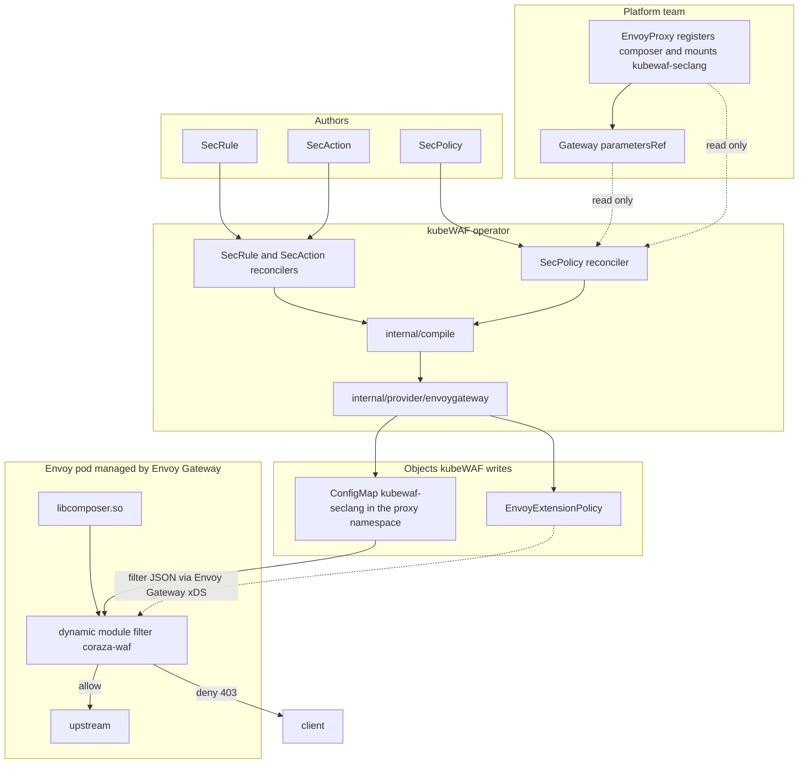

# kubeWAF rewrite plan

Status: planning only. This document is the design. It does not change operator code.

Source tree: `github.com/kubewaf-io/kubewaf` at `v0.1.0-beta.5` (`git describe` → `v0.1.0-beta.5-1-g6d4cabc` on `main`). Latest release named by the owner: `v0.1.0-beta.5`.

The rewrite is a breaking replacement of the API and the data-plane integration. SecRule and SecAction stay, and they map 1:1 onto SecLang. Everything that exists to push Wasm over xDS goes away. The platform team registers a Coraza dynamic module on their `EnvoyProxy` and points the Gateway at it. kubeWAF writes a SecLang ConfigMap and an `EnvoyExtensionPolicy` that references that module by name. Istio and Cilium are a Go interface with no implementation in this stage. A higher-level Protection API is phase 2 and compiles down to the same SecLang bundle.

## 1. Goals and non-goals

### Goals

1. One SecLang API, `seclang.kubewaf.io/v1alpha1`, with `SecRule`, `SecAction`, and `Include` that emit SecLang and nothing else. One directive per object. Chains, targets, operators, transformations, and the five SecLang action classes are fields, not free-form blobs and not a second legacy bag.
2. One attachment object, `SecPolicy`, that selects those rules and binds them to an Envoy Gateway `Gateway` or `HTTPRoute`.
3. The operator writes two Kubernetes objects and then stops: a ConfigMap of SecLang files, and an `EnvoyExtensionPolicy` whose `dynamicModule` names the platform's preinstalled module (`composer`) and filter (`coraza-waf`). kubeWAF never creates, patches, or merges an `EnvoyProxy`, and never patches `Gateway.spec.infrastructure.parametersRef`. Envoy Gateway's own xDS server programs Envoy.
4. The request path contains Envoy and the in-process Coraza module. The operator is not in that path.
5. A provider interface so a later Istio or Cilium backend consumes the same compiled bundle and leaves `api/` and `internal/compile` untouched.
6. A phase-2 `Protection` CRD with CRS presets and exclusions that compiles to SecLang plus the same provider call.
7. Tests that lock the language mapping (SecLang round trip) and a Kind test that proves a clean `GET` returns 200 and `User-Agent: sqlmap/1.0` returns 403.

### Non-goals (this stage)

- Serving `seclang.kubewaf.io/v1beta1` or `waf.kubewaf.io/v1beta1`. No conversion webhook and no dual-stack controller.
- Envoy control-plane integration of any kind: ECDS, the Envoy Gateway Extension Server, a Wasm HTTP server, xDS mutation, `EnvoyFilter`, `CiliumEnvoyConfig`, bootstrap cluster injection.
- Implementing Istio or Cilium. The seam is the interface and an empty registration list.
- Proxy-Wasm engines (`modsecurity-proxy-wasm`, `pow-proxy-wasm`) and the Proof-of-Work challenge filter.
- Shipping a metrics stack. VictoriaMetrics, VictoriaTraces, the OTel collector, the subresource API, and the probe API leave the repo. The Coraza module already exports `waf_tx_total`, `waf_tx_blocked`, and `waf_tx_duration` through Envoy stats.
- A Headlamp plugin, a cluster ID allocator, PhraseList and IPList CRDs, and the RuleSet CRD.
- Persistent collections (`IP`, `SESSION`, `GLOBAL`, `USER`, `RESOURCE`) as a supported feature. The actions stay in the language API so SecLang still round-trips. The dynamic module has no durable `SecDataDir`. Rate limits in phase 2 use Envoy Gateway `BackendTrafficPolicy`, which already has a working store.
- `SecRuleScript` / Lua.
- Editing rules that already live inside the bundled CRS files. Exclusions are `SecRuleRemoveById`, `SecRuleRemoveByTag`, and `SecRuleUpdateTargetById` emitted after the CRS include.
- Creating, patching, or merging `EnvoyProxy`, and patching `Gateway` or `GatewayClass` `parametersRef`. Those objects belong to the platform team. kubeWAF only reads them.

### Decisions recorded here

These are the defaults an implementer should follow. Section 13 lists the ones that still need a spike or an owner override.

| Topic | Decision |
| --- | --- |
| API version | `seclang.kubewaf.io/v1alpha1` only. Promote to `v1` by a storage-version copy after the Kind test has passed on two Envoy Gateway minors and the spikes in section 13 are closed. |
| Rule shape | One logical rule per `SecRule`. Delete `spec.secLangRules[]` and the `Condition` vs `Match` split. |
| Targets | One `Target` type. Delete the separate Variable and Collection structs. |
| Chain action | The emitter writes `chain`. The user does not set it. CEL rejects a hand-written `chain`. |
| IDs | `metadata.id` is required. Delete `SecRuleIDPool`. |
| Phrase and IP lists | Delete the CRDs. Bodies live on `SecPolicy.spec.dataFiles` and are mounted next to the conf. |
| CRS default | Bundled virtual includes inside the Coraza module. Generated CRDs are an opt-in converter output, not a default Helm install. |
| Attachment namespace | `SecPolicy`, its Gateway or HTTPRoute, and the `EnvoyExtensionPolicy` are the same namespace. Rule selectors are the same namespace. The SecLang ConfigMap lives in the Envoy proxy namespace, because that is where the pod runs. |
| EnvoyProxy | Platform-owned. kubeWAF never creates, patches, or merges an `EnvoyProxy`, and never sets `Gateway.spec.infrastructure.parametersRef` or `GatewayClass.spec.parametersRef`. |
| Rule delivery | One well-known ConfigMap, `kubewaf-seclang`, in the Envoy proxy namespace (default `envoy-gateway-system`). The platform `EnvoyProxy` mounts it at `/etc/kubewaf/seclang`. The `EnvoyExtensionPolicy` `Include`s those files. Inline directives are not the delivery path. |
| Module delivery | The platform loads `composer:0.13.0`. The Composer image is scratch, so `cp` cannot be the init command on that image. M0 used a busybox wrapper. An image volume was not run. kubeWAF has no image and no delivery setting. |
| Engine | Upstream Coraza filter inside Tetrate Built-on-Envoy `libcomposer.so`, filter name `coraza-waf`. This repo does not fork the engine. |

## 2. Complexity removed

The current operator is a control plane. A WAF object resolves RuleSets recursively, renders SecLang, pushes it over gRPC ECDS (`:18001`), serves Wasm over HTTP (`:18002`), and runs an Envoy Gateway Extension Server (`:5005`) that patches listeners and clusters. Istio gets an `EnvoyFilter`. Cilium gets a `CiliumEnvoyConfig` plus a hand-merged bootstrap cluster. A second controller on every replica re-publishes the same snapshot so followers can serve gRPC. PhraseList and IPList exist because the Wasm plugin has to receive `data_files` in its JSON. SecRuleIDPool exists because ids are optional. Two SecRule shapes exist (single-rule `match[]` and legacy `secLangRules[]`). goverter plus `github.com/coreruleset/crslang` sit between the CRD and a string. Managed telemetry then adds a collector, VictoriaMetrics, and VictoriaTraces.

The rewrite deletes that stack. The operator's runtime job is: render SecLang, write a ConfigMap, write an `EnvoyExtensionPolicy`. Leader election still guards those writes. Followers do not serve traffic config. There is one rule shape, one target type, one emitter, and no xDS library in `go.mod`. The platform `EnvoyProxy` is read so status can say whether the module and the mount are present. It is not written.

Concrete deletions that follow from that:

- Ports `:18001`, `:5005`, and `:18002`, and the Services, NetworkPolicies, and Cilium bootstrap fragments that exist for them.
- `github.com/envoyproxy/go-control-plane` and the Envoy Gateway extension protobuf.
- The `references2` resolver, RuleSet recursion, finalizers, and `status.ruleSetRefs` back-pointers. A policy watches rules; rules do not point back.
- Path A (`Include @owasp_crs` inside Wasm) versus Path B (CRS as thousands of CRDs plus injected phrase files). One CRS path: the module's embedded files. Custom rules are always SecLang the operator wrote.
- The per-replica "dataplane sync" pipeline. One reconciler writes status, the ConfigMap, and the `EnvoyExtensionPolicy`.
- Engine catalog, Wasm registry client, challenge HMAC Secrets, probe assembler, subresource API server.

What stays conceptually, rewritten against the new types: the SecLang vocabulary already enumerated in `api/seclang/v1beta1`, the CRS converter CLI, a validating admission path that asks Coraza to parse one rule, a small Helm chart, and Kind-based end-to-end tests.

## 3. Inventory

Legend: **Delete** means the rewrite does not carry it forward. **Rewrite** means the idea survives and the code is replaced. **Keep** means it can move with mechanical edits.

### API

| Path | Verdict | Reason |
| --- | --- | --- |
| `api/seclang/v1beta1/secrule_types.go`, `secaction_types.go`, `secrule_metadata.go`, `secrule_actions.go`, `secrule_operator.go`, `secrule_transformations.go`, `secrule_variables.go`, `secrule_collections.go`, `secrule_conditions.go` | Rewrite | Vocabulary is the SecLang catalog and is reused as enums. Shape changes: one target type, required id, no legacy bag, metadata fields match metadata actions including `accuracy`. |
| `api/seclang/v1beta1/convert/` (goverter, `zz_generated_*.go`, crslang mapping) | Delete | A direct emitter replaces the converter. Golden strings are the contract. |
| `api/seclang/v1beta1/phraselist_types.go`, `iplist_types.go` | Delete | Folded into `SecPolicy.spec.dataFiles`. |
| `api/seclang/v1beta1/secrule_id_pool_types.go`, `labels.go` | Delete | Ids are author-supplied. Tag label mirroring existed for RuleSet selectors; selectors match `metadata.tags` via an index the controller maintains, or plain user labels. The controller does not rewrite rule labels. |
| `api/seclang/v1beta1/seclang.go` (`SecLang` interface, `RuleSetRef`) | Delete | No back-references. |
| `api/waf/v1beta1/waf_types.go` | Delete | Provider, ECDS, challenge, CRS Path A/B, telemetry, block headers, and phrase policy are control-plane surface. Attachment becomes `SecPolicy`. Block status and message, if still wanted, are SecLang (`status`, `msg`) plus the module's own 403. |
| `api/waf/v1beta1/ruleset_types.go` | Delete | `SecPolicy.spec.rules` is a name or a label selector. No intermediate object, no recursion. |
| `api/waf/v1beta1/workload_types.go` | Delete | Unused workload-template scaffolding. Not referenced by a CRD. |
| `api/waf/v1beta1/waf_interfaces.go` | Delete | Goes away with RuleSet. |
| `api/subresources/v1alpha1/` | Delete | Probe types for the aggregated API. |

### Controllers, webhooks, compiler inputs

| Path | Verdict | Reason |
| --- | --- | --- |
| `internal/controller/seclang/` (`secrule_controller.go`, `secaction_controller.go`) | Rewrite | Render `status.secLang` and set Ready. Drop ID allocation and label sync. |
| `internal/controller/seclang/id_pool.go`, `iplist_controller.go`, `phraselist_controller.go`, `labels_sync.go` | Delete | The CRDs they own are gone. |
| `internal/controller/waf/` | Delete | Replaced by one `SecPolicy` reconciler. |
| `internal/seclang/render.go` | Rewrite | Becomes `internal/compile`. |
| `internal/coraza/` | Keep, slim | Coraza as a library for admission and unit tests. Delete `internal/coraza/crsdata/` (phrase files embedded for the Wasm path). The dynamic module carries CRS data. |
| `internal/webhook/` | Rewrite | One validator: render the rule, ask Coraza to parse it. Delete PhraseList, IPList, RuleSet, and WAF webhooks. Structural rules move to CEL. |
| `internal/references2/` | Delete | Selectors are a list/watch plus an index. |
| `internal/metrics/` | Rewrite | Operator build info and reconcile counters only. Delete Wasm series catalogs. |

### Data plane

| Path | Verdict | Reason |
| --- | --- | --- |
| `internal/dataplane/ecds/` | Delete | ECDS server, `:18001`. |
| `internal/dataplane/extensionserver/` | Delete | Envoy Gateway Extension Server, `:5005`. |
| `internal/dataplane/wasmserve/` | Delete | Wasm HTTP server, `:18002`. |
| `internal/dataplane/xdsutil/` | Delete | Cluster and OTel xDS helpers. |
| `internal/dataplane/slot/`, `slot/istio/`, `slot/cilium/` | Delete | EnvoyFilter and CiliumEnvoyConfig builders. The future seam is `internal/provider`, which does not import these. |
| `internal/dataplane/engine/` | Delete | Wasm module catalog. |
| `internal/dataplane/config/` | Delete | Portable Wasm JSON, phrase-file injection, compression, provider discovery. |
| `internal/dataplane/pipeline/`, `sync/`, `index/`, `challenge/`, `observability/` | Delete | Leader/follower publish split, challenge HMAC, managed telemetry. |
| `internal/wasmregistry/` | Delete | Registry client for Wasm images. |
| `internal/probeassemble/`, `internal/probetest/`, `internal/subresourceapi/` | Delete | Probe and aggregated API. |
| `cmd/main.go` | Rewrite | Manager, three reconcilers, webhook. No gRPC listeners for xDS. |
| `cmd/crs-converter/` | Rewrite | Emit `v1alpha1` SecRule and SecAction from upstream CRS conf. |
| `cmd/probe-test-server/`, `cmd/subresource-api/`, `cmd/_coraza-wasm-registry/` | Delete | Servers for the removed features. |

### Packaging, samples, engines

| Path | Verdict | Reason |
| --- | --- | --- |
| `engines/modsecurity-proxy-wasm`, `engines/pow-proxy-wasm` | Delete | Submodules. The engine is the upstream Composer image. |
| `wasm.Dockerfile`, `dist/wasm/`, `schemas/waf-plugin-config.json` | Delete | Wasm build outputs and the plugin JSON schema. |
| `charts/kubewaf/` | Rewrite | Operator Deployment, CRDs, RBAC, webhook cert. Delete dataplane Service, ECDS, Cilium fragment, OTel, VictoriaMetrics, VictoriaTraces, probe server, subresource API. |
| `charts/kubewaf-crs/` | Delete as a default install | Thousands of generated CRDs. The converter can still emit them into a git repo the user applies. They are not a supported chart in v1alpha1. |
| `config/samples/crs/`, `config/samples/phraselist/`, `config/samples/iplist/`, `config/samples/cilium/`, `config/samples/observability/` | Delete | Replaced by a handful of v1alpha1 examples under `config/samples/`. |
| `config/crd/bases/seclang.kubewaf.io_{phraselists,iplists,secruleidpools}.yaml`, `waf.kubewaf.io_{rulesets,wafs}.yaml` | Delete | CRDs removed. |
| `config/rbac/*secrule*`, `*secaction*` | Rewrite | New group version. |
| `hack/scripts/cilium_envoy_ecds_merge.py`, `merge-cilium-envoy-ecds-bootstrap.sh`, `extract-wasm-from-image.sh`, `generate-crs-phraselists.py` | Delete | Bootstrap merge and Wasm/phrase tooling. |
| `hack/boilerplate.go.txt`, `hack/githooks/` | Keep | Unrelated to the data plane. |
| `test/e2e/` provider, FTW, phrase, probe, headlamp suites | Rewrite | One Kind suite: Envoy Gateway v1.10, clean GET, sqlmap User-Agent. FTW against full CRS is a follow-up, not a gate for the rewrite. |
| `Makefile` wasm, ecds, local-demo engine targets | Rewrite | Drop Wasm build targets. Keep `generate`, `test`, `lint`, a Kind e2e target. |
| `go.mod` require of `github.com/envoyproxy/gateway` | Rewrite | Bump from v1.8.3 (no dynamic modules; that release ships Envoy 1.38) to v1.10.x so the operator can read `EnvoyProxy` and write `EnvoyExtensionPolicy`. |
| `go.mod` require of `go-control-plane`, `crslang`, `coraza` | Rewrite | Drop `go-control-plane` and `crslang`. Keep `coraza` for parse tests. |
| `README.md`, `CHANGELOG.md`, `TODO.md`, `PROJECT` | Rewrite when implementation starts | This plan does not edit them. The implementation PR updates them to describe the new architecture. |
| `LICENSE`, `CONTRIBUTING.md`, `SECURITY.md`, `CODE_OF_CONDUCT.md` | Keep | |

## 4. Target architecture



Request path: client to Envoy, in-process `coraza-waf`, then upstream or a local 403. Envoy Gateway programs the filter from `EnvoyExtensionPolicy`. kubeWAF does not open an xDS stream.

Reconcile path for a `SecPolicy`:

1. Resolve `spec.rules` in the policy namespace. A missing name or a selector match that is not Ready fails the policy with `RulesResolved=False` and leaves the last good ConfigMap in place.
2. Sort ready rules by `spec.order` ascending, then by name.
3. Compile each object with `internal/compile`. Split on `spec.placement`.
4. Ask Coraza to parse `before + after` with a minimal preamble (`SecRuleEngine On` and the body-access lines). A parse error sets `Programmed=False` and does not write.
5. Build the bundle hash from the file bytes.
6. Read the target Gateway and, when `spec.infrastructure.parametersRef` is empty, its GatewayClass. GET the referenced `EnvoyProxy`. This step is read-only. Set `EngineReady` from that object (section 6). When `EngineReady` is False, do not write the ConfigMap or the `EnvoyExtensionPolicy`. If this policy had written an `EnvoyExtensionPolicy` earlier, delete it so Envoy Gateway does not keep a filter pointed at a missing module or a missing mount. The `EnvoyProxy` and the Gateway stay untouched.
7. Call `provider.Apply`. The Envoy Gateway provider writes this policy's keys in ConfigMap `kubewaf-seclang` and writes the `EnvoyExtensionPolicy`. It does not write an `EnvoyProxy` and it does not patch the Gateway.
8. Read `EnvoyExtensionPolicy` status. Reflect Accepted into `Programmed`.

The hash is a `SecMarker` directive inside the filter config (`SecMarker KUBEWAF<16 hex chars>`). Coraza re-reads `Include` files when the filter config is re-initialized. A ConfigMap-only edit would not change the xDS resource, so the marker is part of `directives` and changes when the files change. The marker sits before user rules. `skipAfter` targets the user's own markers, which are emitted later.

### Filter config the provider builds

`Bundle` is provider-neutral. The compiler fills it. Only the Envoy Gateway provider knows `@coraza.conf` and the JSON keys. CRS files are `Include` objects in the documents, not a flag on the bundle.

```go
// internal/provider/provider.go
type Placement string

const (
    PlacementBeforeCRS Placement = "BeforeCRS"
    PlacementAfterCRS  Placement = "AfterCRS" // default
)

type Bundle struct {
    Namespace string
    Name      string
    Hash      string // lowercase hex sha256 of the file map

    Engine              string // On, DetectionOnly, Off
    RequestBodyAccess   bool
    ResponseBodyAccess  bool
    Inspection          string // REQUEST_ONLY or FULL

    // Before and After are complete SecLang documents. They contain SecRule,
    // SecAction, and Include lines in order. Data-file operator paths are
    // already rewritten to /etc/kubewaf/seclang/<file>.
    Before string
    After  string

    // Files are keys in ConfigMap kubewaf-seclang.
    // Names are "<policy-namespace>_<policy-name>-before.conf", the matching
    // "-after.conf", "<policy-namespace>_<policy-name>_<include>.conf",
    // and "<policy-namespace>_<policy-name>_<basename>.data".
    Files map[string]string
}

type Target struct {
    Namespace string
    Gateway   string
    // HTTPRoute is empty when the policy targets the Gateway.
    HTTPRoute string
}

type Provider interface {
    Name() string
    // Apply writes the ConfigMap keys and the EnvoyExtensionPolicy.
    // It does not create, patch, or merge an EnvoyProxy, and it does not patch a Gateway.
    Apply(ctx context.Context, c client.Client, tgt Target, b Bundle) error
    // Delete removes this policy's EnvoyExtensionPolicy and its ConfigMap keys.
    // It does not delete or patch an EnvoyProxy, and it does not patch a Gateway.
    // The ConfigMap itself is removed when it has no remaining keys.
    Delete(ctx context.Context, c client.Client, tgt Target, policyName string) error
}
```

Envoy Gateway `directives` for every policy:

```text
Include @coraza.conf
SecRuleEngine On
SecRequestBodyAccess On
SecResponseBodyAccess Off
SecMarker KUBEWAF<hash>
Include /etc/kubewaf/seclang/<policy-namespace>_<policy>-before.conf
Include /etc/kubewaf/seclang/<policy-namespace>_<policy>-after.conf
```

`@coraza.conf` stays in the preamble. It is the module's recommended Coraza configuration, not the OWASP rules. Body-access lines override what `@coraza.conf` set, because they come after that include. `@crs-setup.conf` and `@owasp_crs/*.conf` are not inserted here. They are `Include` objects, written into the before or after file at the object's `order`. This matches the [Coraza WAF extension](https://builtonenvoy.io/extensions/coraza-waf/) and the [Envoy Gateway dynamic modules task](https://gateway.envoyproxy.io/docs/tasks/extensibility/dynamic-modules/).

`mode` on the filter JSON is `REQUEST_ONLY` or `FULL`. The extension documents that `mode` chooses which phases are presented to Coraza and does not itself turn body access on. `RESPONSE_ONLY` is deprecated by the extension and is not a value we emit. `request_uri_path_only` is always `true`, which is the value the extension asks new users to set so `REQUEST_URI` is the path and query. `metrics.authority_label` is always `route_name` so `waf_tx_blocked` does not grow with client-supplied `:authority`.

## 5. SecRule and SecAction

Group: `seclang.kubewaf.io`. Version: `v1alpha1`. Scope: namespaced. Short names: `sr`, `sa`, `inc`, `sp`.

Storage conventions: camelCase JSON, one object per logical directive, `status.secLang` is the exact text the policy compiler concatenates. Comments in the Go structs below are the kubebuilder comments the implementation should keep. Methods that only exist to satisfy a back-reference interface are not part of the API.

### 5.1 Go types

```go
package v1alpha1

import metav1 "k8s.io/apimachinery/pkg/apis/meta/v1"

// SecRule is one SecRule directive, or one chain of them, plus an optional SecMarker.
// +kubebuilder:object:root=true
// +kubebuilder:subresource:status
// +kubebuilder:resource:path=secrules,scope=Namespaced,shortName=sr,categories=waf;security
// +kubebuilder:printcolumn:name="Ready",type=string,JSONPath=`.status.conditions[?(@.type=="Ready")].status`
// +kubebuilder:printcolumn:name="ID",type=integer,JSONPath=`.spec.metadata.id`
// +kubebuilder:printcolumn:name="Phase",type=integer,JSONPath=`.spec.metadata.phase`
// +kubebuilder:printcolumn:name="Age",type=date,JSONPath=`.metadata.creationTimestamp`
type SecRule struct {
    metav1.TypeMeta   `json:",inline"`
    metav1.ObjectMeta `json:"metadata,omitempty"`
    Spec              SecRuleSpec   `json:"spec"`
    Status            SecLangStatus `json:"status,omitempty"`
}

type SecRuleSpec struct {
    // Order is the sort key inside a SecPolicy. Lower runs first.
    // Ties break by object name. Zero is a real value.
    // +optional
    // +kubebuilder:default=1000
    Order int32 `json:"order,omitempty"`

    // Placement selects which file the policy writes this rule into when the
    // policy enables the bundled CRS. BeforeCRS is for setup overrides.
    // AfterCRS is the default and is where custom detections belong.
    // +optional
    // +kubebuilder:default=AfterCRS
    // +kubebuilder:validation:Enum=BeforeCRS;AfterCRS
    Placement Placement `json:"placement,omitempty"`

    // MarkerAfter emits a SecMarker line after this rule. skipAfter targets it.
    // +optional
    // +kubebuilder:validation:Pattern=`^[A-Za-z_][A-Za-z0-9_-]*$`
    // +kubebuilder:validation:MaxLength=64
    MarkerAfter string `json:"markerAfter,omitempty"`

    // Metadata is the SecLang metadata actions. id and phase are required.
    Metadata Metadata `json:"metadata"`

    // Chain is one or more links. Link 0 is the SecRule. Later links are
    // emitted with the chain action on the previous link.
    // +kubebuilder:validation:MinItems=1
    // +kubebuilder:validation:MaxItems=16
    Chain []ChainLink `json:"chain"`
}

type Placement string

const (
    PlacementBeforeCRS Placement = "BeforeCRS"
    PlacementAfterCRS  Placement = "AfterCRS"
)

// Metadata maps onto SecLang metadata actions.
// id and phase are emitted first. The rest follow in the canonical order in section 5.4.
type Metadata struct {
    // +kubebuilder:validation:Minimum=1
    // +kubebuilder:validation:Maximum=2147483647
    ID int `json:"id"`

    // Phase is 1 request headers, 2 request body, 3 response headers,
    // 4 response body, 5 logging.
    // +kubebuilder:validation:Minimum=1
    // +kubebuilder:validation:Maximum=5
    Phase int `json:"phase"`

    // +optional
    Message string `json:"message,omitempty"`
    // +optional
    Severity string `json:"severity,omitempty"`
    // +optional
    Tags []string `json:"tags,omitempty"`
    // +optional
    Revision string `json:"revision,omitempty"`
    // +optional
    Version string `json:"version,omitempty"`
    // +optional
    Maturity string `json:"maturity,omitempty"`
    // +optional
    Accuracy string `json:"accuracy,omitempty"`
}

// ChainLink is one SecRule line in a chain.
type ChainLink struct {
    // +kubebuilder:validation:MinItems=1
    Targets []Target `json:"targets"`

    Operator Operator `json:"operator"`

    // +optional
    Transformations []Transformation `json:"transformations,omitempty"`

    // Actions on link 0 may include one disruptive action.
    // Later links must leave Disruptive empty. The chain action is not set here.
    // +optional
    Actions *Actions `json:"actions,omitempty"`
}

// Target is one SecLang variable or collection expression.
// Emission: [!][&]NAME[:selector]
// A selector wrapped in slashes is a regex selector: ARGS:/pattern/
type Target struct {
    Name VariableName `json:"name"`
    // +optional
    Selector string `json:"selector,omitempty"`
    // +optional
    Exclude bool `json:"exclude,omitempty"`
    // +optional
    Count bool `json:"count,omitempty"`
}

type Operator struct {
    // Negate emits !@name.
    // +optional
    Negate bool `json:"negate,omitempty"`
    Name   OperatorName `json:"name"`
    // +optional
    Value string `json:"value,omitempty"`
}

// Actions is the SecLang action list minus metadata (those are Metadata)
// and minus chain (the chain structure emits that).
type Actions struct {
    // +optional
    Disruptive *DisruptiveAction `json:"disruptive,omitempty"`
    // +optional
    Flow []FlowAction `json:"flow,omitempty"`
    // +optional
    Data []DataAction `json:"data,omitempty"`
    // +optional
    NonDisruptive []NonDisruptiveAction `json:"nonDisruptive,omitempty"`
}

type DisruptiveAction struct {
    Type DisruptiveActionType `json:"type"`
    // Value is the argument: allow:phase, allow:request, pause:<ms>,
    // proxy:<url>, redirect:<url>. Empty for deny, drop, block, pass.
    // +optional
    Value string `json:"value,omitempty"`
}

type FlowAction struct {
    // chain is rejected. skip and skipAfter are the accepted types.
    Type  FlowActionType `json:"type"`
    Value string         `json:"value"`
}

type DataAction struct {
    Type DataActionType `json:"type"`
    // +optional
    Value string `json:"value,omitempty"`
}

type NonDisruptiveAction struct {
    Type NonDisruptiveActionType `json:"type"`
    // +optional
    Value string `json:"value,omitempty"`
}

// SecAction is an unconditional SecAction directive.
// +kubebuilder:object:root=true
// +kubebuilder:subresource:status
// +kubebuilder:resource:path=secactions,scope=Namespaced,shortName=sa,categories=waf;security
type SecAction struct {
    metav1.TypeMeta   `json:",inline"`
    metav1.ObjectMeta `json:"metadata,omitempty"`
    Spec              SecActionSpec `json:"spec"`
    Status            SecLangStatus `json:"status,omitempty"`
}

type SecActionSpec struct {
    // +optional
    // +kubebuilder:default=100
    Order int32 `json:"order,omitempty"`
    // +optional
    // +kubebuilder:default=AfterCRS
    // +kubebuilder:validation:Enum=BeforeCRS;AfterCRS
    Placement Placement `json:"placement,omitempty"`
    // +optional
    MarkerAfter string `json:"markerAfter,omitempty"`
    Metadata    Metadata `json:"metadata"`
    // +optional
    Transformations []Transformation `json:"transformations,omitempty"`
    // +optional
    Actions *Actions `json:"actions,omitempty"`
}

type SecLangStatus struct {
    // +listType=map
    // +listMapKey=type
    // +optional
    Conditions []metav1.Condition `json:"conditions,omitempty"`
    // SecLang is the rendered directive text, including a trailing SecMarker line.
    // +optional
    SecLang string `json:"secLang,omitempty"`
}
```

CEL on `SecRule`, expressed as kubebuilder `XValidation` rules:

- `chain` has at least one link (also `MinItems`).
- At most one disruptive action on link 0. Links after 0 have no `actions.disruptive`.
- No flow entry has type `chain`.
- `exclude` and `count` are not both true on one target (`!` and `&` together is not SecLang).
- `operator.name` of `unconditionalMatch`, `detectSQLi`, `detectXSS`, `validateUrlEncoding`, `validateUtf8Encoding`, `geoLookup` has an empty value. Operators that take a value (`rx`, `pm`, `eq`, …) have a non-empty value. The webhook is the backstop for operators whose arity the CEL list misses; CEL covers the common set.
- `metadata.id` and `metadata.phase` are bounded by the int markers above.

`SecAction` uses the same metadata bounds. A disruptive action is allowed (CRS setup uses `pass`). `chain` is rejected.

### 5.2 Canonical emission

The emitter is deterministic so golden files do not churn.

Action order on each SecRule line:

1. `id:<metadata.id>` on link 0 only
2. `phase:<metadata.phase>` on link 0 only
3. `t:<transformation>` in list order
4. `chain` on every link except the last, when the chain has more than one link
5. disruptive action
6. data actions, in list order
7. `skip` and `skipAfter`, in list order
8. metadata other than id and phase, on link 0 only: `msg`, `severity`, `tag` (one action per tag, list order), `rev`, `ver`, `maturity`, `accuracy`
9. non-disruptive actions, in list order

Quoting follows SecLang: the operator value is a quoted string when it is present; action values that contain spaces, quotes, or commas are double-quoted with `\"` and `\\` escapes. The round-trip suite is the spec for the quoter. A single rule is parsed back by Coraza and compared to the golden string.

`SecAction` uses the same action order and no targets or operator:

```text
SecAction "id:900990,phase:1,pass,nolog,setvar:tx.blocking_paranoia_level=2"
```

`markerAfter: END_SCANNERS` appends a line `SecMarker END_SCANNERS`.

Operator emission is `@<name>` or `!<@name>`, with the SecLang token from the tables below (`pmFromFile`, not a display name).

Target emission:

| Fields | SecLang |
| --- | --- |
| name REQUEST_URI | `REQUEST_URI` |
| name REQUEST_HEADERS, selector User-Agent | `REQUEST_HEADERS:User-Agent` |
| name ARGS, count true | `&ARGS` |
| name ARGS, selector password, exclude true | `!ARGS:password` |
| name ARGS, selector `/^id_/`, exclude true | `!ARGS:/^id_/` |

Several targets on one link are joined with `|`.

### 5.3 Example YAML

Scanner block used by the Kind test:

```yaml
apiVersion: seclang.kubewaf.io/v1alpha1
kind: SecRule
metadata:
  name: block-sqlmap
  namespace: default
spec:
  order: 10
  metadata:
    id: 100001
    phase: 1
    message: scanner user-agent
    severity: CRITICAL
    tags:
      - scanner
      - sqlmap
  chain:
    - targets:
        - name: REQUEST_HEADERS
          selector: User-Agent
      operator:
        name: rx
        value: (?i)sqlmap
      actions:
        disruptive:
          type: deny
        data:
          - type: status
            value: "403"
        nonDisruptive:
          - type: log
          - type: auditlog
```

Rendered `status.secLang`:

```text
SecRule REQUEST_HEADERS:User-Agent "@rx (?i)sqlmap" "id:100001,phase:1,deny,status:403,msg:'scanner user-agent',severity:CRITICAL,tag:scanner,tag:sqlmap,log,auditlog"
```

An empty transformation list emits no `t:` action. `t:none` is emitted only when the user lists the `none` transformation. The round-trip suite's golden file is the authority for quoting and action order.

Chain with a marker:

```yaml
apiVersion: seclang.kubewaf.io/v1alpha1
kind: SecRule
metadata:
  name: post-without-type
  namespace: default
spec:
  metadata:
    id: 100010
    phase: 1
    message: POST missing content type
  markerAfter: END_METHOD
  chain:
    - targets:
        - name: REQUEST_METHOD
      operator:
        name: rx
        value: ^POST$
      actions:
        disruptive:
          type: deny
        data:
          - type: status
            value: "403"
    - targets:
        - name: REQUEST_HEADERS
          selector: Content-Type
          count: true
      operator:
        name: eq
        value: "0"
```

Rendered:

```text
SecRule REQUEST_METHOD "@rx ^POST$" "id:100010,phase:1,chain,deny,status:403,msg:'POST missing content type'"
SecRule &REQUEST_HEADERS:Content-Type "@eq 0"
SecMarker END_METHOD
```

Unconditional setup:

```yaml
apiVersion: seclang.kubewaf.io/v1alpha1
kind: SecAction
metadata:
  name: paranoia-2
  namespace: default
spec:
  order: 1
  placement: BeforeCRS
  metadata:
    id: 900990
    phase: 1
  actions:
    disruptive:
      type: pass
    nonDisruptive:
      - type: nolog
      - type: setvar
        value: tx.blocking_paranoia_level=2
      - type: setvar
        value: tx.detection_paranoia_level=2
```

### 5.4 Mapping tables

Tokens match the v1beta1 enums in `api/seclang/v1beta1`, which were generated against SecLang, plus `accuracy` and `prepend` which that API omitted. Emission is the SecLang token, not the Go name.

Coraza support is not a second hand-maintained matrix. The admission webhook and the round-trip test load the rendered line with `github.com/corazawaf/coraza/v3`. A token Coraza's parser rejects fails admission with the parser error. The test records the result per token so the suite is the support list. Known gaps today (do not promise them): `geoLookup`, `gsbLookup`, `rbl`, `inspectFile`, `fuzzyHash`, `validateDTD`, `validateSchema`, `validateHash`, `verifyCPF`, `verifySSN`, `verifySVNR`, and most `PERF_*`, `SCRIPT_*`, `SDBM_*`, `WEBSERVER_ERROR_LOG` variables. They remain in the enum so the language stays complete; admission is what tells the user the engine cannot load them.

#### Targets

Scalar variables (`selector` empty unless noted). Source: `secrule_variables.go`.

| API `name` | SecLang | Notes |
| --- | --- | --- |
| ARGS_COMBINED_SIZE | `ARGS_COMBINED_SIZE` | |
| AUTH_TYPE | `AUTH_TYPE` | |
| DURATION | `DURATION` | |
| FILES_COMBINED_SIZE | `FILES_COMBINED_SIZE` | |
| FILES_NAMES | `FILES_NAMES` | collection; selector optional |
| FILES_SIZES | `FILES_SIZES` | collection |
| FILES_TMP_CONTENT | `FILES_TMP_CONTENT` | collection |
| FILES_TMPNAMES | `FILES_TMPNAMES` | collection |
| FULL_REQUEST | `FULL_REQUEST` | |
| FULL_REQUEST_LENGTH | `FULL_REQUEST_LENGTH` | |
| HIGHEST_SEVERITY | `HIGHEST_SEVERITY` | |
| INBOUND_DATA_ERROR | `INBOUND_DATA_ERROR` | |
| MATCHED_VAR | `MATCHED_VAR` | |
| MATCHED_VAR_NAME | `MATCHED_VAR_NAME` | |
| MODSEC_BUILD | `MODSEC_BUILD` | often unsupported in Coraza |
| MSC_PCRE_ERROR | `MSC_PCRE_ERROR` | |
| MSC_PCRE_LIMITS_EXCEEDED | `MSC_PCRE_LIMITS_EXCEEDED` | |
| MULTIPART_BOUNDARY_QUOTED | `MULTIPART_BOUNDARY_QUOTED` | |
| MULTIPART_BOUNDARY_WHITESPACE | `MULTIPART_BOUNDARY_WHITESPACE` | |
| MULTIPART_CRLF_LF_LINES | `MULTIPART_CRLF_LF_LINES` | |
| MULTIPART_DATA_AFTER | `MULTIPART_DATA_AFTER` | |
| MULTIPART_DATA_BEFORE | `MULTIPART_DATA_BEFORE` | |
| MULTIPART_FILE_LIMIT_EXCEEDED | `MULTIPART_FILE_LIMIT_EXCEEDED` | |
| MULTIPART_FILENAME | `MULTIPART_FILENAME` | |
| MULTIPART_HEADER_FOLDING | `MULTIPART_HEADER_FOLDING` | |
| MULTIPART_INVALID_HEADER_FOLDING | `MULTIPART_INVALID_HEADER_FOLDING` | |
| MULTIPART_INVALID_PART | `MULTIPART_INVALID_PART` | |
| MULTIPART_INVALID_QUOTING | `MULTIPART_INVALID_QUOTING` | |
| MULTIPART_LF_LINE | `MULTIPART_LF_LINE` | |
| MULTIPART_MISSING_SEMICOLON | `MULTIPART_MISSING_SEMICOLON` | |
| MULTIPART_NAME | `MULTIPART_NAME` | |
| MULTIPART_SEMICOLON_MISSING | `MULTIPART_SEMICOLON_MISSING` | |
| MULTIPART_STRICT_ERROR | `MULTIPART_STRICT_ERROR` | |
| MULTIPART_UNMATCHED_BOUNDARY | `MULTIPART_UNMATCHED_BOUNDARY` | |
| OUTBOUND_DATA_ERROR | `OUTBOUND_DATA_ERROR` | |
| PATH_INFO | `PATH_INFO` | |
| PERF_ALL | `PERF_ALL` | engine counters; may not parse |
| PERF_COMBINED | `PERF_COMBINED` | |
| PERF_GC | `PERF_GC` | |
| PERF_LOGGING | `PERF_LOGGING` | |
| PERF_PHASE1 … PERF_PHASE5 | `PERF_PHASE1` … `PERF_PHASE5` | |
| PERF_SREAD | `PERF_SREAD` | |
| PERF_SWRITE | `PERF_SWRITE` | |
| QUERY_STRING | `QUERY_STRING` | |
| REMOTE_ADDR | `REMOTE_ADDR` | |
| REMOTE_HOST | `REMOTE_HOST` | |
| REMOTE_PORT | `REMOTE_PORT` | |
| REMOTE_USER | `REMOTE_USER` | |
| REQBODY_ERROR | `REQBODY_ERROR` | |
| REQBODY_ERROR_MSG | `REQBODY_ERROR_MSG` | |
| REQBODY_PROCESSOR | `REQBODY_PROCESSOR` | |
| REQBODY_PROCESSOR_ERROR | `REQBODY_PROCESSOR_ERROR` | |
| REQBODY_PROCESSOR_ERROR_MSG | `REQBODY_PROCESSOR_ERROR_MSG` | |
| REQUEST_BASENAME | `REQUEST_BASENAME` | |
| REQUEST_BODY | `REQUEST_BODY` | needs request body access |
| REQUEST_BODY_LENGTH | `REQUEST_BODY_LENGTH` | |
| REQUEST_FILENAME | `REQUEST_FILENAME` | |
| REQUEST_LINE | `REQUEST_LINE` | |
| REQUEST_METHOD | `REQUEST_METHOD` | |
| REQUEST_PROTOCOL | `REQUEST_PROTOCOL` | |
| REQUEST_URI | `REQUEST_URI` | path and query, because the filter sets `request_uri_path_only: true` |
| REQUEST_URI_RAW | `REQUEST_URI_RAW` | |
| RESPONSE_BODY | `RESPONSE_BODY` | needs response body access and `inspection: Full` |
| RESPONSE_CONTENT_LENGTH | `RESPONSE_CONTENT_LENGTH` | |
| RESPONSE_CONTENT_TYPE | `RESPONSE_CONTENT_TYPE` | |
| RESPONSE_PROTOCOL | `RESPONSE_PROTOCOL` | |
| RESPONSE_STATUS | `RESPONSE_STATUS` | |
| SCRIPT_BASENAME | `SCRIPT_BASENAME` | web-server variable; often unsupported |
| SCRIPT_FILENAME | `SCRIPT_FILENAME` | |
| SCRIPT_GID | `SCRIPT_GID` | |
| SCRIPT_GROUPNAME | `SCRIPT_GROUPNAME` | |
| SCRIPT_MODE | `SCRIPT_MODE` | |
| SCRIPT_UID | `SCRIPT_UID` | |
| SCRIPT_USERNAME | `SCRIPT_USERNAME` | |
| SDBM_DELETE_ERROR | `SDBM_DELETE_ERROR` | |
| SERVER_ADDR | `SERVER_ADDR` | |
| SERVER_NAME | `SERVER_NAME` | |
| SERVER_PORT | `SERVER_PORT` | |
| SESSIONID | `SESSIONID` | |
| STATUS | `STATUS` | alias of the response status in some engines |
| STATUS_LINE | `STATUS_LINE` | |
| STREAM_INPUT_BODY | `STREAM_INPUT_BODY` | |
| STREAM_OUTPUT_BODY | `STREAM_OUTPUT_BODY` | |
| TIME | `TIME` | |
| TIME_DAY | `TIME_DAY` | |
| TIME_EPOCH | `TIME_EPOCH` | |
| TIME_HOUR | `TIME_HOUR` | |
| TIME_MIN | `TIME_MIN` | |
| TIME_MON | `TIME_MON` | |
| TIME_SEC | `TIME_SEC` | |
| TIME_WDAY | `TIME_WDAY` | |
| TIME_YEAR | `TIME_YEAR` | |
| UNIQUE_ID | `UNIQUE_ID` | |
| URLENCODED_ERROR | `URLENCODED_ERROR` | |
| USERAGENT_IP | `USERAGENT_IP` | |
| USERID | `USERID` | |
| WEBAPPID | `WEBAPPID` | |
| WEBSERVER_ERROR_LOG | `WEBSERVER_ERROR_LOG` | |

Collections. The v1beta1 `Collection` type collapses into `Target`. `count: true` is the `&` prefix. `selector` is the key or `/regex/`. `exclude: true` is the `!` prefix.

| API `name` | SecLang | Typical selector |
| --- | --- | --- |
| ARGS | `ARGS` | parameter name |
| ARGS_GET | `ARGS_GET` | parameter name |
| ARGS_GET_NAMES | `ARGS_GET_NAMES` | |
| ARGS_NAMES | `ARGS_NAMES` | |
| ARGS_POST | `ARGS_POST` | parameter name |
| ARGS_POST_NAMES | `ARGS_POST_NAMES` | |
| ENV | `ENV` | variable name |
| FILES | `FILES` | filename |
| GEO | `GEO` | `COUNTRY_CODE` and the other geo fields |
| GLOBAL | `GLOBAL` | persistent; no store in this engine |
| IP | `IP` | persistent; no store in this engine |
| MATCHED_VARS | `MATCHED_VARS` | |
| MATCHED_VARS_NAMES | `MATCHED_VARS_NAMES` | |
| MULTIPART_PART_HEADERS | `MULTIPART_PART_HEADERS` | header name |
| PERF_RULES | `PERF_RULES` | |
| REQUEST_COOKIES | `REQUEST_COOKIES` | cookie name |
| REQUEST_COOKIES_NAMES | `REQUEST_COOKIES_NAMES` | |
| REQUEST_HEADERS | `REQUEST_HEADERS` | header name, for example `User-Agent` |
| REQUEST_HEADERS_NAMES | `REQUEST_HEADERS_NAMES` | |
| RESOURCE | `RESOURCE` | persistent; no store in this engine |
| RESPONSE_HEADERS | `RESPONSE_HEADERS` | header name |
| RESPONSE_HEADERS_NAMES | `RESPONSE_HEADERS_NAMES` | |
| RULE | `RULE` | `id`, `rev`, `severity`, `msg` |
| SESSION | `SESSION` | persistent; no store in this engine |
| TX | `TX` | key, including `0`–`9` for captures |
| USER | `USER` | persistent; no store in this engine |
| XML | `XML` | XPath expression |

`REQUEST_HEADERS:User-Agent` is a collection target. It is not a separate variable constant. That removes the v1beta1 split where authors had to guess which struct a name belonged to.

#### Operators

`operator.name` values. Emission is `@<token>` and `!<@token>` when `negate: true`. Aliases in parentheses are accepted on input and emitted as the canonical token.

| `name` | SecLang | Value |
| --- | --- | --- |
| beginsWith | `@beginsWith` | required |
| contains | `@contains` | required |
| containsWord | `@containsWord` | required |
| detectSQLi | `@detectSQLi` | empty |
| detectXSS | `@detectXSS` | empty |
| endsWith | `@endsWith` | required |
| eq | `@eq` | required |
| fuzzyHash | `@fuzzyHash` | required |
| ge | `@ge` | required |
| geoLookup | `@geoLookup` | empty |
| gsbLookup | `@gsbLookup` | required |
| gt | `@gt` | required |
| inspectFile | `@inspectFile` | required |
| ipMatch | `@ipMatch` | required |
| ipMatchFromFile | `@ipMatchFromFile` | required; alias `ipMatchF` accepted, emitted as `ipMatchFromFile` |
| le | `@le` | required |
| lt | `@lt` | required |
| pm | `@pm` | required |
| pmFromFile | `@pmFromFile` | required; alias `pmf` accepted, emitted as `pmFromFile` |
| rbl | `@rbl` | required |
| rsub | `@rsub` | required |
| rx | `@rx` | required |
| rxGlobal | `@rxGlobal` | required |
| streq | `@streq` | required; input `strEq` accepted |
| strmatch | `@strmatch` | required; input `strMatch` accepted |
| unconditionalMatch | `@unconditionalMatch` | empty |
| validateByteRange | `@validateByteRange` | required |
| validateDTD | `@validateDTD` | required |
| validateHash | `@validateHash` | required |
| validateSchema | `@validateSchema` | required |
| validateUrlEncoding | `@validateUrlEncoding` | empty |
| validateUtf8Encoding | `@validateUtf8Encoding` | empty |
| verifyCC | `@verifyCC` | required |
| verifyCPF | `@verifyCPF` | empty or required, whichever Coraza accepts; the suite records it |
| verifySSN | `@verifySSN` | same |
| verifySVNR | `@verifySVNR` | same |
| within | `@within` | required |

`pmFromFile` and `ipMatchFromFile` values are basenames (`scanners.data`). The policy compiler rewrites a basename that appears in `spec.dataFiles` to `/etc/kubewaf/seclang/<basename>` at bundle time. The SecRule status string keeps the basename the user wrote, so the rule object stays portable. The file written to the ConfigMap contains the absolute path.

#### Transformations

Each entry emits `t:<token>`, in order. Input aliases on the right are accepted and emitted as the canonical token. British spellings match ModSecurity.

| `transformations[]` | SecLang | Accepted alias |
| --- | --- | --- |
| base64Decode | `t:base64Decode` | |
| base64DecodeExt | `t:base64DecodeExt` | |
| base64Encode | `t:base64Encode` | |
| cmdLine | `t:cmdLine` | |
| compressWhitespace | `t:compressWhitespace` | |
| cssDecode | `t:cssDecode` | |
| escapeSeqDecode | `t:escapeSeqDecode` | |
| hexDecode | `t:hexDecode` | |
| hexEncode | `t:hexEncode` | |
| htmlEntityDecode | `t:htmlEntityDecode` | |
| jsDecode | `t:jsDecode` | |
| length | `t:length` | |
| lowercase | `t:lowercase` | |
| md5 | `t:md5` | |
| none | `t:none` | |
| normalisePath | `t:normalisePath` | `normalizePath` |
| normalisePathWin | `t:normalisePathWin` | `normalizePathWin` |
| parityEven7bit | `t:parityEven7bit` | |
| parityOdd7bit | `t:parityOdd7bit` | |
| parityZero7bit | `t:parityZero7bit` | |
| removeComments | `t:removeComments` | |
| removeCommentsChar | `t:removeCommentsChar` | |
| removeNulls | `t:removeNulls` | |
| removeWhitespace | `t:removeWhitespace` | |
| replaceComments | `t:replaceComments` | |
| replaceNulls | `t:replaceNulls` | |
| sha1 | `t:sha1` | |
| sqlHexDecode | `t:sqlHexDecode` | |
| trim | `t:trim` | |
| trimLeft | `t:trimLeft` | |
| trimRight | `t:trimRight` | |
| uppercase | `t:uppercase` | |
| urlDecode | `t:urlDecode` | |
| urlDecodeUni | `t:urlDecodeUni` | |
| urlEncode | `t:urlEncode` | |
| utf8toUnicode | `t:utf8toUnicode` | |

#### Disruptive actions

One per chain, on link 0 only.

| `type` | SecLang | `value` |
| --- | --- | --- |
| allow | `allow` or `allow:<value>` | empty, `phase`, or `request` |
| block | `block` | empty |
| deny | `deny` | empty |
| drop | `drop` | empty |
| pass | `pass` | empty |
| pause | `pause:<milliseconds>` | required integer |
| proxy | `proxy:<url>` | required |
| redirect | `redirect:<url>` | required |

#### Flow actions

| `type` | SecLang | `value` |
| --- | --- | --- |
| skip | `skip:<n>` | positive integer |
| skipAfter | `skipAfter:<marker>` | marker name emitted by some rule's `markerAfter` |
| chain | emitted by the compiler | rejected if a user sets it |

`SecMarker <name>` is the directive produced by `markerAfter`. It is not an action.

#### Metadata actions

These are `spec.metadata` fields, emitted as actions.

| Field | SecLang |
| --- | --- |
| id | `id:<int>` |
| phase | `phase:<1-5>` |
| message | `msg:'<text>'` |
| severity | `severity:<token>` (`EMERGENCY`, `ALERT`, `CRITICAL`, `ERROR`, `WARNING`, `NOTICE`, `INFO`, `DEBUG`, or `0`–`7`) |
| tags[] | one `tag:<text>` per entry |
| revision | `rev:<text>` |
| version | `ver:<text>` |
| maturity | `maturity:<text>` |
| accuracy | `accuracy:<text>` |

#### Data actions

| `type` | SecLang | `value` |
| --- | --- | --- |
| status | `status:<code>` | HTTP status, for example `403` |
| xmlns | `xmlns:<prefix>=<url>` | the prefix assignment ModSecurity expects |

#### Non-disruptive actions

`value` is the SecLang argument without the action name. Empty value means a flag action.

| `type` | SecLang | `value` |
| --- | --- | --- |
| append | `append:<text>` | text appended to the response body. The v1beta1 comment described a collection append; that was wrong. Collection edits are `setvar`. |
| prepend | `prepend:<text>` | text prepended to the response body. Added for language coverage. |
| auditlog | `auditlog` | empty |
| capture | `capture` | empty |
| ctl | `ctl:<value>` | see the ctl table |
| deprecatevar | `deprecatevar:<collection.var>=<rate>` | required |
| exec | `exec:<path>` | required. The dynamic module is unlikely to execute programs. Admission still allows the token; a parse failure surfaces from Coraza. |
| expirevar | `expirevar:<collection.var>=<seconds>` | required |
| initcol | `initcol:<COLLECTION>=<key>` | required. Persistent collections have no store in this deployment. |
| log | `log` | empty |
| logdata | `logdata:<text>` | required |
| multiMatch | `multiMatch` | empty |
| noauditlog | `noauditlog` | empty |
| nolog | `nolog` | empty |
| sanitiseArg | `sanitiseArg:<name>` | required. Alias `sanitizeArg` accepted. |
| sanitiseMatched | `sanitiseMatched` | empty. Alias `sanitizeMatched`. |
| sanitiseMatchedBytes | `sanitiseMatchedBytes` | optional argument. Alias `sanitizeMatchedBytes`. |
| sanitiseRequestHeader | `sanitiseRequestHeader:<name>` | required. Alias `sanitizeRequestHeader`. |
| sanitiseResponseHeader | `sanitiseResponseHeader:<name>` | required. Alias `sanitizeResponseHeader`. |
| setenv | `setenv:<name>=<value>` | required |
| setrsc | `setrsc:<key>` | required |
| setsid | `setsid:<key>` | required |
| setuid | `setuid:<key>` | required |
| setvar | `setvar:<assignment>` | required. Examples: `tx.score=+5`, `tx.blocked=1`, `!tx.score`. |

#### ctl

`ctl` stays one action. The value is the SecLang text after `ctl:`. Structured ctl objects would double the schema for a feature CRS uses as a string. The table is the allowed grammar; the webhook checks the prefix.

| `value` prefix | SecLang | Example value |
| --- | --- | --- |
| ruleEngine | `ctl:ruleEngine=On\|Off\|DetectionOnly` | `ruleEngine=Off` |
| ruleRemoveById | `ctl:ruleRemoveById=<id>` | `ruleRemoveById=920100` |
| ruleRemoveByTag | `ctl:ruleRemoveByTag=<tag>` | `ruleRemoveByTag=attack-xss` |
| ruleRemoveByMsg | `ctl:ruleRemoveByMsg=<text>` | `ruleRemoveByMsg=Failed SQLi` |
| ruleRemoveTargetById | `ctl:ruleRemoveTargetById=<id>;<TARGET>` | `ruleRemoveTargetById=942100;ARGS:password` |
| ruleRemoveTargetByTag | `ctl:ruleRemoveTargetByTag=<tag>;<TARGET>` | `ruleRemoveTargetByTag=attack-sqli;ARGS:csrf` |
| ruleRemoveTargetByMsg | `ctl:ruleRemoveTargetByMsg=<text>;<TARGET>` | rare |
| auditEngine | `ctl:auditEngine=On\|Off\|RelevantOnly` | `auditEngine=Off` |
| auditLogParts | `ctl:auditLogParts=<parts>` | `auditLogParts=ABCFHZ` |
| forceRequestBodyVariable | `ctl:forceRequestBodyVariable=On\|Off` | `forceRequestBodyVariable=On` |
| requestBodyAccess | `ctl:requestBodyAccess=On\|Off` | `requestBodyAccess=On` |
| requestBodyProcessor | `ctl:requestBodyProcessor=<name>` | `requestBodyProcessor=JSON` |
| requestBodyLimit | `ctl:requestBodyLimit=<bytes>` | `requestBodyLimit=13107200` |
| responseBodyAccess | `ctl:responseBodyAccess=On\|Off` | `responseBodyAccess=Off` |
| responseBodyLimit | `ctl:responseBodyLimit=<bytes>` | `responseBodyLimit=524288` |
| forceResponseBodyVariable | `ctl:forceResponseBodyVariable=On\|Off` | `forceResponseBodyVariable=On` |
| debugLogLevel | `ctl:debugLogLevel=<n>` | `debugLogLevel=3` |
| hashEngine | `ctl:hashEngine=On\|Off` | rare in Coraza |
| hashEnforcement | `ctl:hashEnforcement=On\|Off` | rare in Coraza |

#### Phases

| Phase | SecLang | When it runs | Module requirement |
| --- | --- | --- | --- |
| 1 | `phase:1` | request headers | `inspection` RequestOnly or Full |
| 2 | `phase:2` | request body | `SecRequestBodyAccess On` for body variables |
| 3 | `phase:3` | response headers | `inspection: Full` |
| 4 | `phase:4` | response body | `inspection: Full` and `SecResponseBodyAccess On` |
| 5 | `phase:5` | logging | runs when the transaction reaches logging |

#### Chains

A chain is `spec.chain` with length greater than one. Link 0 carries id, phase, metadata, and the disruptive action. The emitter puts `chain` on every link except the last. Later links carry targets, operator, transformations, and non-disruptive actions such as `capture` and `setvar`. CEL rejects a disruptive action on a later link, which is the ModSecurity rule "disruptive actions can only be specified by the chain starter."

### 5.5 PhraseList, IPList, SecRuleIDPool

Delete all three CRDs.

**Ids.** SecLang rules that other directives remove by id need a stable number. A cluster allocator hides that number in status and races under leadership changes. Authors set `metadata.id`. Convention, documented and not enforced: CRS keeps the upstream ids (under 100000); custom rules use 100000 and above. Two rules in one policy with the same id fail `RulesResolved` with `DuplicateID`.

**Phrase and IP bodies.** `@pmFromFile` and `@ipMatchFromFile` need a file the process can open. The module already embeds CRS data files for `@owasp_crs`. Custom bodies are `SecPolicy.spec.dataFiles` (section 6). The compiler rewrites the basename to the mount path in the file it writes. There is no per-list controller, no Ready hash on a second object, and no `allow-crs-override` annotation. A user who needs a large list puts it in a ConfigMap and references the key. The 1 MiB ConfigMap budget in section 6 is the limit.

**Why this is simpler.** v1beta1 has two CRDs with the same shape (`content` / `configMapRef` / `parts`), a discovery index, a fail-closed policy, and injection into Wasm JSON. The dynamic module reads ordinary files. A field on the policy that already owns the mount is the whole feature.

### 5.6 Include

The SecLang directive is `Include`, so the kind is `Include`, not `SecInclude`. `SecRule` and `SecAction` are named after their directives the same way.

```go
type IncludeSpec struct {
    // +optional
    // +kubebuilder:default=1000
    Order int32 `json:"order,omitempty"`
    // +optional
    // +kubebuilder:default=AfterCRS
    // +kubebuilder:validation:Enum=BeforeCRS;AfterCRS
    Placement Placement `json:"placement,omitempty"`
    // +optional
    MarkerAfter string `json:"markerAfter,omitempty"`
    // VirtualPath is a module-embedded path. One * is allowed: @owasp_crs/*.conf.
    // +optional
    VirtualPath string `json:"virtualPath,omitempty"`
    // ConfigMapRef is file content copied onto the kubewaf-seclang mount.
    // +optional
    ConfigMapRef *ConfigMapKeyRef `json:"configMapRef,omitempty"`
}
```

CEL requires exactly one of `virtualPath` and `configMapRef`. The virtual-path pattern allows a single `*`. The ConfigMap key pattern does not, so a glob is legal only on a virtual path.

`SecPolicy.spec.rules` selects `Include` the same way it selects `SecRule` and `SecAction` (`kind: Include`, plus a name or a label selector). The compiler sorts the selected objects by `order`, then name, and writes `Include <path>` into the before or after file at that position.

A virtual path is emitted as written (`Include @crs-setup.conf`). A ConfigMap include is copied to `<namespace>_<policy>_<include-name>.conf` and emitted as `Include /etc/kubewaf/seclang/<that key>`. The object's own `status.secLang` uses `/etc/kubewaf/seclang/<configMap key>` so the object does not name a policy.

`spec.crs` is not a field. A boolean that emits the same two lines would be a second way to include CRS. The two `Include` objects are the mechanism. The usual order, which puts CRS rules between setup and custom detections, is:

| Object | Placement | Order | Path |
| --- | --- | --- | --- |
| setup `SecAction`s | BeforeCRS | 10 | |
| `Include/crs-setup` | BeforeCRS | 20 | `@crs-setup.conf` |
| `Include/owasp` | AfterCRS | 10 | `@owasp_crs/*.conf` |
| custom `SecRule`s | AfterCRS | 1000 | |

`@coraza.conf` stays in the filter preamble. It is engine configuration, not an `Include` the user attaches.

```yaml
apiVersion: seclang.kubewaf.io/v1alpha1
kind: Include
metadata:
  name: owasp
  namespace: default
spec:
  order: 10
  placement: AfterCRS
  virtualPath: "@owasp_crs/*.conf"
```

#### Include

| API | SecLang |
| --- | --- |
| `virtualPath: "@crs-setup.conf"` | `Include @crs-setup.conf` |
| `virtualPath: "@owasp_crs/*.conf"` | `Include @owasp_crs/*.conf` |
| `configMapRef` key `custom.conf` | `Include /etc/kubewaf/seclang/<namespace>_<policy>_<name>.conf` in the bundle file |

## 6. SecPolicy, the attachment

`SecPolicy` binds `SecRule`, `SecAction`, and `Include` objects to a dataplane. It lives in `seclang.kubewaf.io/v1alpha1` so phase 1 has one API group.

```go
type SecPolicy struct {
    metav1.TypeMeta   `json:",inline"`
    metav1.ObjectMeta `json:"metadata,omitempty"`
    Spec              SecPolicySpec   `json:"spec"`
    Status            SecPolicyStatus `json:"status,omitempty"`
}

type SecPolicySpec struct {
    // TargetRefs attach to a Gateway or an HTTPRoute in this namespace.
    // EnvoyExtensionPolicy is same-namespace, and so is this policy.
    // +kubebuilder:validation:MinItems=1
    // +kubebuilder:validation:MaxItems=16
    TargetRefs []gatewayv1.LocalPolicyTargetReference `json:"targetRefs"`

    // Rules selects SecRule, SecAction, and Include objects in this namespace.
    // Each entry is a name or a label selector.
    // +kubebuilder:validation:MinItems=1
    Rules []RuleSelector `json:"rules"`

    // Engine maps to SecRuleEngine.
    // +optional
    // +kubebuilder:default=On
    // +kubebuilder:validation:Enum=On;DetectionOnly;Off
    Engine string `json:"engine,omitempty"`

    // Inspection maps to the Coraza module mode.
    // RequestOnly evaluates phases 1 and 2. Full also evaluates 3, 4, and 5.
    // +optional
    // +kubebuilder:default=RequestOnly
    // +kubebuilder:validation:Enum=RequestOnly;Full
    Inspection string `json:"inspection,omitempty"`

    // RequestBodyAccess emits SecRequestBodyAccess.
    // +optional
    // +kubebuilder:default=true
    RequestBodyAccess *bool `json:"requestBodyAccess,omitempty"`

    // ResponseBodyAccess emits SecResponseBodyAccess.
    // Default false. Full inspection still needs this for phase 4.
    // +optional
    // +kubebuilder:default=false
    ResponseBodyAccess *bool `json:"responseBodyAccess,omitempty"`

    // DataFiles are bodies for @pmFromFile and @ipMatchFromFile.
    // +optional
    // +kubebuilder:validation:MaxItems=32
    DataFiles []DataFile `json:"dataFiles,omitempty"`

    // DefaultActions emits one SecDefaultAction per phase, before user rules.
    // Leave empty to keep the module and CRS defaults.
    // +optional
    DefaultActions []DefaultAction `json:"defaultActions,omitempty"`

    // ModuleName is the dynamicModules[].name the platform registered.
    // The EnvoyExtensionPolicy references this name. It does not register the module.
    // +optional
    // +kubebuilder:default=composer
    // +kubebuilder:validation:MinLength=1
    // +kubebuilder:validation:MaxLength=253
    // +kubebuilder:validation:Pattern=`^[a-z0-9]([a-z0-9.-]*[a-z0-9])?$`
    ModuleName string `json:"moduleName,omitempty"`
}

type RuleSelector struct {
    // +kubebuilder:validation:Enum=SecRule;SecAction;Include
    Kind string `json:"kind"`
    // Name and Selector are mutually exclusive. One is required.
    // +optional
    Name string `json:"name,omitempty"`
    // +optional
    Selector *metav1.LabelSelector `json:"selector,omitempty"`
}

type DataFile struct {
    // +kubebuilder:validation:Pattern=`^[A-Za-z0-9][A-Za-z0-9._-]*\.data$`
    // +kubebuilder:validation:MaxLength=128
    Name string `json:"name"`
    // Content and ConfigMapRef are mutually exclusive.
    // +optional
    Content string `json:"content,omitempty"`
    // +optional
    ConfigMapRef *ConfigMapKeyRef `json:"configMapRef,omitempty"`
}

type DefaultAction struct {
    // +kubebuilder:validation:Minimum=1
    // +kubebuilder:validation:Maximum=5
    Phase int `json:"phase"`
    // Actions is a raw SecLang action list, for example "log,auditlog,deny,status:403".
    // This is the one raw-string field. SecDefaultAction has no structured form in SecLang
    // beyond an action list, and inventing one would duplicate Actions.
    Actions string `json:"actions"`
}
```

CEL: each `targetRefs` entry has group `gateway.networking.k8s.io` and kind `Gateway` or `HTTPRoute`. Each rule selector has exactly one of `name` and `selector`. Each data file has exactly one of `content` and `configMapRef`.

`SecPolicyStatus` conditions (standard `metav1.Condition`, `observedGeneration` set):

| Type | True when |
| --- | --- |
| Accepted | Targets exist, kinds are legal, and this policy is the only kubeWAF owner of each target. |
| RulesResolved | Every name exists and is Ready, selectors match at least the rules the user asked for, ids are unique inside the policy. |
| EngineReady | Read-only check of the platform `EnvoyProxy` succeeded: the module name is registered and the SecLang ConfigMap is mounted. See below. |
| Programmed | This policy's ConfigMap keys and its `EnvoyExtensionPolicy` are written, and that policy reports Accepted. |
| Ready | The four conditions above are True. |

`EngineReady` is False in two cases, and kubeWAF does not fix either of them:

| Reason | When |
| --- | --- |
| ModuleMissing | The Gateway has no `infrastructure.parametersRef` and its GatewayClass has no `parametersRef`, the referenced `EnvoyProxy` does not exist, or `spec.dynamicModules` has no entry whose `name` equals `spec.moduleName` (default `composer`). |
| MountMissing | The module name is registered, and the `EnvoyProxy` pod template does not mount ConfigMap `kubewaf-seclang` at `/etc/kubewaf/seclang`. |

Read order for the `EnvoyProxy`: `Gateway.spec.infrastructure.parametersRef` when it is set, otherwise `GatewayClass.spec.parametersRef` of `Gateway.spec.gatewayClassName`. A Gateway-level reference wins, which is how Envoy Gateway itself resolves it. Both references are read with get. Neither is written.

Status fields next to conditions: `secLangHash`, `rulesLoaded`, `actionsLoaded`, `envoyExtensionPolicyName`, `configMapName`, `configMapNamespace`, `gatewayName`, and the observed `envoyProxyNamespace` / `envoyProxyName`. Those last two are copies of what the platform set. They are not owned object names.

There is no `renderedDirectives` dump of the full CRS. The hash and the ConfigMap are the artifact. That avoids multi-megabyte status.

### Example SecPolicy

```yaml
apiVersion: seclang.kubewaf.io/v1alpha1
kind: SecPolicy
metadata:
  name: edge
  namespace: default
spec:
  targetRefs:
    - group: gateway.networking.k8s.io
      kind: Gateway
      name: eg
  rules:
    - kind: SecRule
      name: block-sqlmap
  engine: On
  inspection: RequestOnly
  requestBodyAccess: true
  responseBodyAccess: false
```

The Kind test selects only `block-sqlmap`. It does not select `Include/owasp`, so the 403 comes from that rule and not from a CRS scanner rule.

### Objects the provider writes

kubeWAF writes these and nothing else in the data plane:

| Object | Namespace | Name | Lifetime |
| --- | --- | --- | --- |
| ConfigMap | Envoy proxy namespace, default `envoy-gateway-system` | `kubewaf-seclang` | one object for the cluster; keys per policy |
| EnvoyExtensionPolicy | same namespace as the SecPolicy | `kubewaf-<policy>` | one per SecPolicy |

The platform owns `EnvoyProxy` and `Gateway.spec.infrastructure.parametersRef`. kubeWAF does not create them, patch them, merge into them, or set an annotation on the Gateway. There is no `ForeignEnvoyProxy` condition and no managed-parameters-ref annotation, because the operator never has a proxy of its own to reconcile against.

#### Why a well-known ConfigMap, not inline directives

Envoy's pods do not run in the Gateway's namespace. They run in the Envoy Gateway workload namespace. A ConfigMap next to the Gateway cannot be mounted. Putting the SecLang into `EnvoyExtensionPolicy.spec.dynamicModule[].config.directives` would avoid the mount, and it would fit the Kind test, but `@pmFromFile` and `@ipMatchFromFile` still need a file the process can open, and an opt-in generated CRS blows the same 1 MiB object limit the ConfigMap already has. One mounted file set serves both.

The mount is a fixed name, so the platform snippet does not change when rules change. kubeWAF updates keys in `kubewaf-seclang`. The `EnvoyExtensionPolicy` `Include`s `/etc/kubewaf/seclang/<key>` and carries the `SecMarker` hash so Envoy re-reads the files. The platform does not edit the `EnvoyProxy` for a rule change.

The operator flag `--proxy-namespace` (chart value `proxyNamespace`, default `envoy-gateway-system`) is the namespace the platform already chose for Envoy pods. It is not a module image and it is not a delivery switch.

ConfigMap keys for policy `edge` in namespace `default`:

- `default_edge-before.conf`
- `default_edge-after.conf`
- `default_edge_<basename>.data` for each `spec.dataFiles` entry

The namespace prefix keeps two policies in different namespaces from sharing a key. Two policies that still collide on a data-file key stay unprogrammed with reason `DataFileConflict`.

Size budget: the whole ConfigMap stays under 900 KiB. Beyond that `Programmed=False`, reason `ConfigMapTooLarge`. Bundled CRS does not count, because those bytes live in the `.so`. This is why generated CRS CRDs are not the default.

`configMap.optional: true` on the platform volume lets Envoy start before kubeWAF has created the ConfigMap. kubelet projects the keys when they appear. The hash in the extension policy is what makes the filter re-read them.

#### Platform prerequisite

The platform team applies the following. It lives in the repo as `config/samples/envoygateway/platform-envoyproxy.yaml` when implementation starts. kubeWAF does not apply it.

The `.so` inside `ghcr.io/tetratelabs/built-on-envoy/composer:0.13.0` is `/libcomposer.so` (73,038,768 bytes). The image is `FROM scratch` and has no `cp` and no shell. An init container whose image is the Composer image and whose command is `cp` fails with `exec: "cp": executable file not found`. M0 used a wrapper image (busybox plus `COPY --from=composer /libcomposer.so`) for the init container. The Envoy Gateway task's image volume mounts the image root and does not need `cp`. That form was not run in M0. `envoyDeployment.initContainers` and `container.volumeMounts` are fields on `gateway.envoyproxy.io/v1alpha1` `EnvoyProxy`.

```yaml
apiVersion: gateway.envoyproxy.io/v1alpha1
kind: EnvoyProxy
metadata:
  name: eg
  namespace: default
spec:
  provider:
    type: Kubernetes
    kubernetes:
      envoyDeployment:
        initContainers:
          - name: install-composer
            # Not the Composer image. That image is scratch and has no cp.
            # Build: FROM composer:0.13.0 AS src, then busybox, COPY --from=src /libcomposer.so /libcomposer.so
            image: example.local/composer-cp:0.13.0
            imagePullPolicy: IfNotPresent
            command: ["cp", "/libcomposer.so", "/modules/libcomposer.so"]
            volumeMounts:
              - name: dynamic-modules
                mountPath: /modules
        pod:
          volumes:
            - name: dynamic-modules
              emptyDir: {}
            - name: kubewaf-seclang
              configMap:
                name: kubewaf-seclang
                optional: true
        container:
          env:
            - name: GODEBUG
              value: cgocheck=0
          volumeMounts:
            - name: dynamic-modules
              mountPath: /etc/envoy/dynamic-modules
              readOnly: true
            - name: kubewaf-seclang
              mountPath: /etc/kubewaf/seclang
              readOnly: true
  dynamicModules:
    - name: composer
      source:
        type: Local
        local:
          path: /etc/envoy/dynamic-modules/libcomposer.so
      doNotClose: true
      loadGlobally: false
---
apiVersion: gateway.networking.k8s.io/v1
kind: Gateway
metadata:
  name: eg
  namespace: default
spec:
  infrastructure:
    parametersRef:
      group: gateway.envoyproxy.io
      kind: EnvoyProxy
      name: eg
```

The Gateway document is a merge patch of `spec.infrastructure.parametersRef` on the Gateway the platform already runs. Applying it as a full object would drop listeners. The `EnvoyProxy` is a full object the platform creates. kubeWAF applies neither.

`doNotClose: true` and `GODEBUG=cgocheck=0` are what the Envoy Gateway Coraza example sets. The module is a Go `c-shared` library. `dlclose` and the cgo pointer check break that combination. `loadGlobally: false` matches the example (`RTLD_LOCAL`).

`dynamicModules[].name` must match `^[a-z0-9]([a-z0-9.-]*[a-z0-9])?$`. `composer` is the name the Envoy Gateway task uses and the default of `SecPolicy.spec.moduleName`. The `EnvoyExtensionPolicy` references that name. A name that is not in this allowlist is rejected by Envoy Gateway, which is why `EngineReady` checks for it before kubeWAF writes the policy.

On Kubernetes 1.35 and later the platform may replace the init container and the emptyDir with an image volume. kubeWAF does not select this. The ConfigMap mount and `dynamicModules` entry stay the same:

```yaml
volumes:
  - name: dynamic-modules
    image:
      reference: ghcr.io/tetratelabs/built-on-envoy/composer:0.13.0
      pullPolicy: IfNotPresent
```

DaemonSet mode (`envoyDaemonSet`) is out of v1alpha1. The DaemonSet spec this plan was checked against has no `initContainers` field. An image volume sits on `pod.volumes`, which both forms have. That choice remains the platform's.

The platform may set `GatewayClass.spec.parametersRef` instead of a per-Gateway reference when every Gateway in the class should load the module. kubeWAF reads that reference when the Gateway's own `infrastructure.parametersRef` is empty. It writes neither.

The ConfigMap volume name `kubewaf-seclang` is resolved in the proxy pod's namespace (`envoy-gateway-system` by default), not in the Gateway namespace where this `EnvoyProxy` object sits. That is the namespace `--proxy-namespace` must name.

#### EnvoyExtensionPolicy

kubeWAF writes this. `name: composer` and `filterName: coraza-waf` point at the module the platform already loaded.

```yaml
apiVersion: gateway.envoyproxy.io/v1alpha1
kind: EnvoyExtensionPolicy
metadata:
  name: kubewaf-edge
  namespace: default
  labels:
    app.kubernetes.io/managed-by: kubewaf
    seclang.kubewaf.io/policy: edge
spec:
  targetRefs:
    - group: gateway.networking.k8s.io
      kind: Gateway
      name: eg
  dynamicModule:
    - name: composer
      filterName: coraza-waf
      config:
        mode: REQUEST_ONLY
        request_uri_path_only: true
        metrics:
          authority_label: route_name
        directives:
          - Include @coraza.conf
          - SecRuleEngine On
          - SecRequestBodyAccess On
          - SecResponseBodyAccess Off
          - SecMarker KUBEWAF0123456789abcdef
          - Include /etc/kubewaf/seclang/default_edge-before.conf
          - Include /etc/kubewaf/seclang/default_edge-after.conf
```

`filterName: coraza-waf` selects the filter inside `libcomposer.so`. Composer ships more than one filter; an empty filter name does not load Coraza. `config` is arbitrary JSON in the Envoy Gateway API (`apiextensionsv1.JSON`) and is passed to the module's init. The keys above are the ones the Coraza extension documents. Unknown keys are avoided. The extension rejects unknown keys under `metrics`.

CRS includes are lines inside those two files, not extra entries in `directives`. With the order in section 5.6, `default_edge-before.conf` ends with `Include @crs-setup.conf` and `default_edge-after.conf` starts with `Include @owasp_crs/*.conf`.

An HTTPRoute target uses `kind: HTTPRoute` and the route name. The provider reads `HTTPRoute.spec.parentRefs` to find the Gateway whose `EnvoyProxy` it checks for `EngineReady`. It does not create or patch that proxy. v1alpha1 supports a single parent Gateway in the same namespace. More than one parent sets `Accepted=False`, reason `MultipleParents`.

A Gateway `EnvoyExtensionPolicy` and an HTTPRoute `EnvoyExtensionPolicy` are both Accepted. Envoy Gateway does not put both Coraza filters on the chain that serves that route. M0 measured one filter per chain: requests to the route hit only the route policy, and deleting the route policy restored the gateway policy. `StackedPolicy` is not a rejection. The route policy overrides the gateway policy for that HTTPRoute. Routes with no policy of their own keep the gateway policy. A `Protection` and a `SecPolicy` on the same target still conflict, because both would write an `EnvoyExtensionPolicy` with the same role. That conflict stays, under reason `DualAttachment`.

### Reload

1. Rule edit changes `status.secLang`.
2. Policy reconciler rewrites the ConfigMap key and the `SecMarker` hash inside `EnvoyExtensionPolicy.spec.dynamicModule[].config`.
3. Envoy Gateway pushes a new filter config. The module initializes again and `Include`s the mounted files.
4. A ConfigMap update that does not change the policy spec is invisible to Envoy. The hash exists so step 2 always happens together with step 1.
5. The operator writes the files and a `kubewaf-version` key first. A per-node agent mounts that ConfigMap and records the bytes it sees. The operator publishes the `EnvoyExtensionPolicy` only after every Ready Envoy pod that mounts the volume is on a node that reports those bytes. It does not read Envoy logs. `Programmed` is the EnvoyExtensionPolicy Accepted condition, and a Programmed condition when Envoy Gateway sets one. The filter is not published until a Ready Envoy pod has the SecLang volume, which means the platform init container has finished copying `libcomposer.so`.

Adding a policy adds keys to the existing ConfigMap. The platform pod template does not change, so Envoy does not roll. The `.so` mount is already there because the platform put it on the `EnvoyProxy` before any SecPolicy existed.

## 7. Engine and distribution

Use the Coraza HTTP filter packaged as a Built-on-Envoy Composer dynamic module.

| Item | Value |
| --- | --- |
| Project | [Coraza WAF extension](https://builtonenvoy.io/extensions/coraza-waf/) on [Built on Envoy](https://builtonenvoy.io/) |
| Image | `ghcr.io/tetratelabs/built-on-envoy/composer` |
| File | `/libcomposer.so` in that image |
| Load path in Envoy | `/etc/envoy/dynamic-modules/libcomposer.so` |
| EnvoyProxy `dynamicModules[].name` | `composer` |
| `EnvoyExtensionPolicy` `filterName` | `coraza-waf` |
| Filter config | JSON `mode`, `request_uri_path_only`, `metrics`, `directives` |
| Embedded files | `@coraza.conf`, `@crs-setup.conf`, `@owasp_crs/*.conf`, plus the CRS `*.data` files those rules include |
| Build | This repo does not compile the `.so`. Composer is CGO, a Go `c-shared` build, and an Envoy ABI pin. Owning that build would recreate `engines/`. |

The Envoy Gateway task currently shows tag `0.6.0-dev`. M0 pinned the release image `ghcr.io/tetratelabs/built-on-envoy/composer:0.13.0` (`sha256:14962aad43553b1f4f2c1d92cd255423f35c05b3f5c80d255bda714eac32d9a2`) on Envoy Gateway v1.10.0 and Envoy `distroless-v1.40.2`. kubeWAF does not pull that image and has no Helm value for it. The image has no labels. CRS `4.25.0` and Coraza `v3.8.1` are inside `libcomposer.so` (`go version -m`, and the string `OWASP CRS ver.4.25.0`). Envoy logs `Dynamic module ABI version v0.1.0 is deprecated` and still loads the module.

### Version compatibility

Envoy's dynamic module ABI is forward compatible for one minor version. A module built with the SDK for Envoy X.Y loads into Envoy X.Y and X.(Y+1). It is not guaranteed to load into X.(Y+2). Source: [Envoy dynamic modules](https://www.envoyproxy.io/docs/envoy/latest/intro/arch_overview/advanced/dynamic_modules).

Envoy Gateway ships one Envoy minor per release ([compatibility matrix](https://gateway.envoyproxy.io/news/releases/matrix/)):

| Envoy Gateway | Envoy | Dynamic modules in the Gateway API | kubeWAF stance |
| --- | --- | --- | --- |
| v1.8 | 1.38.x | API not in the v1.8.3 module this repo depends on | unsupported |
| v1.9 | 1.39.x | task page exists | best-effort only if the chosen Composer build's ABI window includes 1.39 |
| v1.10 | 1.40.x | task page, Helm example `v1.10.0`, EOL 2027-05-05 | the supported pair |
| v1.11 and later | next Envoy minor | ABI window may exclude a module built for 1.39 | the platform bumps the Composer image in their `EnvoyProxy` in the same change as the Gateway bump |

Composer 0.5.0 already required Envoy 1.38 or newer. A module built for 1.39 therefore covers Envoy Gateway v1.9 (1.39) and v1.10 (1.40). A module built for 1.40 covers v1.10 and the next Gateway minor. The platform sample documents the pair `(envoyGateway, composer)`. kubeWAF reads the `envoy-gateway` Deployment image tag and, when the tag is outside the supported pair, sets `EngineSkew=Unknown` and still programs if `EngineReady` is true. The module is already loaded by the platform; kubeWAF does not choose a different `.so`. If the tag cannot be read, `EngineSkew` stays Unknown.

Kubernetes: Envoy Gateway v1.10 tests 1.34 through 1.37. Image volumes, which the official task uses, are called out by that task as Kubernetes 1.35 and later. The platform sample uses an init container so it covers 1.34. An image volume is a platform edit of that sample, not a kubeWAF setting.

Remote dynamic module source (`source.type: Remote` with a URL and SHA256) is a real Envoy Gateway field. The platform sample does not use it. A URL fetch from Envoy hides the image-supply story. The `.so` comes from the image the platform pulls.

## 8. Provider seam

```text
internal/provider/provider.go          Bundle, Target, Provider
internal/provider/envoygateway/        the only Apply/Delete implementation
internal/provider/registry.go          map[string]Provider, New() returns envoygateway only
```

`internal/compile` returns a `Bundle`. It imports `api/seclang/v1alpha1` and the Coraza parser used by tests. It does not import Envoy Gateway.

`internal/controller/secpolicy` imports the registry. It does not import `envoygateway` types except through the interface. The controller picks the provider with `registry.Get("envoygateway")`. There is no `spec.provider` field. A field with one legal value is a promise to support more than one, and the CRD would then grow Istio workload selectors the way `WAF.spec.provider` did.

Adding Istio later:

1. New package `internal/provider/istio` with `Apply` and `Delete` on the same `Bundle`.
2. Register it.
3. Extend `SecPolicy` target kinds, or add `spec.provider`, in a new API version if the schema change is breaking.
4. Do not edit `SecRule`, `SecAction`, or `internal/compile`.

The Istio package will not be able to open `@owasp_crs` unless that engine has the same virtual filesystem. A provider that cannot honor an `Include` of an `@` path returns an error, and the policy condition is `Programmed=False`, reason `ProviderRejected`. The Envoy Gateway provider honors those paths because Composer embeds them. Cilium follows the same steps when a Cilium build can load this dynamic module or another SecLang engine. Until then the registry has one entry, and a request to add a second provider is a new package, not a change to rule compilation.

What the seam deliberately does not include: a Go interface per Envoy filter, a portable xDS protobuf, or a slot registry with `Ensure`/`Delete` per mesh. Those are the abstractions that produced `internal/dataplane/slot`. The bundle is SecLang text plus flags. The Envoy Gateway provider renders two objects, the ConfigMap and the `EnvoyExtensionPolicy`. It has no client method that updates `EnvoyProxy` or `Gateway`. A later provider is held to the same rule: it attaches by the objects that platform already supports, and it does not take ownership of that platform's proxy CR.

## 9. Phase 2 Protection API

Ship after the Kind test is green. Not in the v1alpha1 chart by default.

Group `waf.kubewaf.io/v1alpha1`, kind `Protection`. It does not create `SecRule` objects. It builds a `Bundle` with `internal/compile` helpers and calls the same `Provider.Apply`. Users who outgrow a preset write `SecRule` and `SecPolicy`. A Gateway or HTTPRoute that already has a `SecPolicy` cannot also have a `Protection` (`DualAttachment`). An HTTPRoute policy overrides a Gateway policy for that route. It does not stack a second Coraza filter.

```yaml
apiVersion: waf.kubewaf.io/v1alpha1
kind: Protection
metadata:
  name: edge
  namespace: default
spec:
  targetRefs:
    - group: gateway.networking.k8s.io
      kind: Gateway
      name: eg
  mode: Blocking          # Blocking → SecRuleEngine On, DetectionOnly → DetectionOnly
  inspection: Full
  crs:
    paranoia: 2           # 1-4, both detection and blocking levels
    inboundAnomalyThreshold: 5
    outboundAnomalyThreshold: 4
    removeIds:
      - 942100
    removeTags:
      - attack-xss
    updateTargets:
      - id: 942100
        remove:
          - ARGS:password
          - REQUEST_COOKIES:session
  customRules:
    - kind: SecRule
      name: block-sqlmap
  rateLimit:
    - name: login
      targetRef:
        kind: HTTPRoute
        name: login
      requests: 10
      unit: Second
```

Compilation, all inside the Protection controller, all text in the bundle files. Protection does not set a field on `SecPolicy`. Its `crs` block compiles to the two `Include` objects in section 5.6 plus the setup `SecAction`.

| Preset field | SecLang or other object |
| --- | --- |
| `mode: Blocking` | `SecRuleEngine On` in the filter directives |
| `mode: DetectionOnly` | `SecRuleEngine DetectionOnly` |
| `crs.paranoia: 2` | `SecAction` in the before file, id `900990`, phase 1, `pass,nolog`, `setvar:tx.blocking_paranoia_level=2` and `setvar:tx.detection_paranoia_level=2`. Placed after `Include @crs-setup.conf` and before `Include @owasp_crs/*.conf`, which is the CRS-documented slot for overriding setup variables. |
| anomaly thresholds | `setvar:tx.inbound_anomaly_score_threshold=<n>` and `tx.outbound_anomaly_score_threshold=<n>` on that same SecAction |
| `removeIds` | `SecRuleRemoveById <id>` in the after file, after the CRS include |
| `removeTags` | `SecRuleRemoveByTag <tag>` in the after file |
| `updateTargets` | `SecRuleUpdateTargetById <id> "!<target>"` in the after file |
| `customRules` | the same selector resolution as `SecPolicy.spec.rules`, appended in the after file |
| CRS bundle | always on for Protection. A Protection that does not want CRS is a SecPolicy. |

`SecRuleRemoveById` is config-time and must follow the include that added the rule. `setvar` is request-time and must run in an earlier phase than the rules that read the variable. The before/after split already does both. Protection does not invent a third file.

Rate limit does not become SecLang. `initcol:IP` needs a persistent store the module does not have, so a SecLang rate limit would reset on every Envoy restart and would not be shared across replicas. The controller creates an Envoy Gateway `BackendTrafficPolicy` named `kubewaf-ratelimit-<protection>-<name>` targeting that HTTPRoute, with the local rate limit the user asked for. Deleting the Protection deletes that policy. Users who need a global limit use Envoy Gateway's existing rate-limit service and own that `BackendTrafficPolicy` themselves; Protection does not embed a rate-limit deployment.

Exclusions and paranoia are the whole phase-2 "developer API". More presets (WordPress, allow-list a path) wait until someone asks. Each new preset has to compile to SecLang the round-trip suite can see, or to an Envoy Gateway policy the provider already knows how to write.

## 10. Repository, controllers, validation, tests

### Layout after the rewrite

```text
api/seclang/v1alpha1/          SecRule, SecAction, SecPolicy
internal/compile/              structs → SecLang, bundle builder, quoter
internal/compile/testdata/     YAML fixtures and golden .seclang files
internal/provider/             interface and registry
internal/provider/envoygateway/
internal/controller/secrule/
internal/controller/secaction/
internal/controller/secpolicy/
internal/webhook/              Coraza parse of one object
cmd/operator/main.go
cmd/crs-converter/main.go
charts/kubewaf/
config/crd/v1alpha1/        generated v1alpha1 CRDs, not installed by the chart yet
config/crd/, config/rbac/, config/samples/
test/e2e/
```

`PROJECT` stays kubebuilder multi-group. Phase 2 adds `api/waf/v1alpha1` when Protection is implemented. It is not scaffolded in the first implementation, so an empty group does not ship.

v1alpha1 CRDs are generated into `config/crd/v1alpha1/` and copied into `charts/kubewaf/crds`. v1beta1 is not served. Uninstall a 0.1.x release and delete the v1beta1 CRDs before installing this chart. There is no conversion webhook.

### Helm chart `charts/kubewaf`

One Deployment, one ServiceAccount, CRDs, a validating webhook with the existing self-signed cert pattern, metrics on the controller-runtime bind address, health probes.

Values that exist: `image`, `replicaCount`, `proxyNamespace` (default `envoy-gateway-system`, the namespace where the platform mounts `kubewaf-seclang`), webhook enablement.

Values that do not exist: `dynamicModule.image`, `dynamicModule.delivery`, and any Composer or Envoy Gateway image pin. The platform sample carries those.

Values that go away: ecds, wasm serve, extension server, otel, victoria metrics, victoria traces, cilium bootstrap, challenge, probe, subresource API, CRS chart dependency.

RBAC:

- `secrules`, `secactions`, `includes`, `secpolicies` in `seclang.kubewaf.io`: `*`, plus status subresource
- `configmaps` in `proxyNamespace`: get, list, watch, create, update, patch, delete, bound with a Role in that namespace so the operator can write `kubewaf-seclang` and nothing else there
- `configmaps` elsewhere: get, list, watch, for `spec.dataFiles[].configMapRef`
- `envoyextensionpolicies` in `gateway.envoyproxy.io`: get, list, watch, create, update, patch, delete
- `envoyproxies` in `gateway.envoyproxy.io`: get, list, watch. No create, update, patch, or delete
- `gateways`, `gatewayclasses`, `httproutes` in `gateway.networking.k8s.io`: get, list, watch. No update and no patch
- `events`: create
- leader-election Lease, as controller-runtime generates it

No cluster role for Istio, Cilium, or monitoring CRDs. No write verb on `envoyproxies` or `gateways`.

The chart documents a hard upgrade: uninstall `0.1.x`, delete the v1beta1 CRDs, install the new chart. CRDs in a different version do not adopt the old objects.

### Controllers

One manager, leader election on. Three reconcilers, all leader-only. No second binary.

`SecRule` and `SecAction`: compile, set `status.secLang`, set `Ready`. On a compile or parse error, `Ready=False` and clear `secLang` so a policy cannot keep a stale string. They do not write other objects. They do not allocate ids. They do not copy tags onto labels.

`SecPolicy`: the algorithm in section 4. Watches SecRule, SecAction, ConfigMap (data-file sources and `kubewaf-seclang`), Gateway, GatewayClass, HTTPRoute, EnvoyProxy, and EnvoyExtensionPolicy. A rule change enqueues policies whose selector matches, using a label index and a name index. Finalizer `seclang.kubewaf.io/policy` deletes this policy's `EnvoyExtensionPolicy` and its ConfigMap keys. It does not delete an `EnvoyProxy` and it does not patch a Gateway.

There is no shared `EnvoyProxy` render. The platform object is an input to `EngineReady` and is not part of the reconcile output.

### Validation

CEL on the CRDs does the structural checks in sections 5 and 6. That covers types, enums, mutually exclusive fields, chain shape, and target refs.

The webhook does one thing CEL cannot: render the object and call Coraza `WAF.New` with that directive plus a two-line preamble (`SecRuleEngine On`, `SecRequestBodyAccess On`). Failure denies admission with the parser message. The webhook does not load the CRS and does not look at other objects. Cross-object checks (duplicate ids, missing rule names, ConfigMap size) are status conditions on `SecPolicy`, because admission webhooks that list the cluster are slow and racy.

Default actions' raw action strings are parsed by the same webhook as a synthetic `SecAction`, so a typo fails at apply time.

### Tests

**Round trip, `internal/compile`.**

- One golden file per fixture under `testdata/`: the sqlmap rule, the chain, the SecAction, the CRS and ConfigMap `Include`s, one fixture per operator, one per transformation, one per action class, one ctl fixture per prefix, one target fixture for scalar, selector, count, exclude, and regex selector.
- A loop over every enum constant builds a minimal object and either matches a golden file or fails the test. Adding a token without a fixture breaks CI.
- Each golden file is parsed with Coraza. Tokens the engine rejects are listed in `testdata/unsupported.txt` with the parser error. Any other parse error fails the test. Updating that file is a deliberate review.
- A fixture that came from upstream CRS (one rule from `REQUEST-942-APPLICATION-ATTACK-SQLI.conf`) is compiled from YAML the converter emitted and compared to the source directive, whitespace-normalized. This is the converter's acceptance test.

**Provider unit test.** A fake client. Input bundle plus a pre-existing platform `EnvoyProxy` and Gateway `parametersRef`. Expect only the ConfigMap and the `EnvoyExtensionPolicy`. Assert the `EnvoyProxy` spec and the Gateway spec are unchanged. Cases: bundle on and off, `ModuleMissing` when `dynamicModules` has no `composer` entry, `MountMissing` when the ConfigMap volume is absent, a second policy adds keys, a hash change updates the marker and not the platform object.

**Kind end-to-end, `test/e2e`.**

1. Create a Kind cluster on a Kubernetes version Envoy Gateway v1.10 supports (1.34 or newer).
2. `helm install eg oci://docker.io/envoyproxy/gateway-helm --version v1.10.0`.
3. Apply the Gateway API quickstart (Gateway `eg`, HTTPRoute, backend) from the v1.10.0 release manifest.
4. Apply `config/samples/envoygateway/platform-envoyproxy.yaml` from the test harness. That is the platform prerequisite: it registers `composer`, mounts `kubewaf-seclang`, and sets `Gateway/eg` `spec.infrastructure.parametersRef`. The operator is not running yet.
5. Record the `EnvoyProxy` spec and the Gateway `infrastructure.parametersRef`.
6. Install the kubeWAF chart.
7. Apply `SecRule/block-sqlmap` and `SecPolicy/edge` with no CRS `Include` selected, target Gateway `eg`.
8. Wait until `SecPolicy` Ready is True and `EnvoyExtensionPolicy/kubewaf-edge` is Accepted.
9. `curl -H 'Host: www.example.com' http://$GATEWAY/` returns 200.
10. `curl -H 'Host: www.example.com' -H 'User-Agent: sqlmap/1.0' http://$GATEWAY/` returns 403.
11. Assert no Service listens on 18001, 18002, or 5005 in the operator namespace.
12. Assert the `EnvoyProxy` spec and the Gateway `infrastructure.parametersRef` still match the snapshot from step 5.
13. Delete the policy and assert the `EnvoyExtensionPolicy` is gone. A following `User-Agent: sqlmap/1.0` request returns 200, which proves the filter was removed.

A second case in the same suite removes `dynamicModules` from a copy of the fixture (or points the Gateway at an `EnvoyProxy` that has none) and expects `EngineReady=False`, reason `ModuleMissing`, and no `EnvoyExtensionPolicy`. The operator still does not write the `EnvoyProxy`.

The sqlmap assertion uses the custom rule, not CRS rule 913100. The test then does not depend on which CRS version the module embedded.

A second, optional, non-gating test selects `Include/crs-setup` and `Include/owasp` and sends `/?id=1'+OR+'1'='1`, expecting 403, which is the example in the Envoy Gateway task. It is nightly, not the PR gate, because CRS scoring can change across Composer patch releases.

## 11. OWASP CRS

**Default: two Include objects.** There is no `spec.crs` field. Attaching `Include` `@crs-setup.conf` (BeforeCRS, after setup actions) and `Include` `@owasp_crs/*.conf` (AfterCRS, before custom rules) is how a policy loads the embedded CRS. The files and the `*.data` phrase files are inside the module, from `github.com/corazawaf/coraza-coreruleset`, which Composer already links. The cluster stores no CRS CRDs. Upgrading CRS means the platform upgrades the Composer image in their `EnvoyProxy`. Samples ship those two objects. A policy that does not select them runs only the rules it names.

**Tuning** of that bundle is phase 2's Protection fields, which emit setup `setvar`s and `SecRuleRemove*` / `SecRuleUpdateTargetById`. A v1alpha1 user who needs the same thing before phase 2 ships writes the `SecAction` and uses `placement: BeforeCRS`, and puts removal directives in `spec.defaultActions` only where that field fits. Removals are not default actions. v1alpha1 therefore allows a small raw escape on the policy:

```go
// PostDirectives are SecLang lines written at the end of the after file.
// Intended for SecRuleRemoveById, SecRuleRemoveByTag, SecRuleUpdateTargetById.
// +optional
// +kubebuilder:validation:MaxItems=64
PostDirectives []string `json:"postDirectives,omitempty"`
```

Each line is parsed by the webhook as its own directive. This is the v1alpha1 exclusion mechanism. Protection replaces it with structured fields and can keep accepting `postDirectives` by compiling them into the same lines. Sixty-four lines is enough for real exclusions and small enough that the field cannot become a second ruleset.

**Generated CRDs: opt-in, off by default.** `cmd/crs-converter` reads an upstream CRS checkout and writes `SecRule` and `SecAction` YAML, one object per logical rule, preserving ids, phases, chains, and `SecMarker` via `markerAfter`. Users who want to delete a rule by deleting a Kubernetes object run the converter, commit the YAML, and attach it with a `SecPolicy` that does not select the CRS `Include` objects. They own the upgrade. The operator does not ship `charts/kubewaf-crs`. Running the converter in CI of this repo, against one pinned CRS tag, is the fixture source for the round-trip test. It is not a release artifact.

Why bundled is the default: the current CRS chart is tens of thousands of lines of generated YAML, a phrase-list chart, and a RuleSet per file. The module already contains those rules. Generating them back into etcd spends the 1 MiB ConfigMap budget and recreates the complexity this rewrite removes. Users who need line-level GitOps still have the converter.

CRS version skew: the bundle version is whatever Composer the platform loaded. The image has no labels, so the operator cannot read a CRS version off the pod. `status.engineImage` is the image reference copied from the platform `EnvoyProxy`. For `composer:0.13.0` the embedded CRS is `4.25.0` (M0). `status.crsVersion` stays empty unless a later spike finds a file the operator can read without pulling the image. The documented pin for that image is `4.25.0`.

## 12. Migration

This is a break. There is no conversion webhook and no v1beta1 storage.

Steps for an existing cluster:

1. `kubectl get secrules,secactions -A -o yaml` and save it. On v1beta1 the rendered text is `status.secRuleString`. That string is the migration source. The new API stores the same kind of text in `status.secLang`.
2. Uninstall the `0.1.x` Helm release.
3. Delete CRDs `secrules`, `secactions`, `phraselists`, `iplists`, `secruleidpools.seclang.kubewaf.io` and `rulesets`, `wafs.waf.kubewaf.io`.
4. Install the new chart. Install Envoy Gateway v1.10 if the cluster is still on an older Gateway that cannot load dynamic modules. The platform team applies the `EnvoyProxy` sample and the Gateway `parametersRef` from section 6 before any `SecPolicy` can become Ready. kubeWAF does not do that step.
5. Re-author rules as v1alpha1, or run a one-shot helper that wraps each saved `status.secLang` line in a SecRule. A helper is optional and is spike 13.4. Hand conversion is acceptable because the owner accepted a breaking release. The helper, if built, shells out to the same parser the converter uses and emits YAML. It is not a controller.
6. Replace each `WAF` with a `SecPolicy` targeting the same Gateway or HTTPRoute. Drop `spec.provider`, `spec.challenge`, `spec.telemetry`, and `spec.crsEnable`. CRS comes back as the two `Include` objects in section 5.6.
7. Delete PhraseList and IPList objects after copying their bodies into `spec.dataFiles`.
8. Remove Cilium bootstrap edits and Istio `EnvoyFilter`s the old chart created. Those data planes are unsupported until a provider exists.

Objects that do not come back: `RuleSet` (inline the selector on `SecPolicy`), `SecRuleIDPool` (write the ids down from `status.ruleId` before uninstall), challenge Secrets, ECDS Services.

API group change: rules stay in `seclang.kubewaf.io` and move from `v1beta1` to `v1alpha1`. The old version is not served. `waf.kubewaf.io/v1beta1` is removed. Phase 2 reuses `waf.kubewaf.io` at `v1alpha1` for `Protection` only.

Helm major: chart version `0.2.0-alpha.1` (or `1.0.0-alpha.1` if the owner wants the break to show in the major). `appVersion` matches the operator image. Artifact Hub prerelease stays set.

## 13. Milestones, risks, spikes

Sizing is the amount of code, not a calendar.

### Milestones

| Milestone | What lands | Size |
| --- | --- | --- |
| M0 | Spikes 13.1–13.3. No product code. A short note appended to this doc with the pin and the `.so` path. | A Kind cluster and a Composer image. |
| M1 | `api/seclang/v1alpha1`, `internal/compile`, round-trip suite, webhook parse. `kubebuilder` CRDs generate. No Envoy. | The enums are mostly a move. The emitter and goldens are the new code. |
| M2 | `internal/provider/envoygateway`, `SecPolicy` reconciler, read-only `EngineReady`, unit tests with a fake client. The provider writes a ConfigMap and an `EnvoyExtensionPolicy` only. | One controller and one YAML renderer. |
| M3 | Helm chart stripped to the operator, with no Composer image values. Kind e2e applies the platform `EnvoyProxy` fixture first, then GET 200 and `User-Agent: sqlmap/1.0` returns 403. Ports 18001/18002/5005 absent. Gateway and `EnvoyProxy` specs unchanged. | The cluster bring-up is the large part. The chart shrinks. |
| M4 | Delete the inventory rows marked Delete. `go.mod` drops `go-control-plane` and `crslang`. README describes the new path. | Large diff, almost all removals. Do this only after M3 is green, in the same release branch, so main is never half-deleted. |
| M5 | Phase 2 `Protection` and `BackendTrafficPolicy` rate limit. Converter emits v1alpha1. Optional nightly CRS bundle test. | A compiler in front of M2. Starts after M3, can overlap M4. |

M1 through M3 are the rewrite the owner asked for. M4 is the cleanup that makes the simplification real. M5 is the higher-level API and waits until the low-level path is proven.

### Risks

| Risk | Why it matters | Mitigation in this design |
| --- | --- | --- |
| ABI break | A Composer build for Envoy 1.39 loads into 1.40 and is not promised for 1.41. Envoy Gateway bumps Envoy every minor. | The platform sample pins the pair. They bump the image when they bump Envoy Gateway. kubeWAF sets `EngineSkew` from a read of the Gateway deployment. |
| `-dev` image | The official task floats `0.6.0-dev`. | M0 pinned `composer:0.13.0`. The platform sample uses that tag. |
| Go module unload | `dlclose` of a Go `c-shared` library crashes the process. | The platform sample sets `doNotClose: true` and `GODEBUG=cgocheck=0`, as the Envoy Gateway example does. |
| Include files do not hot-reload | Envoy will not re-read a mounted conf unless the filter config changes. | `SecMarker` hash inside `directives`. |
| ConfigMap 1 MiB | One cluster-wide `kubewaf-seclang` holds every policy. A full CRS checkout as SecRules does not fit. | Bundled CRS is the default. Budget check at 900 KiB. |
| Module or mount absent | The platform `EnvoyProxy` has no `composer` entry, or it does not mount `kubewaf-seclang`. Traffic is not filtered, and kubeWAF must not paper over that by editing the proxy. | `EngineReady=False` with `ModuleMissing` or `MountMissing`. No `EnvoyExtensionPolicy` is written. |
| Wrong proxy namespace | `--proxy-namespace` does not match the namespace Envoy Gateway runs pods in, so the mount stays empty. | Default `envoy-gateway-system`. `MountMissing` when the volume is absent. Document the flag next to the platform sample. |
| Route policy hides the gateway policy | An HTTPRoute `EnvoyExtensionPolicy` replaces the Gateway policy for that route. A route policy that forgets the gateway rules drops them. | Document the override. Do not emit two policies for one route. `Protection` and `SecPolicy` on the same target stay `DualAttachment`. |
| Image volumes vs Kubernetes 1.34 | Envoy Gateway v1.10 still supports 1.34. The task's image volume is 1.35+. | The platform sample uses an init container. An image volume is their edit on 1.35+. |
| Persistent collections | `initcol` and IP rate limits look like they work and then reset per pod. | Documented unsupported. Phase 2 rate limit is `BackendTrafficPolicy`. |
| Admission cost | Parsing every rule with Coraza on apply. | One rule per admission, no CRS load. Bundle parse happens in the reconciler. |
| Loss of Istio and Cilium | Current beta attaches to both. | Explicit non-goal. The interface is the only thing those providers will need. Call it out in the release notes. |
| CRS behavior changes inside Composer | A Composer patch can change a score and break a nightly test. | PR gate uses the custom sqlmap rule. CRS test is nightly. |

### Spikes and owner decisions

**13.1 Composer pin.** Done in M0. Release tag `composer:0.13.0` loads on Envoy `1.40.2` (Envoy Gateway v1.10.0). `/libcomposer.so` is the path. There are no image labels. CRS `4.25.0` is embedded in the `.so`. `GODEBUG=cgocheck=0` is still required: without it Envoy aborts with the cgo unpinned-pointer panic, exit 134. `doNotClose: true` is the setting that survived a `SecMarker` reload. Details are in the M0 note.

**13.2 Filter reload.** Done in M0. A ConfigMap-only edit is visible in the pod and does not change HTTP results. Changing `SecMarker` in the `EnvoyExtensionPolicy` applies the new file within a few seconds. The hash carrier stays `SecMarker`.

**13.3 Policy combination.** Done in M0. The route policy replaces the gateway policy for that HTTPRoute. They are not two filters on one request. `Gateway.spec.infrastructure.parametersRef` is the field Envoy Gateway v1.10.0 honors. The operator only reads it.

**13.4 Migration helper (does not block M3).** Decide whether to ship a CLI that reads a v1beta1 YAML dump and emits v1alpha1 from `status.secRuleString`. Recommendation: do not block the release on it. The saved `status.secRuleString` is already the portable form.

**13.5 Owner overrides of the recorded decisions.** Any of these can change the plan before M1:

- Ship `seclang.kubewaf.io/v1` directly instead of `v1alpha1`.
- Keep `SecRuleIDPool` for users who do not want to pick ids.
- Keep PhraseList and IPList as CRDs instead of `spec.dataFiles`.
- Make generated CRS CRDs the default instead of the bundle.
- Put rate limits in SecLang despite the missing persistent store.

The recommendations in the decisions table stand unless one of these is answered the other way.

## M0 note

Run on 2026-11-17. No operator code. Kind cluster `m0`, node image `kindest/node:v1.34.0`, `kind v0.30.0`, kubectl client `v1.34.1`, Helm `v3.18.4`. Envoy Gateway installed with `helm install eg oci://docker.io/envoyproxy/gateway-helm --version v1.10.0 -n envoy-gateway-system --create-namespace`. The quickstart is `https://github.com/envoyproxy/gateway/releases/download/v1.10.0/quickstart.yaml`. Gateway `eg` in `default`, HTTPRoute `backend`, hostname `www.example.com`. The host could pull images. The Kind node could not reach Docker Hub, and kube-proxy's iptables mode failed because the kernel has no `xt_statistic` module (`Extension statistic revision 0 not supported`). Switching kube-proxy to `mode: nftables` made ClusterIP work. Those two environment fixes are not part of the design.

Versions that actually ran:

| Piece | Value |
| --- | --- |
| Envoy Gateway chart and controller | `v1.10.0`, image `docker.io/envoyproxy/gateway:v1.10.0`, digest `sha256:c2243d43518bed91d3ed8c2db849a4b7a14ac9b96eb019f2ab104bb1ca8572b1` |
| Envoy | `docker.io/envoyproxy/envoy:distroless-v1.40.2`, digest `sha256:09ca6f2140a61ad8df11779a4a30d52b48433d444466328494f9188c9c35eded`, binary `b2d89e0ae53916f28770771fbdd49c5c99c5c5a2/1.40.2/Clean/RELEASE/BoringSSL` |
| Composer | `ghcr.io/tetratelabs/built-on-envoy/composer:0.13.0`, digest `sha256:14962aad43553b1f4f2c1d92cd255423f35c05b3f5c80d255bda714eac32d9a2`, manifest `version: 0.13.0`, `minEnvoyVersion: 1.38.0` |
| Embedded deps (`go version -m libcomposer.so`) | `github.com/corazawaf/coraza/v3 v3.8.1`, `github.com/corazawaf/coraza-coreruleset/crs/v4 v4.25.0`, Envoy dynamic-module SDK `v0.0.0-20260425100846-90594f45b3ed` |
| File | `/libcomposer.so`, 73,038,768 bytes. Image has no labels and no shell. |

### 13.1 Composer pin

Commands, on the host, before the cluster:

```text
docker pull ghcr.io/tetratelabs/built-on-envoy/composer:0.13.0
docker create --name composerinspect --entrypoint /libcomposer.so ghcr.io/tetratelabs/built-on-envoy/composer:0.13.0
docker export composerinspect | tar -x libcomposer.so manifest.yaml metadatas/waf/config.schema.json
go version -m libcomposer.so
strings libcomposer.so | grep 'OWASP CRS ver'
```

`manifest.yaml` says `minEnvoyVersion: 1.38.0`. The image has no OCI labels, so CRS is not a label. `go version -m` reports Coraza `v3.8.1` and CRS module `v4.25.0`. The binary contains the string `OWASP CRS ver.4.25.0`. The WAF schema in the image requires `directives`, allows `mode` and `request_uri_path_only`, and sets `additionalProperties: false`. It does not list `metrics`. The running module still accepted `metrics.authority_label: route_name`: after that field was added, `User-Agent: blockme-v2` stayed `403` and the admin `config_dump` contained `authority_label` and `KUBEWAFHASH4`.

The platform `EnvoyProxy` was applied in namespace `default`, and `kubectl patch gateway eg --type merge` set `spec.infrastructure.parametersRef` to `group: gateway.envoyproxy.io`, `kind: EnvoyProxy`, `name: platform`. `EnvoyProxy/platform` status was `Accepted=True`. The generated deployment mounted ConfigMap `kubewaf-seclang` from namespace `envoy-gateway-system` at `/etc/kubewaf/seclang`, which is the namespace the plan already chose.

The first init container used the Composer image and `command: ["cp", "/libcomposer.so", "/modules/libcomposer.so"]`. The pod event was:

```text
exec: "cp": executable file not found in $PATH
```

M0 continued with a wrapper image, busybox `1.36` plus `COPY --from=ghcr.io/tetratelabs/built-on-envoy/composer:0.13.0 /libcomposer.so /libcomposer.so`, imported as `docker.io/library/composer-cp:0.13.0`. That init container completed and left `libcomposer.so` on the emptyDir. The image-volume form was not run.

With `GODEBUG=cgocheck=0` and `doNotClose: true`, Envoy logged:

```text
[warning][dynamic_modules] Dynamic module ABI version v0.1.0 is deprecated. Please recompile the module against the SDK with the exact Envoy version used by the main program.
```

The module still loaded. Baseline through NodePort `172.18.0.2:30520`, rule `SecRule REQUEST_HEADERS:User-Agent "@rx blockme-v1" ... status:403`:

| Request | HTTP |
| --- | --- |
| `GET /get` Host `www.example.com` | 200 |
| same, `User-Agent: blockme-v1` | 403 |
| same, `User-Agent: blockme-v2` | 200 |

Removing `GODEBUG` and rolling the proxy produced a new pod with exit code 134. The previous log contains:

```text
panic: runtime error: .../sdk/go/abi/internal.go:1839: result of Go function envoy_dynamic_module_on_http_filter_config_new called from cgo is unpinned Go unsafe pointer
[critical][backtrace] Caught Aborted
```

`GODEBUG=cgocheck=0` stays required. That crashing rollout also set `doNotClose: false`, so `doNotClose` was not isolated. The reload in 13.2 ran with `doNotClose: true` and did not restart Envoy. The sample keeps `doNotClose: true`.

Decision: pin `composer:0.13.0` with Envoy Gateway `v1.10.0` / Envoy `1.40.2`. Record the ABI deprecation. The platform init image must contain `cp`. The Composer image itself cannot be that init image. Nothing here blocks M1. It does change the platform sample before M2.

### 13.2 Filter reload

The mounted file was changed from `blockme-v1` to `blockme-v2` and nothing else. The file inside the pod was the v2 text by 13:33:05Z. HTTP did not change:

| Time | `User-Agent: blockme-v1` | `User-Agent: blockme-v2` |
| --- | --- | --- |
| immediate (13:32:11Z) | 403 | 200 |
| +20s | 403 | 200 |
| +60s | 403 | 200 |

Then the only change was `SecMarker KUBEWAFHASH1` to `SecMarker KUBEWAFHASH2` in `EnvoyExtensionPolicy/kubewaf-edge`. Three seconds later:

| `User-Agent: blockme-v1` | `User-Agent: blockme-v2` |
| --- | --- |
| 200 | 403 |

Envoy did not restart. The hash carrier stays `SecMarker`. A ConfigMap write without an `EnvoyExtensionPolicy` change does not publish rules.

### 13.3 Gateway policy plus HTTPRoute policy

`Gateway.spec.infrastructure.parametersRef` is accepted by the v1.10.0 API server and is what created the proxy deployment above. There is no `spec.envoyProxy` field on the Gateway.

A second policy, `EnvoyExtensionPolicy/kubewaf-route`, targeted HTTPRoute `backend` and included `/etc/kubewaf/seclang/route_only.conf` (`X-Spike: route` -> 403). After both files were on the mount and both policies had a new `SecMarker`:

| Request to `www.example.com` | HTTP |
| --- | --- |
| no special headers | 200 |
| `User-Agent: blockme-v2` | 200 |
| `X-Spike: route` | 403 |
| both headers | 403 |

The gateway rule did not run for that route. `config_dump` shows two HTTP connection managers, one filter each: `.../kubewaf-route/dynamic-module/0` and `.../kubewaf-edge/dynamic-module/0`. They are not two filters in one chain. `Host: other.example.com` with `User-Agent: blockme-v2` returned 404, not 403, so the gateway filter was not on that request either.

Deleting `kubewaf-route` restored the gateway rule:

| Request | HTTP |
| --- | --- |
| clean | 200 |
| `User-Agent: blockme-v2` | 403 |
| `X-Spike: route` | 200 |

Decision: a route policy overrides the gateway policy for that HTTPRoute. It does not double-evaluate. The plan no longer rejects that pair with `StackedPolicy`. Two kubeWAF owners of the same attachment (`SecPolicy` and `Protection`) remain `DualAttachment`, because they would fight over one extension policy.

### What this does not block

M1 is the API and the SecLang compiler. It does not load the module. M0 does not block M1. M2 must use the wrapper-or-image-volume init fact, the `SecMarker` reload, the route-overrides-gateway behavior, and `GODEBUG=cgocheck=0`.

## 14. Implementation note

This document is the only file the planning change adds. Implementation starts at M0 and follows the milestones. M4 is a deletion pass, not a place to redesign the API again. If a spike contradicts a section above, update this document in the same pull request as the code that depends on the new fact.
